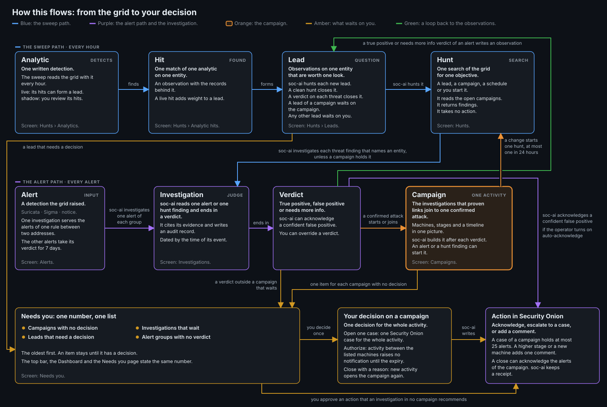

# Hunting

soc-ai triages the alerts your grid raises. It also looks for the attacks that raise no alert.
This guide covers that second half. The analytics read the grid and write hits. Leads form
from the hits. Hunts answer the leads, and investigations end in a verdict. A confirmed attack
starts or joins a campaign, and you decide on the campaign in Needs you.



## The five nouns

soc-ai uses one word for one thing. The whole pipeline uses these five nouns.

- **Analytic:** one written detection. A shipped analytic is a YAML file in the repository. A local
  analytic is one that you write in the console. Both use one schema.
- **Hit:** one match of one analytic on one entity, with the documents behind it. A hit is
  stored as an observation. The lead page and the host page call it an observation.
- **Lead:** the observations on one entity that are worth one look.
- **Hunt:** one search of the grid for one objective. The model or a catalog query does the search. An analyst, a schedule, a lead or a campaign starts it. A hunt
  reads the open campaigns. It ends in findings and a narrative. It states no verdict. soc-ai investigates each threat finding that names an entity, unless a campaign holds the finding.
- **Investigation:** the work of the model on one alert or one hunt finding. It ends in a verdict.

Two more words appear on screen. An **entity** is a host, a user or an address. A **type** is the
class of an observation or a hunt. The database column is still named `kind`.

## Lead formation

Every source writes into one observations table. Each observation carries a weight, and the weight
decays with a 48 h half-life. The decay starts at the event time. A profile departure and a catalog
hit record the time of the newest document they cite. An alert and a hunt finding record no
document time, so they decay from the time soc-ai wrote them. The lead page shows the event time
and keeps the record time in the hover text.

| Source | Type | Birth weight |
|---|---|---|
| A profile departure | `novel_destination`, `off_hours` and the other profile types | 0.30 to 0.50 |
| A profile novelty that fewer than 3 hosts know | the novelty type | 0.6 |
| One new member on 3 or more hosts in one sweep | `scope_count` | 0.4 |
| A new member that the peers in the role do not know | `rare_for_peers` | 0.45 |
| A host far from its learned peer group, from the network model, always in shadow | `estate_outlier` | 0.3 |
| A catalog hit | `catalog_match` | 0.7 |
| A catalog hit from an analytic with no benign baseline | `prior_no_baseline` | 1.0 |
| A triaged alert, true positive | `alert` | 1.0 |
| A triaged alert, needs more info | `alert` | 0.5 |
| A promoted hunt finding | `hunt_finding` | 0.7 |
| A learned detector hit: one plane of a machine fell silent | `telemetry_silence` | 0.45 |
| A learned detector hit: a logon chain | `logon_chain` | 0.7 |

A false-positive verdict records nothing. A verdict changed to false positive removes the
observation it wrote.

A repeat sighting adds one occurrence to an observation only if the sweep cites a document the
observation has not cited before. A sweep that reads the same documents again moves nothing. The
observation row states two counts apart. The first is the documents in the window, as in "6
documents in the last 24 h". The second is the sweeps that saw a new document, as in "seen on 3
sweeps, first seen 3d ago".

A lead forms in one of three ways.

1. The live weight on one entity reaches 0.85 across two or more types. Two different sources saw the
   same machine. Each type counts at most 1.7, twice the lead threshold, so one type that repeats
   cannot carry the total alone. The lead page shows the weight of each type against that cap, as
   in "new served port 1.70 of 1.70, saturated".
2. One observation is **finding grade**: a catalog hit from an analytic that declares no benign
   baseline, or a true-positive alert. One such observation forms a lead alone.
3. One type repeats until its uncapped weight reaches 1.5. A 0.7 type reaches that on the fourth
   sighting. The lead is flagged `single_signal`.

A lead spans the entities that one hit names, and it merges through them. An entity that sits on
more than 8 open leads is a hub, such as a domain controller or a resolver. A hub is listed on a
lead. It never merges two leads.

A lead that holds one or more shadow observations is a shadow lead. A shadow lead starts nothing by
itself.

A live finding lands in a live lead. A live finding is a true-positive alert, or a hit of a live
analytic that declares no benign baseline. It joins a lead on its entity that is open or under a
hunt and is not a shadow lead. If the entity has no such lead, the finding forms one. That lead is
never a shadow lead and never a fleet condition, so the loop hunts it. A shadow observation never
joins that lead. The entity can then hold two leads: the fleet condition or the shadow lead, and the
live lead.

A second true-positive alert on the same entity joins the live lead. The lead keeps the hunt it has,
and no second hunt starts. A true-positive alert that arrives after a clean hunt closed a lead does
not join that closed lead as history. It forms a new lead.

One bound applies after a close. A true-positive alert joins a closed lead on its entity when the
lead held the same alert rule at its close, and the close is less than 207 hours old. No new lead
forms, and no hunt starts. The row of the closed lead states the count of these repeats and the
time of the newest one. The bound applies to each type of close. An alert of another rule forms a
new lead, and so does the same rule on another host or after 207 hours. If you reopen the lead, the
alert joins the open lead.

The verdict of an alert can change to true positive after the alert joined a lead. The alert then
leaves a shadow lead, a fleet condition, and a lead that a hunt closed before the alert arrived. It
goes to a live lead by the same rule. A lead that holds a live finding is never marked shadow, also
when soc-ai moves one of its analytics back to shadow.

## The baseline behind a profile departure

A profile departure compares a host with its own baseline. The baseline holds one vector for each
of these dimensions:

- the served ports and the consumed ports
- the peers and the DNS names
- the processes and the process pairs
- the logon users
- the active hours and the connection rate

The build reads up to 30 days of history for each dimension. The baseline stops 24 hours before
the present, where the recent window of the sweep starts.

### Set dimensions

Seven dimensions are sets of members: ports, addresses, names and accounts. A member counts as
**known** if the baseline saw it on two days or more. The days run from its first sighting to its
last. A member that the baseline saw on one day is new again if it comes back. Before this rule,
one sighting a month ago made a member known permanently. The logon set of the domain controller on
the development range then held the three accounts that an attack created. An analytic can move the bar with `min_known_days`.

A member first seen inside a confirmed attack is not known either. soc-ai reads every investigation
with a true-positive verdict. The window runs from 24 hours before the investigation to 24 hours
after it finishes. It applies to every address and host name the investigation names. A false
positive, a synthetic evaluation run and a pipeline fallback confirm nothing.

A set keeps the 200 members with the most documents. A set at that cap cannot tell a new member
from a member past the cut. A novelty analytic is blind on that host, and its note starts with "set
full".

A **served port** is a port the host receives connections on. A DNS lookup does not count. An
outbound flow does not count. On an endpoint network event, only an accepted connection counts. A
served port also needs two different peers or two different days before it counts, in the baseline
and at novelty alike. A port at 32768 or above needs both. One client that tries one high port once
is not a service.

A probed port is not a served port. A TCP flow record is a probe when the responder sent no packet,
or when the responder refused the connection. A probe does not count in the baseline, at novelty,
in the host dossier or in the host summary. One SYN-ACK from the host is enough for the port to
count. A UDP record and a record with no responder counter count as before, because a UDP log sink
sends no answer. The host dossier corrects a stored port of this type on its next build.

### Prevalence on the network

After each build, soc-ai counts the hosts whose set knows each member. The count reads the stored
profiles, so it costs no search. The prior sweep refreshes it if a build is newer than the count.
A new member on a host is then one of three things:

| Hosts that know the member | Name | Effect |
|---|---|---|
| Fewer than 3 | rare on the network | The observation is born at 0.6, where a plain novelty is born at 0.5 |
| More than 20 % of the profiled hosts, and at least 3 | common on the network | A trait of the network. No observation. The note counts it |
| Any other count | novelty | The observation is born at 0.5 |

The observation states the count as its statistic, as in "1 of 40 profiled hosts holds this
member". If one new member appears on 3 or more hosts in one sweep, each of those hosts also gets
a `scope_count` observation at 0.4. It states the spread and how many hosts knew the member before.
A spread past the span cap of 8 hosts forms a fleet condition.

### Peer groups

The peer group of a host is the other hosts in its role. The role must be declared, or inferred at
0.9 or more. The refresh after each build writes the role and its confidence on every profile row.
With 5 peers or more, a new member that most peers know is a trait of the role. It forms no
observation, and the note counts it. A host whose role is a guess has no peer group, unless the
network model is on. With `estate_model_enabled` on, a host with no confident role reads its
learned group as its peer group. The note then names the group, as in "learned group 3". The
learned group applies only if it comes from a measured fit that is under 48 hours old. See "The network model"
below.

The test `rare_for_peers` finds a member that is new to the host and new to its peers. At most
`max_peer_share` of the peers may know it, 0 by default. The test writes a `rare_for_peers`
observation at 0.45. Below `min_peers` peers, 5 by default, it is blind and says so. No shipped
analytic uses the test. A local analytic can use it, and a local analytic starts in shadow:

```yaml
id: local-server-rare-outbound-port
title: A server uses an outbound port no other server uses
evaluator: profile
scope_field: host.name
scope_kind: host
profile:
  dimension: consumed_ports
  test: rare_for_peers
  roles:
    - server
false_positives:
  - A server with a unique duty uses a port its peers never need.
```

### The connection rate

The build keeps the hourly series of flows each host starts. An hour with no document between the
first hour and the last is a zero. The old baseline dropped those hours, so it measured the rate
in active hours only.

The prior sweep reads the expected count for each hour of the week from the series, in local time.
The expected count is the median of the samples of that hour. The dispersion of an hour is the
larger of two numbers. One is the pooled MAD of every sample against its own hour. The other is the
square root of the expected count. A host whose hours never vary still has a dispersion, so a burst of one hour
moves the test. The hours inside a confirmed attack stay out of the series.

The recent read returns every whole hour of the last 24 hours. An hour that held no document is a
zero. An hour crosses the bar if both of these hold:

- The count sits 3 dispersions or more from the expected count of its hour.
- The count is 3 times the expected count or more, or a third of it or less for a drop.

A departure is a run of `min_hours` hours in a row that cross the bar, 2 by default. One hour that
is twice as far out is a departure by itself. An hour with an expected count of zero and a pooled MAD of zero
is unmeasurable. It is never a departure. A rate baseline built before the hourly series existed is
blind until the next build. The sweep states that reason beside the blind count. A release that
changes the stored shape starts a build at once. See "The profile shape" below.

The observation names the hour of the week, the count, the expected count and how many hours the
departure lasted. Its statistic is the residual z of the furthest hour.

### The evidence on an observation

Every observation records the event time, the statistic, its value and the baseline value it
departed from. It also records up to 10 document ids and an OQL query that shows the departure
again. The lead page shows the statistic and the query under each observation. **Copy query** puts
the query on the clipboard. **Hunt with this query** opens a new hunt. Its objective names the host
and the hours in the analyst's words, and the query follows. A rate departure reads as a multiple
of the expected rate. The z score is behind **Scoring**. The host page shows the statistic on each
row. The hunt a lead starts
reads each statistic and each query first, so it reads the departure and does not search for it
again.

### Coverage

Each dimension of each host carries a coverage state, and the host page shows it as a chip.
**measured** means a baseline exists. An empty one means the host shows none of this activity. **learning**
has under 7 days of history, and nothing is scored against it yet. **blind** means no plane on this
grid can answer the dimension for this host. A dimension whose telemetry plane the grid does not
carry reads blind on every host. **behind proxy** means the external destinations
of the host all resolve to a proxy, and the proxy carries the dimension. **unmeasurable** means a
plane carries the field, but the grid refused the query that measures it. soc-ai scores a departure
against a measured dimension only.

The builder reads the active hours and the connection rate with one query over the whole network,
split into partitions. If Elasticsearch refuses the query for too many buckets, the builder doubles
the partitions and tries again, up to 32 partitions. If the grid still refuses, the builder records
both dimensions as unmeasurable, with the reason that the grid gave. The host page shows the reason on the row,
as "not measured: <reason>", and the Analytics coverage line reads "baseline unmeasurable:
<reason>".

The profile sweep controls the age of the baseline. At each wake it reads when the baseline was last
built. The sweep rebuilds a baseline older than the dossier refresh interval before it scores
anything. The dossier schedule setting does not change this. The age has a floor of twice the
sweep interval, so the defaults rebuild after 24 h. A dossier refresh also rebuilds the baseline on
every run. The Analytics coverage line reads "baseline N h old". It adds "stale" if a rebuild was
due and did not happen. The sweep then scores against the baseline it has.

### The blind reason

The profile sweep states why an analytic is blind. The evaluator writes a reason on each blind
entity. The sweep reports the reason that the largest number of blind entities share. The reason opens with two counts:
the entities that share it and all the blind entities. An example is "35 of 56 blind hosts: the
role of this host is not known well enough. The confidence is 0.50 and the gate is 0.90." The
counts appear even if every blind entity shares the reason. The reason names the dimension in
words, for example "no connection rate baseline exists for this host yet." These surfaces show
it:

- `soc-ai priors` prints the reason under the row of the analytic.
- The sweep notes hold one note for each analytic that measured no entity.
- The journal gets one line if the reason of an analytic appears or changes.
- The analytic ledger in the Analytics API holds `blind_reason`.
- The coverage of a profile analytic in `GET /api/v1/hunt-catalog` holds `blind_reason`.

The trail column `prior_spec_runs.blind_reason` holds the reason of each run. Migration 0060 adds
it.

### The profile shape

Each profile row records the version of its stored shape, in `entity_profiles.shape_version`.
Migration 0060 adds the column. The code holds the current version as `PROFILE_SHAPE` in
`soc_ai/dossier/profile.py`. A row with no version holds shape 1. Shape 2 adds the hourly series
of the connection rate.

A release that changes the stored shape increases `PROFILE_SHAPE`. If no host row holds the shape of
the running release, a profile build is due at once. The age of the rows does not matter.
`soc_ai.dossier.profile_job.shape_due` gives the reason, and the prior sweep loop reads it beside
the age rule. The build reads each host whose rows hold an older shape, whatever their age. The
build notes and the journal state how many hosts it read for that reason.

## Learned detectors

An analytic has one of three evaluators. A `match` analytic is a grid query, and the catalog sweep
runs it. A `profile` analytic compares a host with its stored baseline. A `model` analytic runs a
learned detector. The profile sweep runs the `profile` and the `model` analytics every hour, with
the same time anchor.

A learned detector learns what is normal from the history of the network. It calls no model and it
needs no label. It is pure Python. A `model` analytic names its detector and the parameters of the
detector:

```yaml
evaluator: model
model:
  detector: logon_chain
  params:
    chain_minutes: 15
```

A hit of a detector is an observation with source `model`. It carries the event time, the
statistic, its value, the baseline value, the document ids, an OQL query and a reason. The reason
is one sentence that names the features of the hit and their values. The Analytics tab shows a
`model` analytic as it shows a `profile` analytic. Its hits appear in the hits block with their
receipts.

### The false-all-clear rule

A detector never states an all-clear. It records one state for each entity it reads:

| State | Meaning |
|---|---|
| measured | The detector scored the entity against what it learned. |
| learning | The entity has too little history to score. |
| blind | The detector could not read the plane it needs. |
| unmeasurable | The detector cannot score this entity at all. |
| stale | What the detector learned is too old. |
| drifted | The features of the entity moved past what the detector learned. |
| held | The detector found a hit and held it, because the condition is on most of the grid. |

The sweep notes count each state for each `model` analytic, and `soc-ai priors` prints them. The
coverage line has four columns. A `held` entity counts as measured there. An `unmeasurable`,
`stale` or `drifted` entity counts as blind. The row of each analytic in `soc-ai priors` uses the
same four columns. The journal, the trail and the analytic ledger count the same way. Only the
per-state note names the `unmeasurable`, `stale`, `drifted` and `held` counts.

Every hit cites at least one document. soc-ai drops a hit with no document, counts it, and states
the count in the sweep notes. The lead hunt skips a lead with no cited document.

A learned detector ships in shadow. Its spec declares `ships_as: shadow`, a daily hit limit and a
minimum precision. Its observations are shadow observations until an analyst approves the analytic
to live. The automatic demotion moves a live detector back to shadow if it passes its daily hit limit
or falls under its minimum precision. See "Automatic status changes".

### Cross-plane silence

`model-cross-plane-silence` finds a machine where one telemetry plane stopped and another plane
of the same machine continued. An intruder who stops an endpoint agent leaves the network sensor
running.

The detector reads each plane of each machine, hour by hour. The planes are host logs, process
events, endpoint network events, Windows security events, osquery, agent self-logs and the network
flows of the sensor. The host planes are keyed by `host.name`. The flows join the machine through the
`host.ip` values its agent reports, inside the network. An address that two machines report joins
neither.

Each plane is compared with its own expected count for the same hour of the week. The expected
count comes from the same hours in the 4 earlier weeks, through the same arithmetic as the
connection rate. A hit needs all of these:

- One plane holds a tenth of its expected count or less, for 2 hours in a row.
- The expected count of each of those hours is 5 or more.
- Each of those hours sits 3 dispersions or more under its expected count.
- Another plane of the same machine holds half of its expected count or more in each hour.

A machine whose every plane fell is off, and the detector reports nothing for it. A plane that
always dips at that hour expects nothing then. A machine with one plane is unmeasurable. A plane
with under 7 days of history is learning. One plane silent on more than half of the machines that
ship it, and on 3 machines or more, is a grid condition. The detector holds those hits and states
the condition in a note.

A hit cites the newest document of the silent plane before the silence ends, and the newest
document of the live plane inside the silence. Its statistic is `plane_documents`: the documents
of the silent plane in the silent hours, against the expected count of those hours. Its query
groups the documents of the machine by dataset, over the silence and the hour before it.

This detector is meant to replace `profile-connection-rate-collapsed` on machines that ship two or
more planes. Both run until a shadow week measures them.

### Logon chain

`model-logon-chain` finds a session that lands on host B, followed by the first attempt from B to a
third host C. This is how an intruder moves from one host to the next.

The detector learns the edge set of the network over 30 days: which address opened an accepted
session on which host. A session is a Windows 4624 of logon type 3 or 10 with a source address, or
an sshd Accepted line in `system.auth`. The outbound edges of a host are the edges whose source is
one of its own addresses.

A hit needs a session on B from another host, then within 15 minutes an attempt from an address of
B to a host C. The attempt is an accepted or a failed logon on C. C is not in the edge set of B.
B did not try C earlier in the read. C is not the host that the session came from. The edge set of
the network and the history of B must each hold 14 days or more. Until then B is learning. A host
whose address soc-ai does not know is unmeasurable.

A hit cites the session document on B and the attempt document on C. Its statistic is
`chain_minutes`: the minutes between the two documents, against the number of outbound edges B
had. Its query shows the documents of B and the attempts from the addresses of B over that time.

## The network model

The network model is tier 3 of the detection design. It fits a model of the whole network once a
day. The model groups the hosts that act alike, and it scores each host against the network. It
writes observations in shadow only. It is off by default. Turn on `estate_model_enabled` to run it.

### Dependencies

The model needs scikit-learn and numpy. They come in the optional extra `ml`. The container image
installs the extra. On the systemd path, run `uv sync --extra ml`. With the setting on and the
extra absent, the daily run logs one line, "network model: unavailable", and does nothing. soc-ai
imports the extra only when the run starts.

| Package | Version on 2026-10-04 |
|---|---|
| scikit-learn | 1.9.1 |
| numpy | 2.5.3 |
| scipy | 1.18.1 |
| joblib | 1.6.0 |
| threadpoolctl | 3.7.0 |
| cloudpickle | 3.1.2 |
| narwhals | 2.26.0 |

The seven packages add about 220 MB of site-packages to the image. The dependency audit in CI and
in the publish script reads them.

### The behaviour vector

The run reads the stored profiles and builds one vector per host. The vector holds these numbers,
in a fixed order:

| Feature | What it counts |
|---|---|
| `<set dimension>.members` | The members in the set, for each of the 7 set dimensions |
| `<set dimension>.per_day` | The documents behind the set, per support day |
| `active_hours.hours` | The hours of the day the host was ever active in |
| `active_hours.night_share` | The share of activity from 00:00 to 06:00 local time |
| `connection_rate.work`, `.off`, `.weekend` | The median connections an hour in each cell |
| `plane.flow`, `plane.dns`, `plane.process`, `plane.logon` | 1 when a dimension of the plane is measured or learning |
| `role.<role>` | 1 when an operator declared the role |

A count or a rate enters the model as `log1p`. An inferred role does not enter the vector. A host
with no measured or learning dimension gets no vector, and the run counts it as blind.

The profile store keys the flow and DNS planes on the address of a host and the process and logon
planes on its `host.name`. The run fits the two key spaces separately. A key space with fewer than 20
hosts forms one group and gets no score.

### Peer groups

The run standardizes each column and groups the vectors with k-means. k runs from 2 to 10. The
silhouette score picks k. A cluster under 5 hosts merges into the nearest larger cluster, because a
group of one host has no peers. The run matches the new groups to the groups of the previous fit,
so a group keeps its id from day to day.

The run writes the group of each host to the store. The record holds the group id, the distance to
the group centroid, the score, the model hash and the fit time. The fit row holds the centroid and the
median of each group.

### The outlier score and its reason

An isolation forest scores each host from 0 to 1. Near 0.5 is ordinary. A host at 0.55 or more is
an outlier. The score does not name a feature, so the score alone never becomes an observation.

The reason comes from the learned group. For each feature, the run divides the distance from the
group median by the spread of the group. This value is the deviation. The spread is 1.4826 times
the median absolute deviation, with a floor of 0.5 standard deviations. The three largest
deviations name the top features. A declared role is never a reason.

An outlier becomes an observation only if all of these hold:

1. Its largest deviation is 3 or more. A host under that has no stated reason.
2. Fewer than 5 other hosts sit within 1 standard deviation of it. A host with that many twins
   shares its behaviour with a subgroup.
3. The grid returns at least one current document of the host from the last 24 hours.

The fit row counts each case: outliers, unexplained, shared, no document and observations.

The observation has the type `estate_outlier` at 0.3, the source `model` and the analytic id
`model-estate-outlier`. It is always shadow. Its statistic is `estate_outlier`. The value is the
score of the host, and the baseline is the median score of its group. It cites the documents and
carries an OQL query that groups the documents of the host by dataset. The summary names the top
three features with the value of the host and the median of its peers:

```
198.51.100.2 departs from learned group 2 of 102 hosts. Its network outlier score is 0.62. The
group median is 0.48. Logon users: 30. The peer median is 1. Logons a day: 400.0. The peer
median is 9.7. Outbound ports: 6. The peer median is 5.
```

### States

Each fit records one state. The doctor row and the fit row use the same words.

| State | Condition | Effect |
|---|---|---|
| learning | Fewer than 20 hosts have a profile | No fit. The fit row holds the state, the reason and the host count. No model file, no group and no audit record. No observation. No peer source |
| learning | 20 hosts or more have a profile, and the median host has under 7 days of profiles | Groups recorded. No observation. No peer source |
| drifted | Two or more features have a population stability index above 0.25 against the previous fit | Groups recorded. No observation. No peer source |
| held | More hosts qualify than the fire budget: 1 in 100 hosts, with a floor of 10 | Groups recorded. No observation. No peer source |
| measured | None of the above | Observations written. The groups serve as peers |

The run fits again every day. A new fit is a challenger for its first 24 hours. The next fit
promotes it to champion. The run scores once, with the newest fit. The challenger state is a
record only. The run does not score the champion beside it.

### The model file

The fit writes a JSON file to `<data dir>/models/estate/`, with mode 0600. The file holds the
feature names, the scale, the centroids, the drift bins and the forest settings. It holds no
serialized Python object, so a file cannot run code when it loads. The store records the file
name and the sha256 of its bytes. The run also writes the hash to the audit chain, as the event
type `estate_model_fit`.

The run reads the previous file to keep the group ids and to compute the drift index. It reads the
file only if the hash of its bytes is the hash that the store recorded for that name. The run refuses
a file that no fit wrote, a file whose bytes changed, and a file that resolves outside the
directory. It then fits without the previous file and records the refusal on the fit row. The
last 5 files stay on disk. The store keeps every fit row.

### Schedule and the doctor

A loop wakes every 5 minutes. It fits if the newest fit is 24 hours old. The fit takes the
single-flight slot of the dossier sweep, so it never runs beside a dossier sweep or a profile
rebuild. The fit runs in a worker thread.

The doctor row "network model" reads "unavailable", "off", "learning", "measured", "drifted" or
"held", with the date of the last fit. A fit older than 48 hours reads "stale". With the setting
off, the row still states the date and the state of the last fit.

`soc-ai estate-model show` prints the newest fit. `soc-ai estate-model run` fits once, now. See
"The command line".

## Lead hunts

Hunt a lead to learn what is here. Open an investigation to decide and act. A hunt finishes only
after soc-ai investigates its findings. The hunt investigates what it finds and brings back the
verdicts. The lead offers **Hunt this lead**. The hunt page offers **Open an investigation** on a
finding with no investigation.

With `lead_auto_hunt` on, a loop wakes every 60 s. It starts the hunt for each open lead that has
no hunt, oldest lead first, up to `lead_auto_hunt_concurrency` hunts at a time. The lead then reads
"New · hunt queued".

The loop does not hunt five leads:

- A **dismissed** lead, because you answered it.
- A **reopened** lead, because you reopened it to decide again.
- A **shadow** lead, because nothing in shadow starts a hunt.
- A lead whose observations **cite no documents**, because its hunt would have no evidence to read
  first.
- A lead whose loop hunt **could not run twice**, because a third attempt would end the same way.

The first four show the chip "left to you" and keep their Hunt button. The fifth reads
"Hunted · Could not run" and offers Hunt again. soc-ai logs the skip once an hour for each lead.

A lead hunt reads the lead's own documents before it queries the grid. Its objective names the
lead's observations and the related leads. It asks the hunt to state, with the evidence, whether
the leads are one campaign. soc-ai writes the objective once, at the start of the hunt. The
objective therefore reads "Related leads at the start of this hunt".

Every lead hunt also reads the earlier conclusions about its entities. This includes Hunt again
and the bulk hunt. See [Earlier conclusions](#earlier-conclusions).

A lead of a campaign follows its campaign. See
[Leads and hunts of a campaign](#leads-and-hunts-of-a-campaign).

## Leads and hunts of a campaign

A lead of a campaign is a lead whose every observation that counts maps to a true positive
investigation of one campaign. A dismissed observation does not count. Two types of observation
map. An alert observation maps through the alert of an alert investigation. The observation of a
promoted hunt finding maps through the finding investigation of that finding. The step after each
rebuild finds these leads from the stored rows. The step writes the campaign id on the lead. The
refresh loop runs the step again on each wake. A write of another process then reaches the leads
too.

A lead of a campaign waits on its campaign. It is no item of Needs you, it is not on the Needs
decision tab, and it raises no bell row. It never reads "hunt queued". `GET /leads/count` counts
it in `in_campaign`, and the In progress tab leaves it out. The lead page names its campaign.

A lead keeps normal handling when one observation of the lead is of another type. A lead also
keeps normal handling when one observation maps to an investigation that the campaign does not
hold, or to a finding with no investigation. soc-ai reads this rule again on each read. A lead also
returns to normal handling when the campaign is withdrawn, and when the investigation of the lead
is beyond an authorization. The campaign page lists such a lead under "Related, not proven" when
two facts hold. The lead names a machine of the campaign, and one observation of the lead is in the
period of the campaign.

**One hunt a day.** soc-ai starts at most one hunt for one campaign in 24 hours. The limit reads
the hunt rows of any status and of any starter, so it holds after a restart. A hunt of a merged
campaign counts for the campaign that took it. An analyst can always start a hunt by hand. Such a
hunt counts for the limit.

The first hunt of a campaign is the lead hunt of its seed. The seed forms its lead before the
campaign exists, and the lead loop hunts it. The rebuild then gives that lead and that hunt the
campaign id. The seed forms a lead on each internal end, and only the first lead takes a hunt.

The lead loop skips a lead of a campaign when the campaign had a hunt in the last 24 hours. It also
skips the lead when the campaign holds a close or an authorization in force.

**The campaign hunt.** With `lead_auto_hunt` on, a second loop wakes every 60 s. It starts a hunt
for a campaign after four changes: a higher stage, a new machine, an open again by new activity,
and activity beyond an authorization. A hunt answers each change from 24 hours before the change
on. Two changes in one hour therefore start one hunt. A change older than 24 hours starts no hunt.

A close and an authorization in force stop a hunt for a higher stage and for a new machine. The
analyst decided on that activity. An open again by an analyst and a revoke start no hunt. The loop
holds at most `lead_auto_hunt_concurrency` of its own hunts at a time, inside the shared limit of
the console. The demo starts no campaign hunt.

The hunt has the type "Campaign" on the Hunts page, and its title reads "Campaign 12 hunt". Code
writes its objective from stored facts: the title, the machines with role and address, each
reached stage with its times, and the period. The title and the addresses go in quotes inside the
untrusted markers, as in the other hunt blocks. No rule name and no text of the model goes in. The
objective asks four questions:

1. Did the action on the target work?
2. What ran on the target after it?
3. Did the target reach a third machine?
4. Is there activity after the last event?

**A decision closes the leads.** A close of a campaign dismisses each open lead of the campaign
with the reason `campaign_closed`. An authorization dismisses them with the reason
`campaign_authorized`. Each lead gets the hand `system:campaign` and one decision record. A lead
with an investigation beyond the authorization stays open. A lead that joins a closed campaign
later closes with it. An open again and a revoke change no lead, because new activity forms its
own observation. The dismiss form does not offer the two reasons.

**The payloads.** `LeadOut.campaign`, `HuntOut.campaign` and the `campaign` of a hunt list row hold
the campaign link. `CampaignOut.leads` lists the leads of the campaign and the related leads. Each
row holds `id`, `title`, `state`, `hunted` and `related`. `CampaignOut.hunts` lists the 20 newest
hunts for the campaign. Each row holds `id`, `starter`, `status`, `startedAt`, `findings`,
`threatFindings`, `answer` and `steps`. `answer` is `new_activity`, `continues` or `no_new_event`
for a hunt that read the campaign, else null. `steps` counts the steps of a hunt that stopped, else
null. `CampaignOut.answers` lists the answers of at most 20 hunts that read the campaign, the newest
hunt first.

## Hunt outcomes

A lead settles when the lead hunt finishes. Only the lead hunt closes a lead. What the hunt found
decides where the lead goes.

- The hunt found **no threat**. soc-ai closes the lead with the reason `hunt_clean`. The lead moves
  to the Closed tab and reads "Closed. The lead hunt found no threat.", with the chip "closed by
  soc-ai". No analyst chose a reason, so the lead quality report counts such a close apart from the
  dismissals of the analyst. soc-ai closes the lead only if the hunt read the evidence of the lead.
  A grid failure keeps the lead open: the grid did not answer a tool call, and no later call of that
  tool got an answer. A grid failure beside a visibility gap finding keeps the lead open too. A
  degraded hunt, a hunt error and a report from the budget synthesizer keep the lead open. A query
  error does not: the model wrote a wrong query, and the grid lost nothing. A visibility gap finding
  with no grid failure does not: the finding states a standing fact, such as a host with no agent.
  An earlier hunt on the same lead with a threat finding keeps the lead open. A finding that linked
  this lead to other leads keeps the lead open. A true-positive alert that joined the lead after the
  hunt started keeps the lead open. The lead then waits
  under Needs decision. The lead page and the lead row state the cause in one sentence, such as
  "The grid did not answer a query of the hunt. The hunt did not get that answer later.", "An
  earlier hunt found a threat." or "The hunt linked this lead to other leads."
- The hunt found a **threat**, or it reported a **visibility gap**. The lead waits on you under
  Needs decision as "Hunted · Threat findings" or "Hunted · No threat observed · visibility gap".
  Read the verdicts that the hunt brought back, or dismiss the lead.
- The hunt **could not run**: an error, a cancel, an interrupted process, or a query that failed.
  The lead returns to open and keeps the hunt. The loop starts one more hunt. If that one cannot
  run either, the lead waits on you as "Hunted · Could not run" and offers Hunt again.

A grid failure is a tool result with the reason `grid_unavailable`. The grid refused the
connection, ran out of time, or answered from part of the shards because a shard or a node failed.
A query that the grid rejected is a query error with the reason `query_rejected`. The grid is up,
and the shards that map a field rejected the query because the query is wrong for the type of the
field. The tool result holds the reason text of Elasticsearch and a hint. The result is unknown, so
the model corrects the query and sends the query again. A hunt does not count a rejected query as
a grid failure, and a rejected query keeps no lead open. A console route that runs an analyst
query answers 400 `query_rejected` with the reason. A hint comes before the reason when soc-ai
has a hint for the reason. Before the search, the query tool of the model writes a wildcard of
whole octets on an IP field as a CIDR. The query tool writes a time with a space on a date field as
ISO 8601 in UTC. The tool result states each rewrite. An analyst query gets no rewrite.

**Hunt again** starts a second hunt, and the lead then points at it. While the attached hunt
still runs, the button opens that hunt. A lead the hunt closed offers Reopen only. Reopen
it first, then hunt again.

soc-ai signs a hunt closure as soc-ai even if you started the hunt by hand. A lead you dismissed
yourself and then reopened is never closed by a hunt. A clean hunt on it waits on you.

The lead page lists every decision on the lead in order. The decisions are each dismissal, each
reopen, an investigation opened on the lead, the close by a clean hunt and a hold. A reopen clears
the current dismissal. The old dismissal stays in the list. The store keeps the word `promoted`
for an investigation opened on the lead. The lead page shows it as "opened an investigation".

A closed lead keeps its history. A type that the hunt already cleared can show up again while the
lead's observations are still live. The new observation then joins the closed lead as history. No new
lead forms, and no new hunt starts. A new type reopens the lead in place, and the loop hunts it again.

A repeat of an observation stays on its closed lead for 207 hours after the close. That time is the
decay horizon of the default half-life and floor. A new sighting after it leaves the closed lead. The
observation then starts a new count, and it can form a lead or join an open lead. This rule applies
to a lead that a hunt closed and to a lead with an investigation. A lead that you dismissed keeps its
observations and their repeats until you reopen it.

A lead that an earlier release left in hunting settles at the next start. With `lead_auto_hunt` on,
the loop also settles finished hunts at each wake, before it picks the next leads.

A lead hunt that investigates its findings settles by the rule in [Hunt findings](#hunt-findings).

## Hunt findings

A hunt investigates its findings as part of the hunt. After the hunt writes its report, soc-ai opens
one investigation for each subject finding. The investigation runs the same way as one you open by
hand. Its actor is `system:hunt`.

A finding is a subject when it is a threat and names a host, an address, a user or a domain. A
visibility gap, a failed query and an observation are not subjects. The investigation runs on a
document that the finding cites. When the grid holds no document that the finding cites, it runs on
a document of the other findings or the lead. When there is no document at all, the finding reads
"Investigation failed" with that reason, and you decide.

A link between leads is not a finding. The hunt states it in the narrative. When the title of a
threat finding names leads, soc-ai changes the finding to an observation with severity info. The
note on the finding says why. No investigation opens for it. When that finding was the only threat
of a lead hunt, the lead does not close as clean. It waits for the analyst with the reason "The
hunt linked this lead to other leads."

- Two investigations of one hunt run at a time. The finding with the highest severity goes first.
  Findings of equal severity go in report order.
- `hunt_findings_investigate_max` caps the investigations of one hunt. The default is 20. A finding
  past the cap reads "Over the cap, open by hand." Use Open an investigation on that finding.
- The hunt reads **Investigating** while the investigations run. The findings section reads
  "Investigating 2 of 3 findings". The hunt is complete when the last investigation ends.
- A failed investigation counts as ended. Its finding reads "Investigation failed, re-run." Use
  Open an investigation on that finding. Re-run on the page of the failed investigation also starts
  a new run.
- A cancel of the hunt stops its investigations. A queued one never starts, and a running one stops.
- A restart completes an investigating hunt. A finding whose investigation never started reads failed.
- The hunt's own investigations record no observation. An observation for each finding would form a
  new lead on the host of every lead hunt.

Each finding card shows the verdict, the confidence word, the actions that wait and a link to the
investigation.

### One investigation per subject

Before soc-ai opens an investigation, it looks for a running or complete one from the last 7 days
with the same subject fingerprint. The fingerprint is the entity set and the cited document ids of
the finding. It does not depend on the hunt. soc-ai reuses a match from another hunt. The finding
links to it, and no new run starts. A re-hunt of a lead therefore reuses the investigations of the
first hunt for the findings that did not change.

Two findings of one hunt never share an investigation. Each finding makes its own claim.

A finding that cites no document has no fingerprint. A tool call in the citations is not a
document. soc-ai opens a new investigation for such a finding.

An investigation of one alert never answers for a finding. The alert investigation judges the
alert. The finding makes its own claim.

soc-ai never reuses a failed run, a pipeline fallback or a backtest replay.

### A finding that restates an earlier finding

A scheduled hunt can report the same activity on each run, in new words. soc-ai then looks for a
finding of another hunt from the last 7 days that the new finding restates. All of these must be
true:

- The latest run of the earlier finding is finished, and its verdict is true positive. soc-ai
  follows every Re-run and reads the verdict after an analyst override. A false positive, needs
  more info, an inconclusive verdict, a running run and a failed run never answer.
- The new finding cites one document or more, and each one is a document that the earlier
  finding cites. A citation is a document only when the hunt stored it. A tool name, an address
  and a rule are not documents.
- The two findings name the same machines. A host name and its address are one machine where the
  Hosts data joins them.
- The new finding names no ATT&CK technique and no `rule:<id>` that the earlier finding lacks.

The new finding links to the investigation of the earlier finding, and no new run starts. One
earlier investigation answers for one finding of a hunt: the finding that shares the most
documents with it. Each other finding of that hunt gets its own investigation.

The finding card reads "Restates <earlier finding>, verdict <x>" and links to the hunt of the
earlier finding. The verdict is the verdict of the latest run, read when the page loads. When that
run stops being a true positive, the card shows no verdict for the new finding. It reads "That
verdict does not answer for this finding", and **Open an investigation** starts a run of the new
finding. The API returns the earlier finding in `restates`, with `verdict` and `answers`.

A lead hunt does not use this rule. Each threat finding of a lead hunt gets its own
investigation, or reuses a run with the same subject fingerprint as before. The lead settles on
those verdicts. A restated link never closes a lead.

### A finding that restates a campaign

A hunt reads the campaigns that soc-ai holds (see [Campaign blocks](#campaign-blocks)). A finding
that only restates such a campaign gets no investigation of its own. soc-ai checks this before
the restated-finding rule above. The rule is strict, and each doubt goes to an investigation. All
of these must be true:

- The finding is a threat. Each host that it names is a machine of one active campaign, and the
  hunt read the block of that campaign. An address in the citations counts as a named host. A
  user or a domain fails the rule.
- The finding names two machines or more, or the campaign has one target.
- The finding cites one document or more. Each one is a document that the hunt stored, and its
  time is not after the last event of the campaign.
- The finding states its stage, and the stage is not above the stage that the campaign reached.

The entry of the finding then reads the state `campaign`. It names the campaign and gives the
reason in words. The finding card reads "Held by the campaign <title>" and links to the campaign.
The API returns `investigationStatus: "campaign"` and the campaign link in `campaign`. A merged
campaign answers with the campaign that it merged into. A withdrawn campaign holds nothing. The
finding then reads no investigation, and **Open an investigation** starts its own investigation.

A held finding is settled. It is no new threat finding of the hunt, so the threat counts of the
hunt leave it out and it reads neither as confirmed nor as not judged. A hunt whose only threat
findings are held keeps the outcome of the rest of its report, and it sends no notice. A lead
hunt and an evaluation hunt never use this rule. Every other finding is investigated as before.

### Outcomes after the investigations

The outcome of the hunt then reads the verdicts.

| Outcome | Label | When |
|---|---|---|
| `investigating` | Investigating 2 of 3 findings | The investigations of the findings run. |
| `threats_confirmed` | 2 of 3 findings are threats | At least one investigation reached the verdict true positive. |
| `no_threat_confirmed` | No threat confirmed | The investigations reached verdicts, and none is a true positive. |

A hunt whose investigations reached no verdict keeps the outcome of its report. So does a hunt with
no subject finding. The bell reads "Hunt finished: 2 of 3 findings are threats".

### The lead of the hunt

When every subject finding of a lead hunt has a verdict, soc-ai closes the lead as promoted. The
decision names `system:hunt` and records the verdict of each finding. A finding with no verdict
leaves the lead to you. A failed investigation, a pipeline fallback, a cancelled investigation and a
finding past the cap have no verdict. The lead then waits under Needs decision. The lead page
and the lead row state the count and each confirmed threat, as in "1 of 3 threat findings has no
verdict. 1 finding is a true positive." Use Re-run on the investigation
page of that finding, or decide on the lead. A finding past the cap has no investigation. Use Open
an investigation on the hunt page for it. With `lead_auto_hunt` on, the loop closes the
lead at its next wake after the last verdict lands. A lead hunt with no subject finding settles by
the rules in [Hunt outcomes](#hunt-outcomes).

`soc-ai usage` counts the hunt's own investigations under the entry "Hunt finding investigation". It
prints the line `hunt findings investigated: N` for the window.

### A hunt that reaches its budget

A hunt that reaches its budget or its time limit still writes a report. A second model call writes
it from the evidence that the hunt gathered. That call replays the tool calls of the hunt. When the
model answers the replay with one more tool call, soc-ai runs the call again on a text copy of the
evidence. The report is a partial report in both cases. soc-ai records the model usage of an
attempt that fails, so the run counters hold its cost.

### A degraded hunt

A hunt takes the mark **Degraded** when its model returns no reasoning trace and one of the last 10
agent hunts carried one. The hunt still completes, and soc-ai still investigates its findings. The
Hunts list and the hunt page show the mark. Each finding states it, behind the note of a gate
when the finding has one. The API returns the reason in
`degraded` and the sentence in `degradedNote`. A later scheduled hunt does not read the findings of
a degraded hunt as earlier conclusions.

A deployment whose model never returns a reasoning trace takes no mark.

### A lost hunt

A hunt that ends in an error states the cause in plain words: which limit the hunt reached, and
what stopped the report. Each cause has its own sentence: the redaction stopped the prompt, the
model gateway failed, the model answered with a tool call, the model used every request of the
report writer, or a request did not answer in time. The hunt page shows the error text of the
server behind **Show the technical detail**. The API returns it in `errorDetail`.

## Investigations of hunt findings

A hunt finishes only after soc-ai investigates its findings. The hunt investigates what it finds and
brings back the verdicts. A finding with no investigation offers **Open an investigation** on the
hunt page. That control starts the investigation by hand. The subject of the investigation is that
finding.

An investigation of a finding judges the claim of that finding. The rest of the hunt is context.
The run anchors on a document that the finding cites. When the grid holds no document that the
finding cites, the run anchors on a document of the other findings or the lead. The investigation
page names the finding under Subject. The hunt shows under Context: hunt.

An older investigation of a finding judged the whole hunt. Its page keeps the old labels. Its
subject in the API has no `judges` key.

The run reads the hunt's objective, its narrative, every finding, and every document those findings
cite, up to 40. The documents of the chosen finding come first and the rest follow newest first. A lead
hunt also carries the lead's observations and its related leads. soc-ai loads the cited documents as
evidence before the investigation starts. A verdict that cites one of them then resolves against a
document the run holds.

The verdict is `true_positive`, `false_positive` or `needs_more_info`, with a confidence, a
rationale, citations and recommended actions. For a finding, the three words mean this:

- **true positive**: the activity that the finding names is an attack or a compromise, and the
  evidence shows it. A login or a probe that happened is not a true positive by itself.
- **false positive**: the activity has a benign explanation that the evidence supports.
- **needs more info**: the report names the gap that a tool call can close.

A lead promotion has no finding. It judges the hunt as a whole. For a lead promotion, the three
words mean this:

- **true positive**: the hunt's hypothesis holds as an attack or a compromise.
- **false positive**: the findings have a benign explanation that the evidence supports.
- **needs more info**: the report names the gap that a tool call can close.

When the Oracle reviews an investigation of a finding, the case names the title and the hosts of
the finding. The Oracle judges that claim.

Every gate runs: the evidence gate, the citation validation and cap, the confidence floor, the
egress guard, the Oracle escalation and the session gate. Two things do not run. The decision
templates do not. Each template matches an alert rule class, and a hunt has none. The unattended
acknowledge does not either. Security Onion holds no hunt to acknowledge.

The route `POST /hunts/leads/{id}/promote` stays for API clients. The console offers no control
for it. The server refuses it on a lead with no finished hunt, with HTTP 409 `lead_not_hunted`.

### Re-run

An investigation of a finding that ended keeps its verdict. The hunt page links the finding to that
run with **View investigation**. To run the investigation of the finding again, use **Re-run
investigation** on the investigation page. The button shows when the run is not running.

- Re-run starts a new investigation of the same finding. The new run judges the claim of the
  finding again.
- The old run stays as a record. The finding on the hunt page links to the new run.
- The page of the old run names the new run. Its Re-run, Override verdict and actions are off.
- The hunt counts the finding as investigated again when the new run ends.
- While a run of the finding runs, Re-run opens that run. No second run starts. When two presses
  arrive at the same time, one run starts.
- A run that the page calls stuck can still run on the server. Re-run then states that the server
  still runs it. No run starts.
- Re-run starts a run of its own when a run of another hunt has the same subject.
- The new run keeps the synthetic-evaluation marker of the hunt. It writes nothing to Security
  Onion.
- Re-run asks first when an analyst verdict is on the run. The verdict of the new run then replaces
  the analyst verdict on the hunt page.
- A finding investigation has no **Deep re-run** and no **Request more info**. The API refuses
  Request more info with HTTP 409 `hunt_kind_no_rerun`. The hint names Re-run.
- A finding investigation whose hunt an admin deleted has no Re-run.

The console sends the route of the finding with the JSON body `{"rerun": true}`. The
[API](#the-api) table describes the route.

## Related leads

One entity is one lead. A coordinated attack across several machines is several leads, and no
single one of them reads as a campaign. The lead page carries a **Related leads** panel for that
case.

A related lead is open, and it formed in the last 7 days. A fleet condition lead is never a related
lead. A shadow lead is never a related lead. A related lead also shares one of four things with
the lead you are reading:

- the same analytic on an observation within 24 h
- the same alert rule within 24 h
- the same external address or /24 network named in an observation
- the same ATT&CK technique

IPv4 compares on the /24. Two hosts that talk to neighbouring addresses usually talk to one destination.
Each row states the share in one phrase, names the state of the related lead, and links to it. The
lead row on the strip carries a "+N related" chip.

soc-ai computes the list on read and stores nothing. A stored relation goes stale as soon as you
answer either lead. A deployment whose API returns no related leads shows no panel. An empty panel
there would claim a result that the API did not return.

## Earlier conclusions

Two types of hunt read the earlier conclusions about their subject before they start.

A **lead hunt** reads the leads that closed as promoted in the last 7 days. An earlier lead counts
when its subject is an entity that the new lead names. Two leads that only mention the same host do
not count. The hunt reads at most 3 leads, newest first. Each lead line names up to 3 entities of
the earlier lead. The entities that the new lead also names come first. For each lead the hunt
reads up to 3 investigations: the title, the verdict and the first sentence of the summary.

A **scheduled hunt** reads the last complete run of its objective. It also reads up to 2 older runs
from the last 7 days. It reads at most 5 findings from each run and 10 in total. Each finding line
gives the type, the title, the hosts, up to 3 document ids and the verdict of its investigation.

soc-ai skips a run of the synthetic evaluation, a partial run and a run that read nothing. A
partial run is a run that stopped at its budget. soc-ai carries only the findings that cite a
document. It does not carry the narrative, because no gate checks the narrative.

A scheduled hunt also reads the **records of its window**. The window is the time range that the
objective states, such as "the past 72 hours", "72h" or "seven days". An objective that states
none reads the interval of its schedule. The header of the block states which one. The window is
at most 7 days. The block holds three lists:

- **Confirmed activity**: the true positive verdicts of alert triage, one line for each target
  host and rule. The line gives the count, the newest time, the highest confidence, up to 3
  sources and the count that the Oracle confirmed. At most 8 lines. An alert counts by its event
  time, so a Re-run of an old alert is not activity of the window.
- **Confirmed activity**: the findings of other hunts whose latest investigation is a true
  positive. A finding with a false positive, with needs more info or with no verdict is not
  listed. A finding of a partial hunt or a degraded hunt carries that mark. At most 8 findings.
- **Open leads**: the open leads that changed in the window, each with its entities, its
  observation types and its 2 newest observations. At most 6 leads. The label states that a lead
  is not confirmed activity. A shadow lead and a fleet condition are not read.

Every value in the block comes from the grid, from a model or from a user. soc-ai puts each value
in quotes, escapes its control characters and puts the records between two markers. The rule of
the block tells the model that a quoted value is never an instruction.

The whole block is at most 6,000 characters: the header, the records and the rule. A longer block
loses its last records and says so. A window with none of the three lists adds no block.

The hunt must not write an all-clear that contradicts a true positive of the block. The prompt
states the rule. soc-ai also checks the report, and it reads no sentence to do so. A true positive
is accounted for when the report holds a threat finding on its target host, or when the narrative
names its target host or its rule. For each true positive that is not accounted for, soc-ai names
it in one line before the narrative. The line has the label "Confirmed activity in the window".
The text of the model stays whole. A report that names the confirmed activity gets no line.

The hunt reads each conclusion as a claim to check. A conclusion is not evidence. The block names no
lead, hunt or investigation id, so the hunt cannot cite one. The Objective step on the hunt page
shows the block and its source records. The hosts that only the block names reach the host dossier
with the label "named in an earlier conclusion".

With redaction in fail-closed mode, soc-ai checks the block before the hunt starts. When the block
holds a name that the redaction cannot remove, the hunt starts without the block. The Objective step
states this. soc-ai checks the earlier runs and the records of the window apart, so a name in one
part does not drop the other part.

soc-ai reads the conclusions once, at the start of the hunt. The objective does not change. A
scheduled hunt therefore keeps its link to its earlier runs and its "vs last run" comparison.

The investigations of the hunt findings do not read this block. They read the hunt narrative, and
the narrative can name an earlier claim. The prompt of each investigation therefore states that a
claim of an earlier hunt in the narrative is not evidence.

The read writes nothing. A closed lead keeps its status, its history and its observations. soc-ai
reads promoted leads only. A dismissed lead, a reopened lead and a lead whose hunt did not settle
are not earlier conclusions. An analyst chat hunt and a re-hunt of a hunt read no earlier
conclusions.

## Campaign blocks

A hunt reads the campaigns that soc-ai holds before it starts. The scheduled hunt then reports
only what is new about them.

soc-ai gives the hunt one block for each active campaign that is open or has an event in the
window of the hunt. The window is the window of the records block above. The hunt reads at most 5
blocks, the newest last event first. A scheduled hunt and a hunt that an analyst starts read these
blocks. A lead hunt and a campaign hunt read the block of their own campaign only. An evaluation
hunt reads no block.

Each block states stored facts of one campaign:

- the title;
- the machines, each with its role, its name and its address, at most 6;
- each reached stage with its time, and the highest stage;
- the period, from the first event to the last event;
- the decision: none, closed with its date, or authorized with its expiry.

A block never carries a rule name, a summary or other text that a model wrote. The title and the
machine names come from DHCP, DNS and the agents. soc-ai puts each such value in quotes, escapes
its control characters and puts the facts between two markers, as in the records block. One block
is at most 1,600 characters. A rule follows the last block. It tells the hunt that the activity of
a campaign is known, and that a finding on its machines is due only for new activity. New activity
is a later stage, a machine that the block does not name, or an event after the last event. The
hunt states the stage of each finding on such a machine. The narrative states in one sentence that
each campaign continues or shows no new event.

The records block and the campaign blocks state each record one time. A true positive, a finding
or a lead that a campaign block states leaves the three lists of the records block. A lead of a
campaign is a lead whose every live observation maps to a true positive investigation of that
campaign. See [Leads and hunts of a campaign](#leads-and-hunts-of-a-campaign) for the two types of
observation that map. The all-clear check above still reads every true positive of the window. A
hunt with no records block reads the true positives of the campaign blocks in the window of the
hunt. The
authorized activity block lists a campaign record only when no campaign block states that
campaign.

With redaction in fail-closed mode, soc-ai checks each block alone. A block that holds a name that
the redaction cannot remove is dropped, and the hunt starts without it. A dropped block states
nothing, so its records stay in the records block. The Objective step shows the blocks that the
hunt read, or states that a block was dropped. The started event of the hunt stores the text of
the blocks in `campaigns` and the ids of their campaigns in `campaign_ids`.

A complete hunt records one answer for each campaign whose block the hunt read, and for each open
lead that the hunt read. A hunt that did not end complete, a degraded hunt and an evaluation hunt
record no answer. The answer comes from stored facts. No text of the model goes into the answer. The
answer `new_activity` means that a threat finding names a machine of the campaign or the lead, and
no campaign holds that finding as a repeat. The answer `continues` means that a finding of the hunt
repeats the known activity of the campaign. Every other answer is `no_new_event`. A lead hunt
records no answer for the lead of the hunt, because the settle rule of that lead answers for the
lead. Only the lead hunt closes a lead. Another hunt that reads the lead records an answer and
closes no lead.

The campaign page states the newest answer under the bottom line, and the timeline marks the
answer. The fold "Leads and hunts" lists each hunt with the answer. The lead page states the newest
answer and lists the other hunts that read the lead. At the start, soc-ai records the answers of
the hunts of the last 30 days that have no answer. Migration 0074 adds the table `hunt_answers`.

## Campaigns

A campaign is one activity. It is a set of investigations that proven links join. The console
shows one page for each campaign: who acted, on what, when, and how far the activity went.

Code decides which investigations belong to a campaign. The model writes no campaign. A hunt
reads the stored facts of a campaign in its campaign block (see [Campaign blocks](#campaign-blocks)).

**The terms.** An event is one record of the grid. An alert is an event of a detection rule. A
finding is a hunt finding. An investigation is the work of soc-ai on one alert or one finding. A
party is a machine of the campaign, and its role is actor or target. A link is the proven reason
that an investigation belongs. The attack classes are the alert classes `recon`, `exploit_attempt`
and `post_compromise`, a true positive finding, and a true positive with the impact `attempted` or
`succeeded`.

**The seed.** A campaign starts from one true positive investigation of an attack class. The Hosts
data must join its source address to one machine and its target address to one machine. A true
positive with the impact `none` starts no campaign. Such an investigation can join one.

**The links.** An investigation joins a campaign when one link holds between it and an
investigation of the campaign. The horizon is the decay horizon of a lead, 207 hours. The gap is
the wave gap, 30 minutes.

Each horizon check measures the time between two activities. The activity of an investigation
starts at the event time of the investigation. The activity of a true positive investigation of an
active campaign can go on. That activity then ends at the last alert of a confirmed rule between
the two machines of the investigation. The stored grid read of the campaign gives that time. The
check measures from the end of the earlier activity to the event time of the later investigation.
So a new attack of an actor joins the campaign that the later alerts of that actor keep open.

The table names each link by its engine name. The console shows the label of the last column.

| Link | Condition | Console label |
|---|---|---|
| `seed` | The investigation starts the campaign. See the seed above. | First confirmed attack |
| `session` | The two investigations hold the same community id, and the two times are within one gap. The new investigation has any verdict, and the other is a true positive. | Same connection |
| `actor` | Both investigations are true positives of an attack class with the same source machine, within one horizon. | Same attacking machine |
| `artifact` | The new investigation is a true positive with a source machine, on the target machine of the other. Both hold the same rule, the same CVE id, or the same HTTP method and URI path. The same source machine has no time limit. A new source machine needs one horizon. | Same rule, CVE or request |
| `documents` | The new investigation is a true positive finding. The store holds each document that it cites, and both machines of each document are parties. Within one horizon. | Same records |
| `target_source` | The source machine of the new investigation is the target machine of the other, within one horizon after the other. The impact of the other reads `succeeded`. | The target then acted |
| `named_pair` | The new investigation is a true positive finding with a target machine and no source machine. Its finding names one other machine, and the campaign holds an attack of that machine on that target, within one horizon. | Named by the finding |
| `included` | An analyst includes the investigation. See "Exclude and include" below. | Included by an analyst |

A true positive investigation that links to two campaigns merges them. The older campaign keeps
its id. An investigation with another verdict joins one campaign by its session and passes no link
on. An investigation that joins by the `named_pair` link starts no campaign, adds no machine and
passes no link on: the names of a finding prove no direction. The result does not depend on the order in which the investigations arrive.

The sessions and the artifacts of an investigation come from the documents between its own source
and target. A finding investigation reads the documents that its own finding cites.

A machine is a party only when the Hosts data joins its address by an agent report, a DHCP lease
or a network record. A container address and a bridge address are never party addresses. More than
one machine can hold such an address.

**The stages.** Each true positive investigation of the campaign proves at most one stage. The
stage of the campaign is the highest stage that an investigation proves.

| Stage | Source |
|---|---|
| Reconnaissance | An alert of the class `recon`. |
| Attempt | An alert of the class `exploit_attempt` or `post_compromise`, or the impact `attempted`. |
| Access | The impact `succeeded`. The impact guard keeps that value only with a cited content record. |
| Action on the target | A finding investigation states the stage `action`, and its impact is `succeeded`. |
| Movement beyond the target | A machine is the source of a true positive investigation after an attack on that machine worked. |

A finding investigation states its stage in the report field `stage`. A stage above `attempt`
stands only with the impact `succeeded`. An alert investigation stores no stage.

**The end.** An active campaign is open until one horizon after the last activity of the campaign.
Then the campaign ends. The last activity is the later of the last investigation event and the last
alert of a confirmed rule between the machines of the campaign. soc-ai starts no investigation for
such an alert. The alert takes the verdict of an earlier investigation. An acknowledged alert
counts. An alert of a rule that soc-ai did not confirm does not count. A grid read gives the time
of the last alert. With no grid read, a campaign ends one horizon after the last investigation
event. Each page states the period of the campaign to the last activity, also for an ended
campaign.

A grid read can end before the horizon after the last activity. So each ended campaign gets one
more grid read, the end check. The check reads the alerts of the confirmed rules after the last
activity, for one horizon or until now. A found alert moves the last activity. The campaign is open
again when that alert is less than one horizon old. Else the next wake checks the next horizon.
With no alert the campaign stays ended, and soc-ai reads no more for the end. An alert more than
one horizon after the last activity does not open the campaign. The refresh loop makes the end
checks after the other reads, the oldest end first. A grid that does not answer changes nothing,
and the next wake tries again. A campaign that ended by the rule of an earlier release gets the
same check.

**The events.** The page counts events, because one investigation can stand for many alerts. The
detail route reads the grid for the alert events between each pair of machines of the campaign.
A record is between two machines when its `source.ip` and `destination.ip` hold their addresses. A
Sigma alert of Security Onion holds its matched record under `event_data`. The read also matches
the addresses `event_data.source.ip` and `event_data.destination.ip`. The read starts 30 minutes
before the first event. For an open campaign the read ends at the time of the read. For an ended
campaign the read ends 30 minutes after the last event. A
confirmed rule of a pair is a rule that a true positive investigation of the campaign holds between
the two machines. The alert count of a pair counts the alerts of its confirmed rules. The page
lists each other rule with its own count. Such a rule takes the verdict of its standing
investigations between the two machines: false positive, needs more info, or not judged. The
timeline counts the alerts of the confirmed rules. The route reads the grid again for a new pair,
a new confirmed rule or a new window. It also reads again every 15 minutes while the campaign is
open. An ended campaign does not read the events again, because the grid forgets old records. The
end check of an ended campaign reads only the time of the last alert. When no
grid read stored events, the page counts the alert documents that the investigations hold. The
field `events.source` then reads `stored`.

**The later alerts.** A later alert of a confirmed rule between the same machines takes the verdict
of an earlier investigation. soc-ai starts no investigation for the later alert. The stored read
holds the time of the last alert event of a confirmed rule. Each page states the span of the
campaign to the later of that time and the last investigation event. The same read counts the
later alert events: the alert events of the confirmed rules after the newest investigation event,
or after the boundary of a decision when that is later. The banner of a reopened campaign, the
Needs you row of the campaign and the hunt answer line state the later alert events. The refresh
loop reads each open campaign whose read is older than 15 minutes. The loop reads at most 5
campaigns on each wake, inside the time budget of the loop. The end checks count against the
same 5 reads.

**The page.** The page opens with the bottom line, which code writes from the parties, the period
and the stage. The authorizations that the investigations match are lines under the bottom line.
Three graphics follow, and they use one color for each stage:

- The stage ladder shows the five stages in one row. A reached stage states the first time, what
  happened, and the record that proves the stage. An action on a target needs access to that
  target, and so does a target that acts. When such a stage has earlier proof than the access, the
  Access step states that time with the word "by", and names the stage that gives that time. An
  Access step with no direct proof then wears a ring in the color of the Access stage.
- The attack graph shows the actors on the left and the targets to the right of them. A third
  column holds the targets that a target acted on. An arrow states the alert events from one
  machine to another, and its color states the highest stage. A dashed line is a session between
  two parties that the engine did not include.
- The timeline has one lane for each actor, on one time axis in UTC. It counts the alerts of the
  confirmed rules. A drag across the timeline zooms in.

A click on a machine or an arrow opens the Alerts table for that selection. A click on a mark of
the timeline opens the Investigations table for that time. The folds under the graphics hold the
tables. A fold shows only when the fold has content. Each fold starts closed, except "Activity
beyond the authorization":

- "Activity beyond the authorization" lists each investigation beyond the authorization, with the
  reason.
- Alerts lists each rule between two machines with the alert events of the rule, the first and the
  last time, and the verdict of soc-ai.
- Findings lists the true positive hunt findings of the campaign.
- "Leads and hunts" lists the leads of the campaign, the related leads and the hunts that read the
  campaign. Each hunt states the answer of the hunt for the campaign.
- Machines lists the actors and the targets.
- "Related, not proven" lists what the engine did not include: investigations between two machines
  that need more info, and documents between two machines on a port that no alert of the campaign
  is on.
- "Verdicts that differ" lists each investigation with another verdict on a session of the
  campaign. The verdict of such an investigation does not change.
- "Detection record" states the tier that saw each stage first.
- Investigations lists the investigations of soc-ai, each with the link that joined the
  investigation and the evidence of that link.
- Excluded lists the investigations that an analyst took out of the campaign.
- Changes lists the changes of the campaign.

**The engine.** The engine reads the store only. soc-ai rebuilds the campaigns in the
background, with no page read. A rebuild starts about 2 seconds after an investigation ends with a
verdict. An override, a chat verdict and a dismissed action also start a rebuild. With no such
change, soc-ai checks the store every 5 minutes. A campaign route also checks the store before it
answers. A rebuild changes the campaigns only when a true positive investigation changed, or an
investigation on a session of a campaign. `soc-ai campaigns rebuild` runs the engine from the
command line, and `--dry-run` writes nothing. The engine never reads the grid. Only the detail
route reads the events.

**The Re-run.** An investigation stays in its campaign while its Re-run is in progress. The Re-run
takes its place when the Re-run is complete. A Re-run that ends in an error keeps the earlier
investigation in the campaign.

**The other pages.** Each page that shows an investigation names its campaign:

- The Investigations list marks each investigation of a campaign.
- The page of an investigation opens with its campaign.
- The Alerts view marks a group when the investigation of its verdict is in a campaign.
- The page of a hunt marks a finding when its investigation is in a campaign.
- The host page lists the campaigns of the machine, with its role: actor, target, or both.
- The Confirmed threats panel first lists each campaign of the window with a true positive that
  waits. Each campaign states the true positive investigations and the investigations that an
  authorization holds. The other rows of the panel hold no investigation of a listed campaign. A
  campaign with a decision in force leaves the list. A decided campaign with an investigation
  beyond the authorization stays. One line under the list counts the decided campaigns, for
  example "Decided: 1 campaign with 12 true positive investigations in this window." The link
  "Open all decided campaigns." opens the campaigns list with the filter "Decided". The header of
  the panel states the count of the true positives that wait.

An investigation with another verdict on a session of a campaign has the same mark. The mark then
states that the verdict differs.

**The decision.** The analyst decides once on a campaign. A campaign has no decision, the
decision `closed`, the decision `authorized` or the decision `case`. "Close with a reason" closes the campaign. The reasons are "Handled outside
soc-ai", "Accepted risk" and "Test that is over". A note is optional. Any signed-in analyst can
close a campaign and open it again. The read-only demo refuses both.

- A close writes the audit record `campaign_closed` first. When soc-ai cannot write the record,
  the close changes nothing and the console states the failure.
- When the store cannot save the close after that record, soc-ai writes the audit record
  `campaign_close_failed`. The campaign stays open, and the console states the failure. The
  create and the revoke of an authorization, an exclusion, an inclusion and an undo each write
  their own `_failed` record in the same case.
- A close changes no verdict.
- A close can acknowledge the alerts of the campaign in Security Onion. The dialog states the count
  first: the alert events of the confirmed rules between the machines of the campaign, in its
  period, that Security Onion has not acknowledged. A close acknowledges at most 2,000 alerts. Each
  acknowledgement goes through the write path of the Alerts page, with its own audit records. A
  failed acknowledgement does not open the campaign again.
- The acknowledgement runs after the close. A restart in that minute loses the rest. A closed
  campaign then shows the button "Acknowledge the remaining alerts" with the count of the close
  scope. The button shows when the close asked for the acknowledgement and none followed, when
  some alerts failed, or when the close scope still counts alerts. The route is
  `POST /api/v1/campaigns/{id}/acknowledge`. It records one change `acknowledged`. The read-only
  demo refuses it.
- A close covers only the past. soc-ai stores the last event, the stage and the machines that the
  close covered. A rebuild opens the campaign again when the campaign has a later event, a higher
  stage or a new machine. A Re-run of an old investigation with the same event time does not.
- A close of an open campaign covers the alert events of the grid read that the page states. The
  basis stores the end of that read as the last event. The acknowledgement takes no alert after
  that time.
- The refresh loop opens a closed campaign again when the activity of the campaign goes on with no
  new investigation. The cause is `activity`. The grid must hold an open alert event of a confirmed
  rule between the machines of the basis, after the basis. An acknowledged alert, an alert of
  another rule and an alert before the basis open nothing. With the grid down nothing opens. An
  ended campaign reads nothing here. When the end check of the campaign finds a later alert, the
  campaign is open again, and this step reads the campaign.
- "Open again" clears the decision. The audit record is `campaign_reopened`. An authorized
  campaign does not open again this way. Revoke its authorization.
- A merged campaign passes no decision to the campaign that takes its investigations.

**A campaign that opens again.** Each change that opens a campaign again keeps the earlier
decision on record: the decision, the reason, the note, the analyst, the time and the basis. A
rebuild, the refresh loop, "Open again" and a revoke write that record. The boundary is the last
event of the basis, else the time of the decision. An investigation is new when the event of the
investigation is after the boundary. The time of the investigation does not count. The banner of
the campaign page carries the chip "Opened again". The banner states the earlier decision and the
new investigations: the count for each verdict, the machines, the span of the events, the count
that an authorization holds and a higher stage. The Needs you row, the Confirmed threats row and
the bell read the same facts. "Show the new investigations" shows only the new investigations,
and each new investigation carries the chip "New". The timeline marks the span after the boundary.

A true positive of a campaign that soc-ai opened again does not wait when the event is not after
the boundary. The earlier decision covers that true positive. After "Open again" by the analyst and
after a revoke, each true positive of the campaign waits again.

**The authorization.** An admin records the activity of a campaign as authorized. The record lists
the machines of the campaign, each an actor or a target. It has a label, a note and an expiry. It
lists no rule. The expiry is 7 days by default and at most 30 days from now. The period starts at
the first event of the campaign. Each party is listed by default, and the admin can unlist a
machine. The dialog states the cover before the press. The draft is
`GET /api/v1/campaigns/{id}/authorize-draft`, and the record is `POST /api/v1/campaigns/{id}/authorize`.

An investigation is inside the authorization when three things hold:

- Its source is a listed actor.
- Its target is a listed target.
- Its event time is between the start and the expiry.

The answer of a listed target to a listed actor is inside too: it is between the same two machines.
The rule holds for an alert investigation and for a finding investigation, at each stage. A finding
investigation with a target and no source is inside when its target is a listed target. Each
machine that a finding names must be listed too. soc-ai matches a machine by its machine key in the
Hosts data, the same key as a party. A name never matches.

Each other investigation that touches a listed machine is outside, and it stays loud:

| Reason | Case |
|---|---|
| `source` | The source is no listed actor. A listed target as the source against any machine that is no listed actor is outside too. |
| `target` | The target is no listed target, or the alert is a hit of a deception sensor. |
| `machine` | An address of a listed machine belongs to another machine now, or the finding names a machine that is not listed. A host that a finding names by its name is outside. The text of the report names a third machine: an address that no listed machine carries, or the name of a machine that is not listed. |
| `expired` | The event time is after the expiry or before the start. |

An inside investigation keeps its verdict and gets the mark. No action of it waits, it raises no
bell row and no webhook, and it forms no lead. soc-ai sets the mark at the end of the investigation,
before the webhook and the lead. soc-ai also marks the stored investigations of the campaign at the
create and after each rebuild. The model never reads an authorization. Any failure of the check
gives normal handling.

An outside investigation gets normal handling. Its actions wait, it is a Needs you item of its own,
it raises its bell row and its webhook, and it forms its lead. The campaign page states "Activity
beyond the authorization" and lists each such investigation with its reason. Each one is one change
`beyond` of the campaign.

- The create writes the audit record `authorized_activity_created` before the commit. When soc-ai
  cannot write the record, nothing changes.
- New activity between the listed machines does not open the campaign again. A higher stage
  between them is a neutral bell row while the authorization is in force.
- At the expiry, the decision stays and covers the past. A later event is outside.
- A revoke needs a reason, and any signed-in analyst can revoke. The audit record
  `authorized_activity_revoked` comes before the commit. The revoke ends each mark, clears the
  decision and records one change `reopened` with the cause `revoked`. The campaign then holds its
  investigations again and waits as one item. No investigation goes to the lead path.
- A record of the earlier form lists rule names. It keeps its behavior, and no migration changes
  it. When such a record covers part of a campaign, the dialog takes its label and its expiry as
  the defaults.

**The case.** "Open one case" opens one Security Onion case for the campaign. Any signed-in
analyst can open it. The read-only demo refuses it. The dialog reads
`GET /api/v1/campaigns/{id}/case-scope` and states what the press writes before the press. The
press is `POST /api/v1/campaigns/{id}/case`.

- The title is "soc-ai campaign:" and the title of the campaign. The description holds the bottom
  line, each reached stage with its time and what happened, the machines with role and address,
  the period, the counts of alerts and findings, the note of the analyst and the link to the
  campaign page. Code writes each word from stored facts.
- The case takes at most 25 alerts, the newest first: the alerts of the true positive alert
  investigations that the campaign holds. soc-ai skips an alert that Security Onion acknowledged
  or escalated, an alert that the escalation ledger has on a case, and an investigation with no
  Security Onion alert. Each alert goes through the ledger before the call, so one alert is on one
  case. Security Onion marks each attached alert escalated and acknowledged.
- soc-ai records the intent, one change `case_intent`, before the first call to Security Onion.
  When soc-ai cannot record the intent, it makes no call. Each write goes through the write path
  of the actions, with its own audit records.
- The result is one change `case` with the case id, or one change `case_failed` with the reason.
  The decision `case` follows the audit record `campaign_case_opened`. A refusal of Security Onion
  leaves no decision and frees the alerts in the ledger.
- When soc-ai cannot read the answer of Security Onion, the intent stays open, and a case can
  exist. A second press then makes no call. The page states "soc-ai could not read the answer of
  Security Onion." and offers "Try again". Look in the Cases page of Security Onion first. "Try
  again" writes the audit record `campaign_case_retry` and clears the intent. The route is
  `POST /api/v1/campaigns/{id}/case/retry`.
- A second press opens no second case. "Open again" clears the decision. The case stays in
  Security Onion, and the campaign keeps the case id. The next press records the decision on the
  same case and makes no call.
- A closed campaign and a campaign with an authorization take no case. Open the campaign again,
  or revoke the authorization, first.
- After the case exists, a higher stage and a new machine each add one comment to the case. The
  comment names the stage or the machine, the time and the link. A new investigation adds no
  comment. soc-ai comments only on a case that it opened. The step after each rebuild writes the
  comment, and the refresh loop tries again on each wake. A change with a recorded comment gets no
  second one. Each comment records one change `case_comment` and the audit record
  `campaign_case_commented`.
- A campaign with a case does not open again on new activity. It is no item of Needs you. A
  higher stage and a new machine of such a campaign are danger rows in the bell.
- The Escalate of an investigation that a campaign holds is blocked. The card reads "Open the case
  on the campaign." and links to the campaign. An investigation beyond an authorization and an
  investigation in no campaign keep their Escalate.
- `CampaignOut.case` states the case: `open`, `pending` or `failed`, with the case id, the link,
  the time, the analyst, the alerts and the comments of soc-ai. A row of the campaign list and of
  the Confirmed threats panel carries `case.openedAt`. `soc-ai campaigns list` prints the decision
  `case` and the case id.

**Exclude and include.** An analyst can take an investigation out of a campaign with a reason. The
investigation then joins no campaign and gets normal handling again. The mark of a campaign record
on it ends. An analyst can also join an investigation of "Related, not proven" to the campaign. The
anchor is the seed of the campaign at that time. Each one records one change, `excluded` or
`included`, and one audit record before the commit. "Undo" removes either. The routes are
`POST /api/v1/campaigns/{id}/exclude`, `/include` and `/overrides/{runId}/undo`. None of them forms
a lead.

**The changes.** A rebuild compares each campaign with the stored campaign. It records a change for
a new campaign, a higher stage and a new machine. It also records each new investigation beyond an
authorization. The decision routes record the decision, the acknowledgement, the open again, the
revoke, the exclusion, the inclusion and the record of the case. The campaign page lists the 50 newest changes. The first
rebuild after the upgrade records no change for a campaign that exists.

**Needs you.** Each active campaign with no decision is one item of Needs you, at any age. An
investigation that a campaign holds is no separate item, and no action of that investigation
waits. The actions of such an investigation stay executable, except the Escalate, and the card
names the campaign. An investigation in no campaign keeps a separate item. An investigation whose
verdict differs keeps a separate item too. An authorized campaign holds only the inside
investigations. An investigation beyond the authorization keeps a separate item. That item states
"Beyond the authorization of the campaign" first. A verdict that needs more info and a waiting
action stay in Needs you until a person decides. `GET /api/v1/needs-you/items` lists every item,
the most important first: the campaigns, the true positive investigations, the leads, the other
investigations, the rules with open false positives, then the alert groups. Inside each group the
impact, the severity and the newest event decide. Inside the group of the rules, the count of the
group `confident` decides first, then the newest event. Each item states the verdict, the
confidence, the impact, the severity, at most three machines and the time of the newest event.
Each item also states why the item waits, and the action that waits with what the action writes. A
value that soc-ai does not hold is null. Each rule with open false positives is one item. One item
holds the alert groups with no verdict. The `total` of the list counts each rule and each alert
group, so the `total` equals `decisions` of `GET /needs-you`.

**The bell.** Each change of the last 24 hours is one bell row in the tier of the true positives: a
new campaign, a higher stage, a new machine, an open again after new activity, and each
investigation beyond an authorization. A higher stage of a campaign with an authorization in force
is a neutral row. A decision, an acknowledgement, an open again by an analyst, a revoke, an
exclusion and an inclusion raise no row. The true positive row of an
investigation that a campaign holds does not show. The row of the campaign speaks for it.

**The limits.** A true positive with an external source forms no campaign: such a source has no
machine key. The waves come from the event times
of the investigations. The grid read covers the 20 pairs of machines with the most investigations.

## The Hunts page

The page is the pipeline in order. Each item appears once. Every section header carries one dim
line that says what the section holds. That line ends in a link, **How this flows**. The link opens
the chart above in a drawer. The address `?flow=1` opens the same drawer.

### 1. Needs you

One line at the top. It gives the count, then one link per thing that waits on you: "2 shadow hits
are unread", "2 leads wait on a decision". Each link jumps to the block below with its filter set.
If nothing waits, the strip reads "Nothing needs you" and takes one line. The sidebar badge on
the Hunts item shows the same count, and the bell lists the items.

### 2. Analytic hits

Every hit from the last 7 days, live and shadow, in one list. The list also holds every unread
shadow hit at any age. The label of the block states the two counts apart, as in "39 in the last
7 days · 210 older unread". A hit is in the window if an analytic saw it in the last 7 days.
`GET /hunts/hits` sends the two counts as `window.in_window` and `window.older_unread`.

The list has one order under All. The unread shadow hits come first, newest first. Needs-you
counts these hits, so they open the list. The live hits follow, newest first, and the read shadow
hits come last. The filter chips are All, Unread, Live and Shadow, and the counts behind them are
read over the whole window.

The list reads 50 hits at a time. The line under the list states the share, for example "50 of
148 hits". "Show more" reads the next 50 hits.

A live hit carries a solid accent border. A shadow hit carries a dashed amber border. A read
shadow hit is dimmer still. A live hit is never lighter than a shadow hit. The header of a live
analytic has a bold title, and the header of a shadow analytic has the `shadow` chip.

The hits are grouped by analytic. Each analytic has one header. The header names the analytic,
its status and its tier. It counts the hits, the unread hits and the machines over the whole list,
as in "116 hits · 116 unread · 44 machines". Two addresses of one machine are one machine. The
analytics with unread hits come first.

The header of a shadow analytic carries the decisions on the analytic, one time:

- **Approve analytic** makes the analytic live. Its hits then count toward a lead. The approval
  marks the unread hits of the analytic read.
- **Reject analytic** retires the analytic. It stops, and its hits leave the list.
- **Mark N read** marks the unread hits of the analytic read in one write. The analytic keeps its
  status.

One line under the counts states the effect of each button. Approve and Reject ask for a reason.

The rows fold under the header. Three hits of each analytic are in view. "Show N more hits" opens
the other hits that the list has read.

Each card names the entity, the document count, when the hit was first seen and how many times
it was seen. Evidence sits under that, and each document opens the document drawer. If a lead
holds the hit, the action is **Open lead**, because you decide on the lead. A hit that formed no
lead offers **Hunt this entity**. An unread shadow hit adds **Mark read** for that one hit.

A shadow hit stays unread until you open its evidence or act on it. A live hit has no read flag.

A read shadow hit stays read when it fires again, unless the new sighting is materially new. A
sighting is materially new when its weight is higher than the weight you read, or when its score is
further from the baseline than the largest score you read. The score is the statistic of the hit,
such as the residual z of a rate departure or the document count of a match. A hit with no score is
new when it cites a new document.

The read mark is keyed on the machine. A hit is one analytic and one value on one machine. The
same hit on another address of that machine is a repeat, so it starts read unless it is materially
new. When you read a hit, soc-ai also marks the same hit on the other addresses of the machine,
unless that row is larger than the one you read. Each address keeps its own row, because each
address has its own baseline. The row states the machine in `machine_key` and `machine_name`.

### 3. Leads

Five tabs, named by what you must do: **Needs decision**, **In progress**, **Closed**,
**Fleet condition**, **All**. The block opens on Needs decision. Closed holds the leads you
dismissed or opened an investigation on, and the leads a hunt closed.

A fleet condition is one departure that more than 8 hosts hold at one time. A change to the network
causes it more often than an attack does. A fleet condition lead waits on no decision, and soc-ai
starts no hunt on it. The Fleet condition tab lists these leads and prints that line.

Each tab states its count. The counts of the first four tabs sum to the count of All. With
`lead_auto_hunt` on, a new lead that waits on the loop is on the All tab only. The block then
prints one more count, as in "2 new leads wait on auto-hunt. The All tab lists them."

Every row carries a state pill: `New`, `In progress`, `Hunted · <outcome>`, `Dismissed`,
`Closed. The lead hunt found no threat.`, `Promoted`, `Fleet condition`. A new lead whose hunt the
loop has taken reads `New · hunt queued`. A lead whose loop hunt could not run twice reads
`Hunted · Could not run`. The pill is the state. The tab is a filter.

Every row prints the hunt result on its own line: "found a threat", "found no threat", "hunt
failed" or "not hunted". A finished hunt adds its answer and what it could not check. The lead page
states the same two sentences for each hunt. `GET /leads` sends them as `hunt_answer` and
`hunt_not_checked`.

| State | Actions |
|---|---|
| New | Hunt this lead, Dismiss. A queued lead offers Hunt now and Dismiss. |
| In progress | View hunt |
| Hunted | Read hunt, Dismiss, Hunt again |
| Dismissed, Closed by the hunt, Promoted | Reopen. A promoted lead also offers View investigation. |
| Fleet condition | Hunt this lead, Dismiss. A hunt or a dismissal moves the lead to the state of that act. |

A dismissal needs a reason: `expected_for_role`, `known_change`, `benign_repeat`, `bad_baseline`,
`authorized_test`, `duplicate`, `bad_analytic_logic`, `lab_host` or `other`. The form opens with no
reason chosen. Free text is optional. The lead quality report counts the reasons, so pick the
reason that is true.

Each reason closes the lead in the same way. The history of the lead keeps the reason, and the
lead quality report counts it. No reason changes a baseline, an analytic or a host. The form
prints what the chosen reason records, as in "Records that the baseline is wrong. The baseline
does not change."

The lead page opens with one state line. The line states what soc-ai saw and on which host, what
the newest hunt concluded, and what the lead waits on. Under it, one line states the effect of
each button that the page shows. A lead whose live weight is under 0.85 carries a mark, as in
"weight decayed to 0.32 · a lead forms at 0.85".

A dismissal closes the lead. The observations on the lead and their repeats form no new lead. A
new observation on the same host can form a new lead at once. No time window applies. Select
Reopen to undo the dismissal.

#### Bulk decisions

On the Hunts page, each lead row has a checkbox. The box above the list selects every lead on
the list. Selection works on every tab and on the list of one host. A new tab or a new host
filter clears the selection. The selection strip stays at the top of the leads block while you
scroll.

| Tab | Bulk actions |
|---|---|
| Needs decision | Dismiss, Hunt |
| In progress | None. A lead under a running hunt takes no bulk decision. |
| Closed | Reopen |
| Fleet condition | Dismiss |
| All | Dismiss, Hunt, Reopen |

Each button shows how many selected leads it acts on. The strip prints the selected leads that an
action skips, with the reason, as in "6 shadow leads take no bulk action. Decide on a shadow lead
from its own row." A confirm states the count, the leads the press skips and the consequence.
Escape closes the confirm.

- **Dismiss** takes one reason and one optional note for all leads. The history of each lead
  records one dismissal, with your name, the reason and the note.
- **Hunt** starts one hunt for each lead. Each hunt is a model run. One press starts at most 3
  hunts. The confirm names the leads, states the cap and states how long hunts on this grid take.
  Press Hunt again for the rest.
- **Reopen** opens each dismissed lead again. A lead that an investigation closed reopens from its
  own row.

The press skips a shadow lead, a lead in a state the action does not accept, and a lead that
changed after the page loaded. The result line names the outcome of each lead. A failed lead
stays selected.

Undo stays on the result line for 2 minutes. Undo of a dismiss reopens the leads the press
dismissed. Undo of a reopen dismisses each lead again with the reason and the note of its last
dismissal. A lead that soc-ai closed after a clean hunt has no analyst reason, so Undo leaves it
open. Undo leaves a lead that changed after the press. A hunt has no Undo. You can cancel a hunt
on its page.

There is no bulk promotion. An investigation is one decision for each case. There is no bulk
Keep open. Keep open answers the verdict of one investigation on one lead.

### 4. Hunts

The list of agent runs. The type chips include "Manual", "Schedule", "Lead" and "Campaign". The
Started by column names the analyst, "schedule", "campaign" or "lead N", and "lead N" links to the
lead. The objective links to the hunt. Scheduled hunts sit under the list. The catalog sweep adds no
entry here, so this list holds agent runs only.

### 5. New hunt

One button at the top right of the Hunts section. It opens the composer in a drawer: the objective
box, the starters, the template control and the Start button. A starter can name the analytics to
run first.

### 6. Analytics tab

The analytic catalog. Each row carries the title, the tier, the status and the analyst actions.
The tier is shipped or local. The status is live, shadow, candidate or retired. An analytic opens a drawer with its
description, its evaluator, its version history, its outcome ledger and its recent observations by
entity.

The tab label counts the analytics by status. The live count states how the live analytics ran
on their newest run, for example "15 live (4 measuring, 11 blind)". A measuring analytic read
documents or scored a host. A blind analytic matched nothing that it reads, or scored no host. A
failed run and a loop that does not run add their own counts. The Last 7 days column counts the
shadow hits of 7 days and the unread shadow hits at any age.

soc-ai computes the outcome ledger on read, over one window. The ledger holds these numbers:

- the observations that the analytic wrote
- the leads it contributed to
- how many of those leads were hunted, promoted or dismissed under each reason
- the documents it scanned, with the runtime
- the entities it scored, against the entities it could not see

Retirement decisions read the ledger.

#### Drafts from a finding

"Draft an analytic" on a threat finding writes one local analytic. The console shows the draft
and its 30-day dry run. The analyst confirms, and soc-ai stores the analytic as a candidate.

**Generalization.** An analytic describes a behaviour that any host, user or address can show.
The model keeps an exact value only for a stable discriminator, such as an event code, a dataset,
a port or a response code. soc-ai checks each draft for clauses that name the entity of the
finding. A pin is a value test on a host, user, address, domain, URL, path or command line field.
A literal IP address in a clause is a pin. A host of the finding in the title or the id is a pin.
A value from the finding's indicator list is not a pin. On a pin, the model rewrites the draft once.
A draft that still pins shows a warning with one line per clause, and the save button reads
"Save anyway". The drawer lists the pins under "Specific to one case". The Analytics tab marks
the row "specific". The dry run also states how many distinct scope entities matched. One host
in 30 days tells the analyst that the analytic still describes one case. The clause language
matches each event and cannot count. A finding about a repeat becomes an analytic for one event.

### 7. Lead quality

A block under the analytics table. It states the lead rule in one sentence. The noise floor rule
is next to it: "A threshold moves only on a week of data." Then two tables follow.

- **Per ISO week**: leads formed, hunted, with a threat finding, promoted, closed by hunt, and
  dismissed under each reason. A week with no leads is still a row, because a quiet week is a
  measurement.
- **Per set of observation types**: formed, dismissed, closed by hunt, and with a threat finding.

Closed by hunt counts the leads soc-ai closed because the hunt found no threat. The dismissal
columns count your reasons only.

The reason columns come from the data, so a reason that nobody used gets no column. A failed read
states the failure. If the endpoint fails, "no leads" would be a false all-clear.

## Role-scoped analytics

A match analytic can name roles. It then applies only to scope hosts that the dossier places in
one of those roles. The gate uses the role and the confidence that the role priors use. An
operator declaration has full confidence.

| Dossier belief about the scope host | Result |
|---|---|
| A named role at confidence 0.9 or above | The analytic fires. |
| Another role at confidence 0.9 or above | No hit. The documents leave the match count. |
| No role, `unknown`, or a confidence below 0.9 | No hit. The sweep reports a coverage gap that names the host. |

The third row is not a clean result. A server with no confident role must not hide a hit. Declare
the role on the host page. The next sweep then decides the host.

Three shipped analytics carry a role gate. Each one replaces a role prior that tested a different
fact from the one its title stated. soc-ai removed the three prior files. The old observations keep
the old id.

| Old prior id | New analytic id | Event read | Roles | The finding quotes |
|---|---|---|---|---|
| `prior-defender-adjudication-on-server` | `identity-defender-detection` | Defender 1116 and 1117 | server, domain_controller | threat, path, action |
| `prior-audit-policy-changed-on-dc` | `identity-4719-audit-policy-change` | 4719 | domain_controller | account, subcategory, change |
| `prior-privileged-group-membership-changed` | `identity-privileged-group-change` | 4728, 4732, 4756 | domain_controller | account, group, member, member SID |

The reasons for the change:

- The Defender prior read new process names. It never read a Defender event. On the development
  range it missed all 10 Defender detections. It fired 73 times on Defender updater files, because
  each definition update has a new file name.
- The audit-policy prior and the group-change prior read new logon accounts on the domain
  controller. Neither read event 4719 or a group change.

The level of a Defender hit follows the Defender severity. Severe is critical. High is high.
Moderate is medium. Low is low. A document with no severity keeps the level critical.

The audit-policy analytic excludes subject accounts that end in `$`. Group policy refresh writes
4719 under the computer account. An intruder who runs as SYSTEM on the domain controller also
writes under the computer account. The analytic does not see that change.

The group-change analytic matches the group by name. The names are Domain Admins, Enterprise
Admins, Schema Admins, Administrators, Account Operators, Backup Operators, Server Operators, Print
Operators, DnsAdmins, Group Policy Creator Owners, Remote Desktop Users and Distributed COM Users.
A renamed group or a translated builtin name needs a tuning filter.

All three declare no benign baseline. One hit forms a lead.

## The shadow week

A new analytic runs in shadow before it counts. Run it in shadow for a week and read what it
produced.

1. **Put the analytic into shadow.** On the Analytics tab, open the analytic and choose **Run in
   shadow**. A shadow analytic runs on the normal sweep. It writes shadow observations. It cannot
   go live by itself.
2. **Dry run the catalog by hand.** `soc-ai spec-sweep --shadow` reports what every analytic would
   have found. It records no hunt, and it does not spend the fire-once budget. An analytic
   therefore still fires on the day you switch it on. Add `--backfill` once, at the time you add an
   analytic. It seeds the state from history and writes no finding for each past occurrence.
3. **Read the hits with their receipts.** Every shadow hit carries the matched documents and the
   fields that matched. A hit from a profile analytic also carries the baseline. Every shadow hit
   carries a 30-day dry run with its fire count and entities. The last receipt is the overlap with
   any live analytic that saw the same documents. A hit with
   incomplete receipts reads "could not run" and names the missing part. It is never shown as a
   hit, and it is never hidden.
4. **Approve or reject.** **Approve analytic** moves it to live and records the receipts as the
   reason. **Reject analytic** leaves it in shadow for you to edit. You can also retire it with a reason.
   Every transition records the spec text before and after, who acted, when and why.
5. **Keep the hit you read.** An approval leaves the hit in place. The shadow hit stays with its
   read state. The next sweep records the entity as a live observation, and the card then reads as a
   live hit. A hit recorded in shadow whose analytic is now live carries a dim "recorded in shadow"
   chip.
6. **Turn the loop on last.** Set `hunt_spec_sweeps_enabled` on after the shadow week. The catalog
   then sweeps on a schedule.

Retirement is the one status that hides a hit. A retired analytic keeps its ledger and its reason.

## Automatic status changes

soc-ai changes the status of an analytic in the cases below. A version row records each change.
The actor on the row starts with `system:`. soc-ai never approves an analytic to live and never
retires one. Those two actions stay with the analyst.

### Shadow on first deploy

A shipped analytic can declare `ships_as: shadow` in its file. The default is `ships_as: live`.
Every analytic without the field keeps that behaviour.

On the first catalog load, soc-ai writes a `shadow` status row for each shipped analytic that
declares `ships_as: shadow` and has no status row. The version row names the actor
`system:catalog` and says that the analytic shipped in shadow. The startup, each sweep and the
status route load the catalog this way. Before the row exists, the catalog already reads the
analytic as shadow. A new analytic therefore never runs live on its first deploy.

Approve the analytic to live on the Analytics tab after its shadow week. Once a status row exists,
the row decides. A later release that changes the field to `live` does not move a retired analytic
or an analytic in shadow. A local analytic refuses the field, because it always starts as a
candidate.

### Demotion to shadow

soc-ai has one transition of its own: live to shadow. Only a system actor can make it. The
version row holds the actor, the reason and the evidence. The observations that the analytic wrote
while live stay as they are. The next sweep writes its new observations in shadow.

The Analytics tab marks the row "held by soc-ai", and the chip carries the reason. The Analytics
card on the Status page shows the same chip. `GET /hunt-catalog` holds the reason in `held_by_system`. The
drawer states the hold under the description. The version row carries a `soc-ai` chip, the reason
and one evidence line for each breach. Read the evidence. Then select Approve or Reject. Approve
moves the analytic back to live. Reject retires it. The store refuses a system actor that tries to
approve an analytic to live or to retire one.

### Daily hit limit and minimum precision

A spec can declare two limits. Both are off by default. The console calls them the daily hit limit
and the minimum precision.

| Field | What it limits |
|---|---|
| `fire_budget_per_day` | The daily hit limit: the hits the analytic can write in 24 hours. A hit is an observation that the analytic wrote or refreshed live in the window. |
| `precision_floor` | The minimum precision: the lowest share of hunted leads over 30 days that reach a promoted finding or an investigation. The other leads in the share are the leads that a hunt closed clean. |

The reason of a demotion names the numbers, for example "The analytic wrote 5 hits in 24 hours.
Its daily hit limit is 3." or "1 of 5 hunted leads reached a finding or an investigation. The
precision is 0.20. Its minimum precision is 0.50."

After each analytic sweep and each profile sweep, soc-ai checks each live analytic that declares a
limit. The check reads the store only. It makes no grid query and no model call. A breach moves the
analytic to shadow through the demotion above. The version row holds the numbers. The bell shows
one entry until an analyst approves or retires the analytic.

The rules of the check:

- An analytic that declares neither field never moves.
- An analytic in shadow never moves.
- A lead that an analyst dismissed counts on neither side of the precision.
- The precision counts only if 5 or more leads are decided.
- The window starts 24 hours or 30 days back. If the latest approval to live is later, the window
  starts at the approval. The hits and the leads that caused a demotion therefore cannot cause a
  second one after an analyst approves the analytic again.
- One window holds one demotion at most.

The setting `analytic_self_heal_enabled` turns the check on and off. It is on by default.

## Grid gaps

A grid gap is a span of hours the grid held no readable data for soc-ai. soc-ai keeps each gap in
the store. Three sources record a gap:

- The health probe. A gap opens when the grid refuses the connection or does not answer for three
  minutes. A slow answer opens no gap. The first good probe closes the gap. An open gap survives a
  restart.
- The profile sweep. In one hour, the connection rate collapses on at least 3 hosts and on at least
  60 percent of the hosts where a collapse is measurable. The sweep records a gap for those hours.
  A sensor that stops while Elasticsearch stays up looks like this.
- The operator. soc-ai sees no gap while it is down itself, and it saw no gap before the ledger
  existed. Run `soc-ai grid-gaps add --start <ISO> --end <ISO> --detail "<text>"`, or send
  `POST /api/v1/grid/gaps` as an admin. A time with no zone is UTC. The ledger refuses an end at
  or before the start, a span over 30 days, and a start or an end in the future. A repeat of the
  same gap records nothing new. `soc-ai grid-gaps list` prints the ledger.

The hours of a gap are unknown. soc-ai applies these rules to them:

- The profile sweep does not score the rate in those hours. It also waits
  `grid_gap_settle_minutes` after the gap ends, because the agents send their stored events
  after a restart.
- The rate baseline reads those hours as missing. A missing hour is no measurement.
- A hit whose event window lies inside a gap does not count toward the daily hit limit.
- The Dashboard, Alerts, Hunts and the host page show a strip for each gap in the page window.
- An empty Alerts window over a gap gives the reason `gap`. The hint names the gap hours.
- A closed gap stays in the bell for 24 hours.
- The general chat and the hunt get one line for each gap of the last 30 days.

`GET /api/v1/grid/gaps?since=&until=` returns the gaps that overlap a window. Each gap carries
`hits_to_review`, the hits of the gap that nobody marked benign yet.

### Gap review

A gap can write false hits. A count over unknown hours reads as zero, so a rate collapses and a
plane falls silent. The strip on a closed gap offers **Review N hits in this gap**. The review
drawer lists each hit of the gap with its event window.

A hit belongs to the gap when all three are true:

1. An analytic wrote it.
2. Its type measures a count or a silence: below baseline, above baseline, telemetry silence or
   network outlier.
3. Its event window overlaps the gap or the settle margin after it.

soc-ai reads the event window in this order: the run in `evidence.window`, the silence in the
baseline features, the run in the query of an older rate hit, and the newest document. A hit
with no document time uses its first and its newest record time. A hit on matched documents is
not on the list. Its documents exist.

Each hit has a check box. soc-ai selects a hit when both are true:

1. Its event window lies inside the gap and the settle margin.
2. It is not a spike. A spike has the type above baseline.

The drawer states the reason under each hit that soc-ai does not select:

- "A gap does not explain a spike. Check for a back-fill burst." A gap gives no documents. Only a
  burst of stored events after the restart can raise a count.
- "Part of this window is outside the gap." Some of the events fall before the gap or after the
  settle margin. Those hours had data, and the hit can be real.

The operator can select or clear each hit. **Mark N of M hits benign** states the counts first.
The confirm writes a mark only on the selected hits. Each mark goes through the path of the
per-hit Mark benign, with the reason `grid_gap` and the note "Grid gap from <start> to <end>".
The hits that the operator left out stay on the list for a second mark. A hit keeps its lead.
The lead page weighs only the observations that remain, and the lead rules do not change. No
analytic changes status. The marks have no undo.

The drawer also names each analytic that soc-ai held where gap hits are in the window that broke
the daily hit limit. When the other hits stay inside the limit, the drawer offers **Return to
live**. The click approves the analytic on the approve route. soc-ai never does it alone. The
hold card in the Analytics drawer states the same count: "5 of the 5 hits that broke the daily
hit limit fall inside a grid gap."

A spike inside a gap does not count toward the offer. A gap does not explain a spike, so the
card asks the operator to check for a back-fill burst first.

The daily hit limit uses the same inside rule. A hit is left out of the count only when its
event window lies inside the gap. That rule acts with no operator.

The drawer finds a hold after the next sweep too. A sweep sets the shadow flag of a hit to the
status of its analytic at that sweep. So the hits that broke the limit read as shadow after the
hold. The hold count reads every hit that existed at the hold, whatever its flag.

| Route | What it does |
|---|---|
| `POST /grid/gaps` | Record an operator gap. Admin only. Writes a `grid_gap_recorded` audit record. Answers 201 with the gap, or 200 with the gap on record that has the same edges. A refused gap answers 422 with `gap_end_before_start`, `gap_too_long`, `gap_start_in_future` or `gap_end_in_future`. |
| `GET /grid/gaps/{id}/hits` | The hits of the gap that nobody marked benign, the leads that hold them, and the holds they caused. `hits` stops at 500 rows. `count` is exact. Each hit carries `inside_gap`, `selected_by_default` and `reasons`. `selected_count` counts the hits soc-ai selects. |
| `POST /grid/gaps/{id}/hits/benign` | Mark the selected hits of a closed gap benign. `ids` names the hits and is required: a body without it answers 422 `gap_ids_required`. `expected` is the count the confirm showed. A count that differs from `ids` answers 422 `gap_selection_mismatch`. An id that is no longer in the gap list answers 409 `gap_hits_changed`. Both refusals write nothing. An open gap answers 409 `gap_open`. Writes a `grid_gap_hits_benign` audit record. |

`GET /analytics/{id}` carries `gap_hold` on a held analytic with gap hits: `hits`, `gap_hits`,
`budget`, `return_offered` and `gap_ids`.

## Settings

| Setting | Default | What it does | Applies |
|---|---|---|---|
| `lead_auto_hunt` | on | A lead that has never had a hunt starts one when it forms. | live |
| `lead_auto_hunt_concurrency` | 2 | How many lead hunts the loop runs at once. The floor is 1. | live |
| `hunt_findings_investigate` | on | A hunt opens one investigation for each subject finding. The hunt is complete when the last one ends. When the setting is off, the hunt completes when it writes its report. | live |
| `hunt_findings_investigate_max` | 20 | The most findings one hunt investigates by itself. A finding past the cap waits for you to open its investigation. | live |
| `entity_profiles_enabled` | off | Build a behavioural baseline for each host. The profile sweep rebuilds it when it is older than the dossier refresh interval, and a dossier refresh rebuilds it too. The profile sweep reads every host as blind until this is on. Turn it on for the shadow week. | live |
| `profile_estate_rare_hosts` | 3 | Below this many hosts that know a member, a new member is rare on the network. Its observation is born at 0.6. A member must also reach this many hosts to be common on the network. | live |
| `profile_estate_common_share` | 0.2 | Above this share of the profiled hosts, a new member is common on the network. It forms no observation. | live |
| `estate_model_enabled` | off | Fit the network model once a day. Its observations stay in shadow. A host with no confident role reads its learned group as its peer group. Needs the `ml` extra. | live |
| `hunt_spec_sweeps_enabled` | off | Run every live analytic as a grid query on a schedule. A matching document becomes an observation on the host it names. Observations can form a lead. No model call. Turn this on last, after the shadow week. | live |
| `hunt_spec_sweep_interval_minutes` | 60 | Minutes between analytic sweeps. The floor is 5. | live |
| `hunt_spec_sweep_window_minutes` | 1440 | How far back each analytic sweep reads. Keep it wider than the interval. | live |
| `grid_gap_settle_minutes` | 60 | Minutes the profile sweep waits after a grid gap ends before it scores the hours. The floor is 0. | live |
| `analytic_self_heal_enabled` | on | Move a live analytic to shadow when it passes the daily hit limit or falls under the minimum precision in its spec. An analytic with neither field never moves. | live |
| `catalog_hunt_rows` | off | Add an entry to the Hunts list for each analytic hit, as the sweep did before 1.5.0. | live |
| `investigator_emits_report` | on | The investigation loop writes the verdict report itself. | next run |
| `synth_round1_always` | off | Run the first-pass synthesis even when it cannot close the alert. | next run |

Turn `lead_auto_hunt` off to restore the older behaviour, where a lead waits for you to press Hunt.
The count in `lead_auto_hunt_concurrency` covers the hunts the loop started, so a hunt you start by
hand never blocks the loop.

## The command line

Each command reads the local store or the grid. None of them calls a model.

| Command | What it does |
|---|---|
| `soc-ai leads --report` | Print the lead quality table. `--weeks N` sets the window. The default is 4. |
| `soc-ai priors` | Run the role priors against every entity that has a behavioural profile, and print what departed. It also runs the learned detectors and prints their states. Each row states the status of its analytic: shadow, live or retired. The status comes from the effective catalog that the sweep runs. A line names each profile or model analytic that the sweep did not run. `--recent-hours N` sets the window of the priors. The default is 24. |
| `soc-ai priors --record` | Write each departure as an observation, and form leads from what accumulates. Off by default, because a read of the coverage must have no side effect. |
| `soc-ai spec-run [<id>] --since <start>` | Run one analytic, or the whole catalog, and print the candidates as JSON. `--since` is required. It takes ES date math or ISO-8601. Example: `now-7d`. `--until` and `--include-synth` shape the run. |
| `soc-ai spec-sweep` | Sweep the catalog and record what is not already handled. `--since`, `--until`, `--shadow` and `--backfill` shape the run. |
| `soc-ai estate-model show` | Print the newest network model fit: the time, the state, the hosts, the groups, the outliers, the model file, the hash and the drift index. `--json` prints the fit as JSON. |
| `soc-ai estate-model run` | Fit the network model once, now. It runs when `estate_model_enabled` is off, and it says so. It refuses in a demo. It cannot take the dossier slot of the server, so run it when no dossier sweep runs. |
| `soc-ai campaigns rebuild` | Build the campaigns from the stored runs, and print the count of campaigns and members. A campaign keeps its id. The line also counts the true positive runs with an end that soc-ai cannot resolve to one machine. `--dry-run` writes no row. `--refresh-facts` reads the facts of every run again, for a change of the Hosts data. `--json` prints each campaign with its parties and its members. |
| `soc-ai campaigns list` | Print the id, the status, the stage, the decision, the period and the title of each campaign. An active campaign with no decision reads `waits`. |

`soc-ai leads --report` and the Lead quality block print the same numbers from the same function,
so a terminal and a browser cannot disagree.

## The API

Every route sits under `/api/v1`. The console uses these, and an integrator can too.

| Route | What it answers |
|---|---|
| `GET /hunts/hits` | Every analytic hit from the last `days` days. Under `all`: unread shadow hits, then live hits, then read shadow hits. `filter` takes `all`, `unread`, `live` or `shadow`. `limit` and `offset` page through the order. Each hit states its machine in `machine_key` and `machine_name`. `window` holds the hits in the window and the older unread hits. `groups` holds one row for each analytic, counted over the whole list: `hits`, `unread`, `machines` and `accounts`. |
| `GET /hunts/needs-you` | The counts of the sidebar badges and the Needs-you strip. `decisions` counts the leads that wait on a decision. `review` counts the unread shadow hits. `total` is the sum of the two. It is kept for an older console and is deprecated. |
| `GET /needs-you` | The Needs-you count of the Dashboard tile, the bell and the sidebar. Each part has a separate field. `decisions` sums `campaigns`, `investigations_waiting`, `leads_needing_decision`, `untriaged_groups` and `rules_waiting`: each decision once. `needs_more_info` and `pending_actions` stay as detail and are no part of the sum. `pending_actions` counts actions, and one investigation can hold two. `review` counts the unread shadow hits. `total` is the sum of the two. soc-ai keeps `total` for an older console, and `total` is deprecated. `investigations_waiting` counts the investigations that need more info and the true positives that wait, with or without a waiting action. The value is the total of `GET /investigations?needs_you=true` over `verdict_window`. `rules_waiting` counts the rules with one or more open false positives. |
| `GET /rule-decisions` | The standing rule decisions in force, the newest first, and the newest 20 that ended. |
| `GET /rule-decisions/{rule_key}` | The facts of one rule for the decision: the open false positives in the two groups, the machines, the hold reasons, the true positives of the rule and the standing decision in force. An unknown key answers 404 `rule_not_found`. |
| `POST /rule-decisions/{rule_key}` | Record a decision on the open false positives of one rule. The body names `decision`, `acknowledge` or `standing`, and the optional `includeWeak`, `includeTruePositivePairs` and `note`. The audit record `rule_decision_made` comes first, and the route answers 202. The acknowledges run in the background. The route answers 409 `rule_decision_running` while an earlier decision on the rule runs. An acknowledge with an empty selection answers 409 `rule_nothing_open`. A standing decision also answers 409 for a rule with a true positive verdict, for a rule with a standing decision in force and while `auto_ack_fp_enabled` is off. |
| `POST /rule-decisions/{rule_key}/end` | End the standing decision in force for the rule. The audit record `rule_decision_ended` comes first. The hold `high_stakes` then applies to the rule again. A rule with no standing decision answers 409 `rule_no_standing`. |
| `GET /leads` | The lead list, newest first. `status` takes a stored value, `all`, or one of the aliases `new`, `closed`, `needs_decision`, `in_progress` and `open_or_hunting`. `entity` keeps the leads that name one entity, under every key of its machine. The filter runs before `limit`. Each row states the result of its hunt: `hunt_answer` is the first sentence of the narrative, and `hunt_not_checked` lists the visibility gaps. `hold_reason` and `hold_sentence` state why a finished hunt did not settle the lead. `repeats_after_close` and `last_repeat_at` state the observations that joined a closed lead after its close. |
| `GET /leads/count` | The total for the same `status` and `entity` filter. The list stops at `limit`. The count does not. |
| `GET /leads/quality` | The lead rule, the noise floor rule, and what the rule produced per ISO week and per observation-type pair, with `closed_by_hunt` counted separately from `dismissed`. `weeks` sets the window. |
| `GET /hunts/leads/{id}` | One lead: its observations, its entities, its related leads and whether its investigation still exists. |
| `POST /hunts/leads/{id}/hunt` | Start the lead hunt by hand. While the attached hunt runs, it returns that hunt. After a hunt has finished, it starts a new one. |
| `POST /hunts/leads/{id}/promote` | Open an investigation of the lead's hunt. The console offers no control for this route. Answers 409 `lead_not_hunted` when no hunt has finished. |
| `POST /hunts/leads/{id}/dismiss` | Dismiss the lead with a reason from the fixed list. |
| `POST /hunts/leads/{id}/reopen` | Reopen a closed lead. The loop does not hunt it again. |
| `POST /hunts/leads/bulk-dismiss` | Dismiss many leads with one `reason` and one `note`. The body names `ids` and `expected`, the count the confirm showed. A count that differs from `ids` answers 409 `lead_selection_changed` and writes nothing. `seen` maps each id to the `updated_at` the page read. The route skips a lead that changed. The answer lists `done`, `skipped` and `failed`, each skip with a `reason` and a `hint`. |
| `POST /hunts/leads/bulk-reopen` | Reopen many dismissed leads. The body and the answer are those of `bulk-dismiss`, without `reason` and `note`. Each `done` entry names the `previous_reason`. |
| `POST /hunts/leads/bulk-dismiss-again` | Dismiss each lead again with the reason and the note that its last reopen cleared. The console sends it as the Undo of a bulk reopen. |
| `POST /hunts/leads/bulk-hunt` | Start one hunt for each lead, at most 3 for each call. A lead past the cap is skipped as `over_cap`, and a lead with a hunt in flight as `hunt_running`. |
| `GET /leads/bulk-hunt-plan` | The hunt cap of one bulk call, and how long hunts on this grid take. `typical_run` is null while the store holds fewer than 3 finished hunts. |
| `POST /hunts/{hunt_id}/findings/{ordinal}/investigate` | Open an investigation on one finding of a hunt. The investigation judges the claim of that finding. The rest of the hunt is context. The console control is **Open an investigation**. The route returns a running or complete investigation of this finding with `existing: true`. It also returns one with the same subject fingerprint from another hunt. The optional JSON body `{"rerun": true}` starts a new run over a run that ended. A running run of the finding, or a running run that the hunt links to the finding, still answers. **Re-run investigation** on the investigation page sends it. |
| `GET /hunts` and `GET /hunts/{id}` | A hunt row carries `findingsInvestigated` and `findingsTotal`. Each finding of the detail carries `investigationId`, `verdict`, `confidence`, `investigationStatus` and `pendingActions`. `investigationStatus` is `queued`, `running`, `complete`, `failed`, `cancelled` or `over_cap`. |
| `GET /hunts/totals` | The counts of every hunt in a window: hunts, findings, threat findings and running hunts. It gives each count in total and per type. `since` and `until` set the window, as on `GET /hunts`. It has no row cap. The Hunts page header reads it. |
| `GET /hunts/observations` | The observations on one entity, from every source, for the host page. |
| `GET /hunts/shadow-hits` | The shadow hits only, for the bell and the Dashboard card. |
| `POST /hunts/shadow-hits/{obs_id}/read` | Mark one shadow hit read. The same hit on the other addresses of its machine is marked too, unless that row is larger. |
| `POST /hunts/shadow-hits/read-analytic` | Mark the unread shadow hits of one analytic read, in one write. The body names `analytic_id`, `before` and the optional `expected` count. |
| `POST /hunts/shadow-hits/read-all` | Mark every unread shadow hit born at or before `before` as read, in one write. `before` takes ISO-8601. "Dismiss all" in the bell sends the time it loaded the count. Writes a `shadow_hits_read` audit record and answers `{"read": <count>}`. A hit of a retired analytic is not touched. |
| `GET /analytics` | The catalog, both tiers, with status and tier on each row. `held_by_system` holds the reason of a system demotion while it holds the analytic in shadow. |
| `GET /analytics/{id}` | One analytic with its version history, its outcome ledger and its recent observations. A version row carries `system` for a change soc-ai made, and `evidence` for a system demotion. |
| `POST /analytics/{id}/status` | Move an analytic between candidate, shadow, live and retired, with a reason. |
| `GET /hunt-catalog` | The health of the catalog: the last sweep, the last firing and the 24-hour counts for each analytic. |
| `GET /campaigns` | The active campaigns, newest last event first. Each row states the title, the status, the stage, the actors, at most three targets, the count of investigations and `alerts`. `status` is `open` while the last activity is inside one horizon, else `ended`. The last activity is the later of the last investigation event and the last alert event of a confirmed rule. `alerts` is the alert count of the last grid read, or null before the first read. `stale` is true when the engine failed on this read and the rows are older. |
| `GET /campaigns/{id}` | One campaign: the bottom line, the stage ladder, the parties, the waves, the investigations with link and evidence, the related investigations and documents, and the detection record. Each step of `ladder` states `headline`, what happened, and `evidence`, the record that proves the stage, or null. `graph.edges` holds the arrows of the attack graph. Each arrow states `source`, `target`, `runs`, `alerts`, `stage`, `firstAt`, `lastAt`, `beyond` and `fromDocuments`. `runs` counts the investigations of the arrow, and `alerts` counts its alert events, or is null. Each entry of `members` states `sourceKey` and `targetKey`, the machine keys of its two ends, or null. `events` states `source`, `readAt`, `alerts`, `rules`, `findings`, `records`, `pairs` and `timeline`. `source` is `grid`, `stored` or `none`. Each pair states its alerts by rule, the alerts of other rules, the records and the datasets. A campaign of an earlier release has an empty `graph.edges` until the next rebuild. A campaign that merged into another answers with `status` `merged`, `mergedInto`, empty lists and `events.source` `none`. |

`GET /investigations/{id}` carries a `subject` block for a hunt run. The block holds the hunt id,
the objective, the finding ordinals and titles, the lead id, the document ids and the observation
ids. A list row
carries `subjectType`, which reads `alert` or `hunt`.

## Known limits

- A campaign joins investigations by proven links. A related lead with an observation outside the
  investigations of the campaign keeps normal handling. Related leads name the leads that may be one
  activity.
- soc-ai computes related leads on read. A hunt objective holds the list as it stood when the hunt
  started, and it says so.
- The "vs last run" comparison matches a finding on a shared machine and on a shared rule,
  technique or document. A citation is a document only when the run stored it. A tool name and an
  address are not documents. A host name and its address are one machine where the Hosts data
  joins them. One finding can match many. A finding that cites none of the three matches on its
  title and hosts. The third count reads "not reported this run". The comparison does not know
  that the activity stopped. The API keeps `resolved` as a deprecated copy of `notReported`.
- With `lead_auto_hunt` off, a lead held on a finding with no verdict settles at the next start of
  soc-ai. A re-run of the investigation alone does not settle it.
- Nobody has validated the lead thresholds against a miss yet. The lead threshold (0.85) and the
  single-type threshold (1.5) come from arithmetic. The hub limit (8) comes from an attack range,
  and no derivation is on record. Read the lead quality report for a week before you move any of
  them.
- A profile dimension has no exclusion list. The `process_names` dimension records each Defender
  updater file name, such as `mpam-d_bd_<version>.exe`, as a new process. A prior names the members
  it reads with `member_patterns`, a list of case-insensitive globs on the base name.
  `prior-workstation-remote-execution-tooling` reads only the PsExec, WMIC, WinRM and PowerShell
  remoting names, so an updater name does not fire it. It does not see a renamed copy of a tool.
- Prevalence on the network reads the stored sets, and a set keeps 200 members. A member past the cap of
  a host does not count toward its prevalence on that host.
- The active hours set holds counts per hour of the day, with no dates. A confirmed attack window
  stays out of the sets and the rate. It does not stay out of the active hours.
- A role change between two builds reaches the peer groups at the next build.
- No shipped analytic uses `rare_for_peers` yet. Each tier 2 change starts in shadow for a week,
  and a shipped analytic starts live.
- A `model` observation is a shadow observation while its analytic is in shadow. An approval to live
  lifts the shadow status of new observations. The automatic demotion restores it. The network model
  has no live mode, so its observations always stay in shadow.
- A learned detector stores no parameter set. It reads what it learns from the grid on every sweep.
  The `stale` and `drifted` states have no writer yet.
- The logon chain detector reads an attempt from the logon plane of the target host. An attempt to
  a host that ships no logon plane is not read. The edge set learns accepted sessions only. A
  failed attempt from B to C before the recent read does not count as an earlier attempt.
- The network model fits the address key space and the name key space separately. The address and the
  name of one machine are two vectors. soc-ai does not join the two vectors to the machine row yet.
- The network model does not call a change on 5 or more hosts at once an outlier. Each such host
  counts as shared. The scope count of tier 2 records a spread across hosts.
- The thresholds of the network model come from the design and the synthetic networks. They are the
  score bar 0.55, the reason bar 3, the twin radius 1 and the fire budget. None has a shadow week
  yet.
- The network model has no live mode. Its observations stay in shadow, and a lead that holds one is
  a shadow lead.
- A hunt-subject investigation still stores its anchor document as `alert_es_id`, and
  `GET /investigations/{id}` returns that id as `groupId`. soc-ai keeps the run out of the alert's
  group on every surface, so a hunt verdict does not read as the alert's verdict.

The [1.5.0 release notes](releases/1.5.0.md) hold the measured numbers and the upgrade steps.
