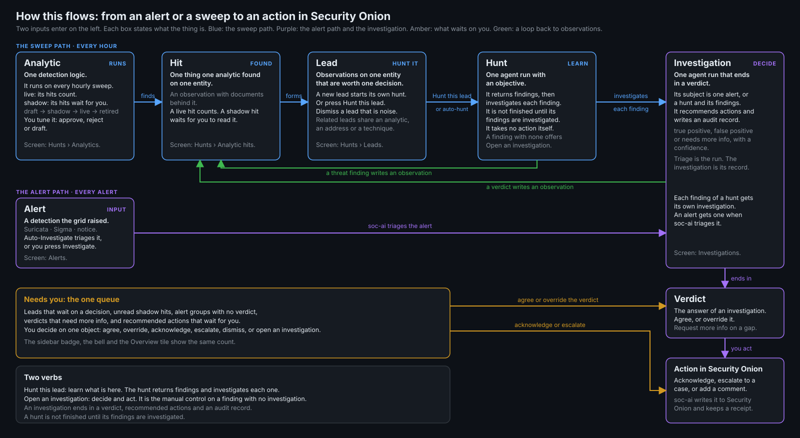

# Hunting

soc-ai triages the alerts your grid raises. It also looks for the attacks that raise no alert.
This guide covers that second half. The analytics run over the grid and write hits. Leads form
from the hits. Hunts answer the leads, and investigations end in a verdict.



## The five nouns

soc-ai uses one word for one thing. The whole pipeline uses these five nouns.

- **Analytic:** one written detection. A shipped analytic is a YAML file in the repository. A local
  analytic is one that you write in the console. Both use one schema.
- **Hit:** one match of one analytic on one entity, with the documents behind it. A hit is
  stored as an observation. The lead page and the host page call it an observation.
- **Lead:** the observations on one entity that are worth one decision.
- **Hunt:** one run against one objective. The model or a catalog query runs it. An analyst, a schedule or a lead starts it. A hunt
  ends in findings and a narrative. It states no verdict. soc-ai investigates its findings.
- **Investigation:** one run of the model that ends in a verdict. Its subject is one alert, or one hunt
  with all of its findings.

Two more words appear on screen. An **entity** is a host, a user or an address. A **type** is the
class of an observation or a hunt. The database column is still named `kind`.

## Lead formation

Every source writes into one observations table. Each observation carries a weight, and the weight
decays with a 48 h half-life. The decay starts at the event time. A profile departure and a catalog
hit record the time of the newest document they cite. An alert and a hunt finding record no
document time, so they decay from the time soc-ai wrote them. The lead page shows the event time
and keeps the record time in the hover text.

| Source | Type | Birth weight |
|---|---|---|
| A profile departure | `novel_destination`, `off_hours` and the other profile types | 0.30 to 0.50 |
| A profile novelty that fewer than 3 hosts know | the novelty type | 0.6 |
| One new member on 3 or more hosts in one sweep | `scope_count` | 0.4 |
| A new member that the peers in the role do not know | `rare_for_peers` | 0.45 |
| A host far from its learned peer group, from the estate model, always in shadow | `estate_outlier` | 0.3 |
| A catalog hit | `catalog_match` | 0.7 |
| A catalog hit from an analytic with no benign baseline | `prior_no_baseline` | 1.0 |
| A triaged alert, true positive | `alert` | 1.0 |
| A triaged alert, needs more info | `alert` | 0.5 |
| A promoted hunt finding | `hunt_finding` | 0.7 |
| A learned detector hit: one plane of a machine fell silent | `telemetry_silence` | 0.45 |
| A learned detector hit: a logon chain | `logon_chain` | 0.7 |

A false-positive verdict records nothing. A verdict changed to false positive removes the
observation it wrote.

A repeat sighting adds one occurrence to an observation only if the sweep cites a document the
observation has not cited before. A sweep that reads the same documents again moves nothing. The
observation row states two counts apart. The first is the documents in the window, as in "6
documents in the last 24 h". The second is the sweeps that saw a new document, as in "seen on 3
sweeps, first seen 3d ago".

A lead forms in one of three ways.

1. The live weight on one entity reaches 0.85 across two or more types. Two different sources saw the
   same machine. Each type counts at most 1.7, twice the lead threshold, so one type that repeats
   cannot carry the total alone. The lead page shows the weight of each type against that cap, as
   in "new served port 1.70 of 1.70, saturated".
2. One observation is **finding grade**: a catalog hit from an analytic that declares no benign
   baseline, or a true-positive alert. One such observation forms a lead alone.
3. One type repeats until its uncapped weight reaches 1.5. A 0.7 type reaches that on the fourth
   sighting. The lead is flagged `single_signal`.

A lead spans the entities that one hit names, and it merges through them. An entity that sits on
more than 8 open leads is a hub, such as a domain controller or a resolver. A hub is listed on a
lead. It never merges two leads.

A lead that holds one or more shadow observations is a shadow lead. A shadow lead starts nothing by
itself.

## The baseline behind a profile departure

A profile departure compares a host with its own baseline. The baseline holds one vector for each
of these dimensions:

- the served ports and the consumed ports
- the peers and the DNS names
- the processes and the process pairs
- the logon users
- the active hours and the connection rate

The build reads up to 30 days of history for each dimension. The baseline stops 24 hours before
the present, where the recent window of the sweep starts.

### Set dimensions

Seven dimensions are sets of members: ports, addresses, names and accounts. A member counts as
**known** if the baseline saw it on two days or more. The days run from its first sighting to its
last. A member that the baseline saw on one day is new again if it comes back. Before this rule,
one sighting a month ago made a member known permanently. The logon set of the domain controller on
the development range then held the three accounts that an attack created. An analytic can move the bar with `min_known_days`.

A member first seen inside a confirmed attack is not known either. soc-ai reads every investigation
with a true-positive verdict. The window runs from 24 hours before the investigation to 24 hours
after it finishes. It applies to every address and host name the investigation names. A false
positive, a synthetic evaluation run and a pipeline fallback confirm nothing.

A set keeps the 200 members with the most documents. A set at that cap cannot tell a new member
from a member past the cut. A novelty analytic is blind on that host, and its note starts with "set
full".

A **served port** is a port the host receives connections on. A DNS lookup does not count. An
outbound flow does not count. On an endpoint network event, only an accepted connection counts. A
served port also needs two different peers or two different days before it counts, in the baseline
and at novelty alike. A port at 32768 or above needs both. One client that tries one high port once
is not a service.

### Estate prevalence

After each build, soc-ai counts the hosts whose set knows each member. The count reads the stored
profiles, so it costs no search. The prior sweep refreshes it if a build is newer than the count.
A new member on a host is then one of three things:

| Hosts that know the member | Name | Effect |
|---|---|---|
| Fewer than 3 | estate-rare | The observation is born at 0.6, where a plain novelty is born at 0.5 |
| More than 20 % of the profiled hosts, and at least 3 | estate-common | A trait of the estate. No observation. The note counts it |
| Any other count | novelty | The observation is born at 0.5 |

The observation states the count as its statistic, as in "1 of 40 profiled hosts holds this
member". If one new member appears on 3 or more hosts in one sweep, each of those hosts also gets
a `scope_count` observation at 0.4. It states the spread and how many hosts knew the member before.
A spread past the span cap of 8 hosts forms a fleet condition.

### Peer groups

The peer group of a host is the other hosts in its role. The role must be declared, or inferred at
0.9 or more. The refresh after each build writes the role and its confidence on every profile row.
With 5 peers or more, a new member that most peers know is a trait of the role. It forms no
observation, and the note counts it. A host whose role is a guess has no peer group, unless the
estate model is on. With `estate_model_enabled` on, a host with no confident role reads its
learned group as its peer group. The note then names the group, as in "learned group 3". The
learned group applies only if it comes from a measured fit that is under 48 hours old. See "The estate model"
below.

The test `rare_for_peers` finds a member that is new to the host and new to its peers. At most
`max_peer_share` of the peers may know it, 0 by default. The test writes a `rare_for_peers`
observation at 0.45. Below `min_peers` peers, 5 by default, it is blind and says so. No shipped
analytic uses the test. A local analytic can use it, and a local analytic starts in shadow:

```yaml
id: local-server-rare-outbound-port
title: A server uses an outbound port no other server uses
evaluator: profile
scope_field: host.name
scope_kind: host
profile:
  dimension: consumed_ports
  test: rare_for_peers
  roles:
    - server
false_positives:
  - A server with a unique duty uses a port its peers never need.
```

### The connection rate

The build keeps the hourly series of flows each host starts. An hour with no document between the
first hour and the last is a zero. The old baseline dropped those hours, so it measured the rate
in active hours only.

The prior sweep reads the expected count for each hour of the week from the series, in local time.
The expected count is the median of the samples of that hour. The dispersion of an hour is the
larger of two numbers. One is the pooled MAD of every sample against its own hour. The other is the
square root of the expected count. A host whose hours never vary still has a dispersion, so a burst of one hour
moves the test. The hours inside a confirmed attack stay out of the series.

The recent read returns every whole hour of the last 24 hours. An hour that held no document is a
zero. An hour crosses the bar if both of these hold:

- The count sits 3 dispersions or more from the expected count of its hour.
- The count is 3 times the expected count or more, or a third of it or less for a drop.

A departure is a run of `min_hours` hours in a row that cross the bar, 2 by default. One hour that
is twice as far out is a departure by itself. An hour with an expected count of zero and a pooled MAD of zero
is unmeasurable. It is never a departure. A rate baseline built before the hourly series existed is
blind until the next build. The sweep states that reason beside the blind count. A release that
changes the stored shape starts a build at once. See "The profile shape" below.

The observation names the hour of the week, the count, the expected count and how many hours the
departure lasted. Its statistic is the residual z of the furthest hour.

### The evidence on an observation

Every observation records the event time, the statistic, its value and the baseline value it
departed from. It also records up to 10 document ids and an OQL query that shows the departure
again. The lead page shows the statistic and the query under each observation. **Copy query** puts
the query on the clipboard. **Hunt with this query** opens a new hunt. Its objective names the host
and the hours in the analyst's words, and the query follows. A rate departure reads as a multiple
of the expected rate. The z score is behind **Scoring**. The host page shows the statistic on each
row. The hunt a lead starts
reads each statistic and each query first, so it reads the departure and does not search for it
again.

### Coverage

Each dimension of each host carries a coverage state, and the host page shows it as a chip.
**measured** means a baseline exists. An empty one means the host shows none of this activity. **learning**
has under 7 days of history, and nothing is scored against it yet. **blind** means no plane on this
grid can answer the dimension for this host. A dimension whose telemetry plane the grid does not
carry reads blind on every host. **behind proxy** means the external destinations
of the host all resolve to a proxy, and the proxy carries the dimension. **unmeasurable** means a
plane carries the field, but the grid refused the query that measures it. soc-ai scores a departure
against a measured dimension only.

The builder reads the active hours and the connection rate with one query over the whole estate,
split into partitions. If Elasticsearch refuses the query for too many buckets, the builder doubles
the partitions and tries again, up to 32 partitions. If the grid still refuses, the builder records
both dimensions as unmeasurable, with the reason that the grid gave. The host page shows the reason on the row,
as "not measured: <reason>", and the Analytics coverage line reads "baseline unmeasurable:
<reason>".

The profile sweep controls the age of the baseline. At each wake it reads when the baseline was last
built. The sweep rebuilds a baseline older than the dossier refresh interval before it scores
anything. The dossier schedule setting does not change this. The age has a floor of twice the
sweep interval, so the defaults rebuild after 24 h. A dossier refresh also rebuilds the baseline on
every run. The Analytics coverage line reads "baseline N h old". It adds "stale" if a rebuild was
due and did not happen. The sweep then scores against the baseline it has.

### The blind reason

The profile sweep states why an analytic is blind. The evaluator writes a reason on each blind
entity. The sweep reports the reason that the largest number of blind entities share. The reason opens with two counts:
the entities that share it and all the blind entities. An example is "35 of 56 blind hosts: the
role of this host is not known well enough. The confidence is 0.50 and the gate is 0.90." The
counts appear even if every blind entity shares the reason. The reason names the dimension in
words, for example "no connection rate baseline exists for this host yet." These surfaces show
it:

- `soc-ai priors` prints the reason under the row of the analytic.
- The sweep notes hold one note for each analytic that measured no entity.
- The journal gets one line if the reason of an analytic appears or changes.
- The analytic ledger in the Analytics API holds `blind_reason`.
- The coverage of a profile analytic in `GET /api/v1/hunt-catalog` holds `blind_reason`.

The trail column `prior_spec_runs.blind_reason` holds the reason of each run. Migration 0060 adds
it.

### The profile shape

Each profile row records the version of its stored shape, in `entity_profiles.shape_version`.
Migration 0060 adds the column. The code holds the current version as `PROFILE_SHAPE` in
`soc_ai/dossier/profile.py`. A row with no version holds shape 1. Shape 2 adds the hourly series
of the connection rate.

A release that changes the stored shape increases `PROFILE_SHAPE`. If no host row holds the shape of
the running release, a profile build is due at once. The age of the rows does not matter.
`soc_ai.dossier.profile_job.shape_due` gives the reason, and the prior sweep loop reads it beside
the age rule. The build reads each host whose rows hold an older shape, whatever their age. The
build notes and the journal state how many hosts it read for that reason.

## Learned detectors

An analytic has one of three evaluators. A `match` analytic is a grid query, and the catalog sweep
runs it. A `profile` analytic compares a host with its stored baseline. A `model` analytic runs a
learned detector. The profile sweep runs the `profile` and the `model` analytics every hour, with
the same time anchor.

A learned detector learns what is normal from the estate's own history. It calls no model and it
needs no label. It is pure Python. A `model` analytic names its detector and the parameters of the
detector:

```yaml
evaluator: model
model:
  detector: logon_chain
  params:
    chain_minutes: 15
```

A hit of a detector is an observation with source `model`. It carries the event time, the
statistic, its value, the baseline value, the document ids, an OQL query and a reason. The reason
is one sentence that names the features of the hit and their values. The Analytics tab shows a
`model` analytic as it shows a `profile` analytic. Its hits appear in the hits block with their
receipts.

### The false-all-clear rule

A detector never states an all-clear. It records one state for each entity it reads:

| State | Meaning |
|---|---|
| measured | The detector scored the entity against what it learned. |
| learning | The entity has too little history to score. |
| blind | The detector could not read the plane it needs. |
| unmeasurable | The detector cannot score this entity at all. |
| stale | What the detector learned is too old. |
| drifted | The features of the entity moved past what the detector learned. |
| held | The detector found a hit and held it, because the condition is on most of the grid. |

The sweep notes count each state for each `model` analytic, and `soc-ai priors` prints them. The
coverage line has four columns. A `held` entity counts as measured there. An `unmeasurable`,
`stale` or `drifted` entity counts as blind. The row of each analytic in `soc-ai priors` uses the
same four columns. The journal, the trail and the analytic ledger count the same way. Only the
per-state note names the `unmeasurable`, `stale`, `drifted` and `held` counts.

Every hit cites at least one document. soc-ai drops a hit with no document, counts it, and states
the count in the sweep notes. The lead hunt skips a lead with no cited document.

A learned detector ships in shadow. Its spec declares `ships_as: shadow`, a daily hit limit and a
minimum precision. Its observations are shadow observations until an analyst approves the analytic
to live. The automatic demotion moves a live detector back to shadow if it passes its daily hit limit
or falls under its minimum precision. See "Automatic status changes".

### Cross-plane silence

`model-cross-plane-silence` finds a machine where one telemetry plane stopped and another plane
of the same machine continued. An intruder who stops an endpoint agent leaves the network sensor
running.

The detector reads each plane of each machine, hour by hour. The planes are host logs, process
events, endpoint network events, Windows security events, osquery, agent self-logs and the network
flows of the sensor. The host planes are keyed by `host.name`. The flows join the machine through the
`host.ip` values its agent reports, inside the estate. An address that two machines report joins
neither.

Each plane is compared with its own expected count for the same hour of the week. The expected
count comes from the same hours in the 4 earlier weeks, through the same arithmetic as the
connection rate. A hit needs all of these:

- One plane holds a tenth of its expected count or less, for 2 hours in a row.
- The expected count of each of those hours is 5 or more.
- Each of those hours sits 3 dispersions or more under its expected count.
- Another plane of the same machine holds half of its expected count or more in each hour.

A machine whose every plane fell is off, and the detector reports nothing for it. A plane that
always dips at that hour expects nothing then. A machine with one plane is unmeasurable. A plane
with under 7 days of history is learning. One plane silent on more than half of the machines that
ship it, and on 3 machines or more, is a grid condition. The detector holds those hits and states
the condition in a note.

A hit cites the newest document of the silent plane before the silence ends, and the newest
document of the live plane inside the silence. Its statistic is `plane_documents`: the documents
of the silent plane in the silent hours, against the expected count of those hours. Its query
groups the documents of the machine by dataset, over the silence and the hour before it.

This detector is meant to replace `profile-connection-rate-collapsed` on machines that ship two or
more planes. Both run until a shadow week measures them.

### Logon chain

`model-logon-chain` finds a session that lands on host B, followed by the first attempt from B to a
third host C. This is how an intruder moves from one host to the next.

The detector learns the edge set of the estate over 30 days: which address opened an accepted
session on which host. A session is a Windows 4624 of logon type 3 or 10 with a source address, or
an sshd Accepted line in `system.auth`. The outbound edges of a host are the edges whose source is
one of its own addresses.

A hit needs a session on B from another host, then within 15 minutes an attempt from an address of
B to a host C. The attempt is an accepted or a failed logon on C. C is not in the edge set of B.
B did not try C earlier in the read. C is not the host that the session came from. The edge set of
the estate and the history of B must each hold 14 days or more. Until then B is learning. A host
whose address soc-ai does not know is unmeasurable.

A hit cites the session document on B and the attempt document on C. Its statistic is
`chain_minutes`: the minutes between the two documents, against the number of outbound edges B
had. Its query shows the documents of B and the attempts from the addresses of B over that time.

## The estate model

The estate model is tier 3 of the detection design. It fits a model of the whole estate once a
day. The model groups the hosts that act alike, and it scores each host against the estate. It
writes observations in shadow only. It is off by default. Turn on `estate_model_enabled` to run it.

### Dependencies

The model needs scikit-learn and numpy. They come in the optional extra `ml`. The container image
installs the extra. On the systemd path, run `uv sync --extra ml`. With the setting on and the
extra absent, the daily run logs one line, "estate model: unavailable", and does nothing. soc-ai
imports the extra only when the run starts.

| Package | Version on 2026-10-04 |
|---|---|
| scikit-learn | 1.9.1 |
| numpy | 2.5.3 |
| scipy | 1.18.1 |
| joblib | 1.6.0 |
| threadpoolctl | 3.7.0 |
| cloudpickle | 3.1.2 |
| narwhals | 2.26.0 |

The seven packages add about 220 MB of site-packages to the image. The dependency audit in CI and
in the publish script reads them.

### The behaviour vector

The run reads the stored profiles and builds one vector per host. The vector holds these numbers,
in a fixed order:

| Feature | What it counts |
|---|---|
| `<set dimension>.members` | The members in the set, for each of the 7 set dimensions |
| `<set dimension>.per_day` | The documents behind the set, per support day |
| `active_hours.hours` | The hours of the day the host was ever active in |
| `active_hours.night_share` | The share of activity from 00:00 to 06:00 local time |
| `connection_rate.work`, `.off`, `.weekend` | The median connections an hour in each cell |
| `plane.flow`, `plane.dns`, `plane.process`, `plane.logon` | 1 when a dimension of the plane is measured or learning |
| `role.<role>` | 1 when an operator declared the role |

A count or a rate enters the model as `log1p`. An inferred role does not enter the vector. A host
with no measured or learning dimension gets no vector, and the run counts it as blind.

The profile store keys the flow and DNS planes on the address of a host and the process and logon
planes on its `host.name`. The run fits the two key spaces separately. A key space with fewer than 20
hosts forms one group and gets no score.

### Peer groups

The run standardizes each column and groups the vectors with k-means. k runs from 2 to 10. The
silhouette score picks k. A cluster under 5 hosts merges into the nearest larger cluster, because a
group of one host has no peers. The run matches the new groups to the groups of the previous fit,
so a group keeps its id from day to day.

The run writes the group of each host to the store. The record holds the group id, the distance to
the group centroid, the score, the model hash and the fit time. The fit row holds the centroid and the
median of each group.

### The outlier score and its reason

An isolation forest scores each host from 0 to 1. Near 0.5 is ordinary. A host at 0.55 or more is
an outlier. The score does not name a feature, so the score alone never becomes an observation.

The reason comes from the learned group. For each feature, the run divides the distance from the
group median by the spread of the group. This value is the deviation. The spread is 1.4826 times
the median absolute deviation, with a floor of 0.5 standard deviations. The three largest
deviations name the top features. A declared role is never a reason.

An outlier becomes an observation only if all of these hold:

1. Its largest deviation is 3 or more. A host under that has no stated reason.
2. Fewer than 5 other hosts sit within 1 standard deviation of it. A host with that many twins
   shares its behaviour with a subgroup.
3. The grid returns at least one current document of the host from the last 24 hours.

The fit row counts each case: outliers, unexplained, shared, no document and observations.

The observation has the type `estate_outlier` at 0.3, the source `model` and the analytic id
`model-estate-outlier`. It is always shadow. Its statistic is `estate_outlier`. The value is the
score of the host, and the baseline is the median score of its group. It cites the documents and
carries an OQL query that groups the documents of the host by dataset. The summary names the top
three features with the value of the host and the median of its peers:

```
198.51.100.2 departs from learned group 2 of 102 hosts. Its estate outlier score is 0.62. The
group median is 0.48. Logon users: 30. The peer median is 1. Logons a day: 400.0. The peer
median is 9.7. Outbound ports: 6. The peer median is 5.
```

### States

Each fit records one state. The doctor row and the fit row use the same words.

| State | Condition | Effect |
|---|---|---|
| learning | Fewer than 20 hosts have a profile | No fit. The fit row holds the state, the reason and the host count. No model file, no group and no audit record. No observation. No peer source |
| learning | 20 hosts or more have a profile, and the median host has under 7 days of profiles | Groups recorded. No observation. No peer source |
| drifted | Two or more features have a population stability index above 0.25 against the previous fit | Groups recorded. No observation. No peer source |
| held | More hosts qualify than the fire budget: 1 in 100 hosts, with a floor of 10 | Groups recorded. No observation. No peer source |
| measured | None of the above | Observations written. The groups serve as peers |

The run fits again every day. A new fit is a challenger for its first 24 hours. The next fit
promotes it to champion. The run scores once, with the newest fit. The challenger state is a
record only. The run does not score the champion beside it.

### The model file

The fit writes a JSON file to `<data dir>/models/estate/`, with mode 0600. The file holds the
feature names, the scale, the centroids, the drift bins and the forest settings. It holds no
serialized Python object, so a file cannot run code when it loads. The store records the file
name and the sha256 of its bytes. The run also writes the hash to the audit chain, as the event
type `estate_model_fit`.

The run reads the previous file to keep the group ids and to compute the drift index. It reads the
file only if the hash of its bytes is the hash that the store recorded for that name. The run refuses
a file that no fit wrote, a file whose bytes changed, and a file that resolves outside the
directory. It then fits without the previous file and records the refusal on the fit row. The
last 5 files stay on disk. The store keeps every fit row.

### Schedule and the doctor

A loop wakes every 5 minutes. It fits if the newest fit is 24 hours old. The fit takes the
single-flight slot of the dossier sweep, so it never runs beside a dossier sweep or a profile
rebuild. The fit runs in a worker thread.

The doctor row "estate model" reads "unavailable", "off", "learning", "measured", "drifted" or
"held", with the date of the last fit. A fit older than 48 hours reads "stale". With the setting
off, the row still states the date and the state of the last fit.

`soc-ai estate-model show` prints the newest fit. `soc-ai estate-model run` fits once, now. See
"The command line".

## Lead hunts

Hunt a lead to learn what is here. Open an investigation to decide and act. A hunt finishes only
after soc-ai investigates its findings. The hunt investigates what it finds and brings back the
verdicts. The lead offers **Hunt this lead**. The hunt page offers **Open an investigation** on a
finding with no investigation.

With `lead_auto_hunt` on, a loop wakes every 60 s. It starts the hunt for each open lead that has
no hunt, oldest lead first, up to `lead_auto_hunt_concurrency` hunts at a time. The lead then reads
"New · hunt queued".

The loop does not hunt five leads:

- A **dismissed** lead, because you answered it.
- A **reopened** lead, because you reopened it to decide again.
- A **shadow** lead, because nothing in shadow starts a hunt.
- A lead whose observations **cite no documents**, because its hunt would have no evidence to read
  first.
- A lead whose loop hunt **could not run twice**, because a third attempt would end the same way.

The first four show the chip "left to you" and keep their Hunt button. The fifth reads
"Hunted · Could not run" and offers Hunt again. soc-ai logs the skip once an hour for each lead.

A lead hunt reads the lead's own documents before it queries the grid. Its objective names the
lead's observations and the related leads. It asks the hunt to state, with the evidence, whether
the leads are one campaign. soc-ai writes the objective once, at the start of the hunt. The
objective therefore reads "Related leads at the start of this hunt".

Every lead hunt also reads the earlier conclusions about its entities. This includes Hunt again
and the bulk hunt. See [Earlier conclusions](#earlier-conclusions).

## Hunt outcomes

A lead settles when its hunt finishes. What the hunt found decides where the lead goes.

- The hunt found **no threat**. soc-ai closes the lead with the reason `hunt_clean`. The lead moves
  to the Closed tab and reads "Closed. The hunt found no threat.", with the chip "closed by soc-ai".
  No analyst chose a reason, so the lead quality report counts it separately from your dismissals.
  soc-ai closes the lead only if the hunt read its evidence. A visibility gap finding, a failed
  tool call, a degraded run or a report from the budget synthesizer keeps the lead open. An earlier
  hunt on the same lead with a threat finding keeps it open too. A finding that linked this lead to
  other leads also keeps it open. The lead then waits under Needs decision. The lead page states the
  reason: "The hunt could not read all evidence.", "An earlier hunt found a threat." or "The hunt
  linked this lead to other leads."
- The hunt found a **threat**, or it reported a **visibility gap**. The lead waits on you under
  Needs decision as "Hunted · Threat findings" or "Hunted · No threat observed · visibility gap".
  Read the verdicts that the hunt brought back, or dismiss the lead.
- The hunt **could not run**: an error, a cancel, an interrupted process, or a query that failed.
  The lead returns to open and keeps the hunt. The loop starts one more hunt. If that one cannot
  run either, the lead waits on you as "Hunted · Could not run" and offers Hunt again.

**Hunt again** starts a second hunt, and the lead then points at it. While the attached hunt
still runs, the button opens that hunt. A lead the hunt closed offers Reopen only. Reopen
it first, then hunt again.

soc-ai signs a hunt closure as soc-ai even if you started the hunt by hand. A lead you dismissed
yourself and then reopened is never closed by a hunt. A clean hunt on it waits on you.

The lead page lists every decision on the lead in order. The decisions are each dismissal, each
reopen, an investigation opened on the lead, the close by a clean hunt and a hold. A reopen clears
the current dismissal. The old dismissal stays in the list. The store keeps the word `promoted`
for an investigation opened on the lead. The lead page shows it as "opened an investigation".

A closed lead keeps its history. A type that the hunt already cleared can show up again while the
lead's observations are still live. The new observation then joins the closed lead as history. No new
lead forms, and no new hunt starts. A new type reopens the lead in place, and the loop hunts it again.

A lead that an earlier release left in hunting settles at the next start. With `lead_auto_hunt` on,
the loop also settles finished hunts at each wake, before it picks the next leads.

A lead hunt that investigates its findings settles by the rule in [Hunt findings](#hunt-findings).

## Hunt findings

A hunt investigates its findings as part of the hunt. After the hunt writes its report, soc-ai opens
one investigation for each subject finding. The investigation runs the same way as one you open by
hand. Its actor is `system:hunt`.

A finding is a subject when it is a threat and names a host, an address, a user or a domain. A
visibility gap, a failed query and an observation are not subjects. The investigation runs on a
document that the finding cites. When the grid holds no document that the finding cites, it runs on
a document of the other findings or the lead. When there is no document at all, the finding reads
"Investigation failed" with that reason, and you decide.

A link between leads is not a finding. The hunt states it in the narrative. When the title of a
threat finding names leads, soc-ai changes the finding to an observation with severity info. The
note on the finding says why. No investigation opens for it. When that finding was the only threat
of a lead hunt, the lead does not close as clean. It waits for the analyst with the reason "The
hunt linked this lead to other leads."

- Two investigations of one hunt run at a time. The finding with the highest severity goes first.
  Findings of equal severity go in report order.
- `hunt_findings_investigate_max` caps the investigations of one hunt. The default is 20. A finding
  past the cap reads "Over the cap, open by hand." Use Open an investigation on that finding.
- The hunt reads **Investigating** while the investigations run. The findings section reads
  "Investigating 2 of 3 findings". The hunt is complete when the last investigation ends.
- A failed investigation counts as ended. Its finding reads "Investigation failed, re-run." Use
  Open an investigation on that finding. Re-run on the page of the failed investigation also starts
  a new run.
- A cancel of the hunt stops its investigations. A queued one never starts, and a running one stops.
- A restart completes an investigating hunt. A finding whose investigation never started reads failed.
- The hunt's own investigations record no observation. An observation for each finding would form a
  new lead on the host of every lead hunt.

Each finding card shows the verdict, the confidence word, the actions that wait and a link to the
investigation.

### One investigation per subject

Before soc-ai opens an investigation, it looks for a running or complete one from the last 7 days
with the same subject fingerprint. The fingerprint is the entity set and the cited document ids of
the finding. It does not depend on the hunt. soc-ai reuses a match from another hunt. The finding
links to it, and no new run starts. A re-hunt of a lead therefore reuses the investigations of the
first hunt for the findings that did not change.

Two findings of one hunt never share an investigation. Each finding makes its own claim.

A finding that cites no document has no fingerprint. A tool call in the citations is not a
document. soc-ai opens a new investigation for such a finding.

An investigation of one alert never answers for a finding. The alert investigation judges the
alert. The finding makes its own claim.

soc-ai never reuses a failed run, a pipeline fallback or a backtest replay.

### Outcomes after the investigations

The outcome of the hunt then reads the verdicts.

| Outcome | Label | When |
|---|---|---|
| `investigating` | Investigating 2 of 3 findings | The investigations of the findings run. |
| `threats_confirmed` | 2 of 3 findings are threats | At least one investigation reached the verdict true positive. |
| `no_threat_confirmed` | No threat confirmed | The investigations reached verdicts, and none is a true positive. |

A hunt whose investigations reached no verdict keeps the outcome of its report. So does a hunt with
no subject finding. The bell reads "Hunt finished: 2 of 3 findings are threats".

### The lead of the hunt

When every subject finding of a lead hunt has a verdict, soc-ai closes the lead as promoted. The
decision names `system:hunt` and records the verdict of each finding. A finding with no verdict
leaves the lead to you. A failed investigation, a pipeline fallback, a cancelled investigation and a
finding past the cap have no verdict. The lead then waits under Needs decision. The lead page
states the reason: "A threat finding of the hunt has no verdict." Use Re-run on the investigation
page of that finding, or decide on the lead. A finding past the cap has no investigation. Use Open
an investigation on the hunt page for it. With `lead_auto_hunt` on, the loop closes the
lead at its next wake after the last verdict lands. A lead hunt with no subject finding settles by
the rules in [Hunt outcomes](#hunt-outcomes).

`soc-ai usage` counts the hunt's own investigations under the entry "Hunt finding investigation". It
prints the line `hunt findings investigated: N` for the window.

## Investigations of hunt findings

A hunt finishes only after soc-ai investigates its findings. The hunt investigates what it finds and
brings back the verdicts. A finding with no investigation offers **Open an investigation** on the
hunt page. That control starts the investigation by hand. The subject of the investigation is that
finding.

An investigation of a finding judges the claim of that finding. The rest of the hunt is context.
The run anchors on a document that the finding cites. When the grid holds no document that the
finding cites, the run anchors on a document of the other findings or the lead. The investigation
page names the finding under Subject. The hunt shows under Context: hunt.

An older investigation of a finding judged the whole hunt. Its page keeps the old labels. Its
subject in the API has no `judges` key.

The run reads the hunt's objective, its narrative, every finding, and every document those findings
cite, up to 40. The documents of the chosen finding come first and the rest follow newest first. A lead
hunt also carries the lead's observations and its related leads. soc-ai loads the cited documents as
evidence before the investigation starts. A verdict that cites one of them then resolves against a
document the run holds.

The verdict is `true_positive`, `false_positive` or `needs_more_info`, with a confidence, a
rationale, citations and recommended actions. For a finding, the three words mean this:

- **true positive**: the activity that the finding names is an attack or a compromise, and the
  evidence shows it. A login or a probe that happened is not a true positive by itself.
- **false positive**: the activity has a benign explanation that the evidence supports.
- **needs more info**: the report names the gap that a tool call can close.

A lead promotion has no finding. It judges the hunt as a whole. For a lead promotion, the three
words mean this:

- **true positive**: the hunt's hypothesis holds as an attack or a compromise.
- **false positive**: the findings have a benign explanation that the evidence supports.
- **needs more info**: the report names the gap that a tool call can close.

When the Oracle reviews an investigation of a finding, the case names the title and the hosts of
the finding. The Oracle judges that claim.

Every gate runs: the evidence gate, the citation validation and cap, the confidence floor, the
egress guard, the Oracle escalation and the session gate. Two things do not run. The decision
templates do not. Each template matches an alert rule class, and a hunt has none. The unattended
acknowledge does not either. Security Onion holds no hunt to acknowledge.

The route `POST /hunts/leads/{id}/promote` stays for API clients. The console offers no control
for it. The server refuses it on a lead with no finished hunt, with HTTP 409 `lead_not_hunted`.

### Re-run

An investigation of a finding that ended keeps its verdict. The hunt page links the finding to that
run with **View investigation**. To run the investigation of the finding again, use **Re-run
investigation** on the investigation page. The button shows when the run is not running.

- Re-run starts a new investigation of the same finding. The new run judges the claim of the
  finding again.
- The old run stays as a record. The finding on the hunt page links to the new run.
- The page of the old run names the new run. Its Re-run, Override verdict and actions are off.
- The hunt counts the finding as investigated again when the new run ends.
- While a run of the finding runs, Re-run opens that run. No second run starts. When two presses
  arrive at the same time, one run starts.
- A run that the page calls stuck can still run on the server. Re-run then states that the server
  still runs it. No run starts.
- Re-run starts a run of its own when a run of another hunt has the same subject.
- The new run keeps the synthetic-evaluation marker of the hunt. It writes nothing to Security
  Onion.
- Re-run asks first when an analyst verdict is on the run. The verdict of the new run then replaces
  the analyst verdict on the hunt page.
- A finding investigation has no **Deep re-run** and no **Request more info**. The API refuses
  Request more info with HTTP 409 `hunt_kind_no_rerun`. The hint names Re-run.
- A finding investigation whose hunt an admin deleted has no Re-run.

The console sends the route of the finding with the JSON body `{"rerun": true}`. The
[API](#the-api) table describes the route.

## Related leads

One entity is one lead. A coordinated attack across several machines is several leads, and no
single one of them reads as a campaign. The lead page carries a **Related leads** panel for that
case.

A related lead is open, and it formed in the last 7 days. It also shares one of four things with
the lead you are reading:

- the same analytic on an observation within 24 h
- the same alert rule within 24 h
- the same external address or /24 network named in an observation
- the same ATT&CK technique

IPv4 compares on the /24. Two hosts that talk to neighbouring addresses usually talk to one destination.
Each row states the share in one phrase, names the state of the related lead, and links to it. The
lead row on the strip carries a "+N related" chip.

soc-ai computes the list on read and stores nothing. A stored relation goes stale as soon as you
answer either lead. A deployment whose API returns no related leads shows no panel. An empty panel
there would claim a result that the API did not return.

## Earlier conclusions

Two types of hunt read the earlier conclusions about their subject before they start.

A **lead hunt** reads the leads that closed as promoted in the last 7 days. An earlier lead counts
when its subject is an entity that the new lead names. Two leads that only mention the same host do
not count. The hunt reads at most 3 leads, newest first. Each lead line names up to 3 entities of
the earlier lead. The entities that the new lead also names come first. For each lead the hunt
reads up to 3 investigations: the title, the verdict and the first sentence of the summary.

A **scheduled hunt** reads the last complete run of its objective. It also reads up to 2 older runs
from the last 7 days. It reads at most 5 findings from each run and 10 in total. Each finding line
gives the type, the title, the hosts, up to 3 document ids and the verdict of its investigation.

soc-ai skips a run of the synthetic evaluation, a partial run and a run that read nothing. A
partial run is a run that stopped at its budget. soc-ai carries only the findings that cite a
document. It does not carry the narrative, because no gate checks the narrative.

The hunt reads each conclusion as a claim to check. A conclusion is not evidence. The block names no
lead, hunt or investigation id, so the hunt cannot cite one. The Objective step on the hunt page
shows the block and its source records. The hosts that only the block names reach the host dossier
with the label "named in an earlier conclusion".

With redaction in fail-closed mode, soc-ai checks the block before the hunt starts. When the block
holds a name that the redaction cannot remove, the hunt starts without the block. The Objective step
states this.

soc-ai reads the conclusions once, at the start of the hunt. The objective does not change. A
scheduled hunt therefore keeps its link to its earlier runs and its "vs last run" comparison.

The investigations of the hunt findings do not read this block. They read the hunt narrative, and
the narrative can name an earlier claim. The prompt of each investigation therefore states that a
claim of an earlier hunt in the narrative is not evidence.

The read writes nothing. A closed lead keeps its status, its history and its observations. soc-ai
reads promoted leads only. A dismissed lead, a reopened lead and a lead whose hunt did not settle
are not earlier conclusions. An analyst chat hunt and a re-hunt of a hunt read no earlier
conclusions.

## The Hunts page

The page is the pipeline in order. Each item appears once. Every section header carries one dim
line that says what the section holds. That line ends in a link, **How this flows**. The link opens
the chart above in a drawer. The address `?flow=1` opens the same drawer.

### 1. Needs you

One line at the top. It gives the count, then one link per thing that waits on you: "2 shadow hits
are unread", "2 leads wait on a decision". Each link jumps to the block below with its filter set.
If nothing waits, the strip reads "Nothing needs you" and takes one line. The sidebar badge on
the Hunts item shows the same count, and the bell lists the items.

### 2. Analytic hits

Every hit from the last 7 days, live and shadow, in one list. Under All, the unread shadow hits
come first, newest first. Needs-you counts these hits, so they open the list. The live hits follow,
newest first, and the read shadow hits come last. The filter chips are All, Unread, Live and
Shadow, and the counts behind them are read over the whole window.

The list reads 50 hits at a time. The line under the list states the share, for example "50 of
148 hits". "Show more" reads the next 50 hits.

A live hit carries a solid accent border and a bold title. A shadow hit carries a dashed amber
border and the `shadow` chip. A read shadow hit is dimmer still. A live hit is never lighter than a
shadow hit.

Each card names the analytic, the entity, the document count, when the hit was first seen and how
many times it was seen. Evidence sits under that, and each document opens the document drawer. If
a lead holds the hit, the action is **Open lead**, because you decide on the lead.
A hit that formed no lead offers **Hunt this entity**. A shadow hit adds **Approve analytic**,
**Reject analytic** and **Mark read**.

A shadow hit stays unread until you open its evidence or act on it. A live hit has no read flag.

### 3. Leads

Four tabs, named by what you must do: **Needs decision**, **In progress**, **Closed**, **All**. The
block opens on Needs decision. Closed holds the leads you dismissed or opened an investigation on,
and the leads a hunt closed.

Every row carries a state pill: `New`, `In progress`, `Hunted · <outcome>`, `Dismissed`,
`Closed. The hunt found no threat.`, `Promoted`. A new lead whose hunt the loop has taken reads
`New · hunt queued`. A lead whose loop hunt could not run twice reads `Hunted · Could not run`. The
pill is the state. The tab is a filter.

| State | Actions |
|---|---|
| New | Hunt this lead, Dismiss. A queued lead offers Hunt now and Dismiss. |
| In progress | View hunt |
| Hunted | Read hunt, Dismiss, Hunt again |
| Dismissed, Closed by the hunt, Promoted | Reopen. A promoted lead also offers View investigation. |

A dismissal needs a reason: `expected_for_role`, `known_change`, `benign_repeat`, `bad_baseline`,
`authorized_test`, `duplicate`, `bad_analytic_logic`, `lab_host` or `other`. The form opens with no
reason chosen. Free text is optional. The lead quality report counts the reasons, so pick the
reason that is true.

A dismissal closes the lead. The observations on the lead and their repeats form no new lead. A
new observation on the same host can form a new lead at once. No time window applies. Select
Reopen to undo the dismissal.

#### Bulk decisions

On the Hunts page, each lead row has a checkbox. The box above the list selects every lead on
the list. Selection works on every tab and on the list of one host. A new tab or a new host
filter clears the selection. The selection strip stays at the top of the leads block while you
scroll.

| Tab | Bulk actions |
|---|---|
| Needs decision | Dismiss, Hunt |
| In progress | None. A lead under a running hunt takes no bulk decision. |
| Closed | Reopen |
| All | Dismiss, Hunt, Reopen |

Each button shows how many selected leads it acts on. A confirm states the count, the leads the
press skips and the consequence. Escape closes the confirm.

- **Dismiss** takes one reason and one optional note for all leads. The history of each lead
  records one dismissal, with your name, the reason and the note.
- **Hunt** starts one hunt for each lead. Each hunt is a model run. One press starts at most 3
  hunts. The confirm names the leads, states the cap and states how long hunts on this grid take.
  Press Hunt again for the rest.
- **Reopen** opens each dismissed lead again. A lead that an investigation closed reopens from its
  own row.

The press skips a shadow lead, a lead in a state the action does not accept, and a lead that
changed after the page loaded. The result line names the outcome of each lead. A failed lead
stays selected.

Undo stays on the result line for 2 minutes. Undo of a dismiss reopens the leads the press
dismissed. Undo of a reopen dismisses each lead again with the reason and the note of its last
dismissal. A lead that soc-ai closed after a clean hunt has no analyst reason, so Undo leaves it
open. Undo leaves a lead that changed after the press. A hunt has no Undo. You can cancel a hunt
on its page.

There is no bulk promotion. An investigation is one decision for each case. There is no bulk
Keep open. Keep open answers the verdict of one investigation on one lead.

### 4. Hunts

The list of agent runs, with a Started-by column that reads Manual, Schedule or Lead. The objective
of a lead hunt links to the lead. Scheduled hunts sit under the list. The catalog sweep adds no
entry here, so this list holds agent runs only.

### 5. New hunt

One button at the top right of the Hunts section. It opens the composer in a drawer: the objective
box, the starters, the template control and the Start button. A starter can name the analytics to
run first.

### 6. Analytics tab

The analytic catalog. Each row carries the title, the tier, the status and the analyst actions.
The tier is shipped or local. The status is live, shadow, candidate or retired. An analytic opens a drawer with its
description, its evaluator, its version history, its outcome ledger and its recent observations by
entity.

soc-ai computes the outcome ledger on read, over one window. The ledger holds these numbers:

- the observations that the analytic wrote
- the leads it contributed to
- how many of those leads were hunted, promoted or dismissed under each reason
- the documents it scanned, with the runtime
- the entities it scored, against the entities it could not see

Retirement decisions read the ledger.

#### Drafts from a finding

"Draft an analytic" on a threat finding writes one local analytic. The console shows the draft
and its 30-day dry run. The analyst confirms, and soc-ai stores the analytic as a candidate.

**Generalization.** An analytic describes a behaviour that any host, user or address can show.
The model keeps an exact value only for a stable discriminator, such as an event code, a dataset,
a port or a response code. soc-ai checks each draft for clauses that name the entity of the
finding. A pin is a value test on a host, user, address, domain, URL, path or command line field.
A literal IP address in a clause is a pin. A host of the finding in the title or the id is a pin.
A value from the finding's indicator list is not a pin. On a pin, the model rewrites the draft once.
A draft that still pins shows a warning with one line per clause, and the save button reads
"Save anyway". The drawer lists the pins under "Specific to one case". The Analytics tab marks
the row "specific". The dry run also states how many distinct scope entities matched. One host
in 30 days tells the analyst that the analytic still describes one case. The clause language
matches each event and cannot count. A finding about a repeat becomes an analytic for one event.

### 7. Lead quality

A block under the analytics table. It states the lead rule in one sentence. The noise floor rule
is next to it: "A threshold moves only on a week of data." Then two tables follow.

- **Per ISO week**: leads formed, hunted, with a threat finding, promoted, closed by hunt, and
  dismissed under each reason. A week with no leads is still a row, because a quiet week is a
  measurement.
- **Per set of observation types**: formed, dismissed, closed by hunt, and with a threat finding.

Closed by hunt counts the leads soc-ai closed because the hunt found no threat. The dismissal
columns count your reasons only.

The reason columns come from the data, so a reason that nobody used gets no column. A failed read
states the failure. If the endpoint fails, "no leads" would be a false all-clear.

## Role-scoped analytics

A match analytic can name roles. It then applies only to scope hosts that the dossier places in
one of those roles. The gate uses the role and the confidence that the role priors use. An
operator declaration has full confidence.

| Dossier belief about the scope host | Result |
|---|---|
| A named role at confidence 0.9 or above | The analytic fires. |
| Another role at confidence 0.9 or above | No hit. The documents leave the match count. |
| No role, `unknown`, or a confidence below 0.9 | No hit. The sweep reports a coverage gap that names the host. |

The third row is not a clean result. A server with no confident role must not hide a hit. Declare
the role on the host page. The next sweep then decides the host.

Three shipped analytics carry a role gate. Each one replaces a role prior that tested a different
fact from the one its title stated. soc-ai removed the three prior files. The old observations keep
the old id.

| Old prior id | New analytic id | Event read | Roles | The finding quotes |
|---|---|---|---|---|
| `prior-defender-adjudication-on-server` | `identity-defender-detection` | Defender 1116 and 1117 | server, domain_controller | threat, path, action |
| `prior-audit-policy-changed-on-dc` | `identity-4719-audit-policy-change` | 4719 | domain_controller | account, subcategory, change |
| `prior-privileged-group-membership-changed` | `identity-privileged-group-change` | 4728, 4732, 4756 | domain_controller | account, group, member, member SID |

The reasons for the change:

- The Defender prior read new process names. It never read a Defender event. On the development
  range it missed all 10 Defender detections. It fired 73 times on Defender updater files, because
  each definition update has a new file name.
- The audit-policy prior and the group-change prior read new logon accounts on the domain
  controller. Neither read event 4719 or a group change.

The level of a Defender hit follows the Defender severity. Severe is critical. High is high.
Moderate is medium. Low is low. A document with no severity keeps the level critical.

The audit-policy analytic excludes subject accounts that end in `$`. Group policy refresh writes
4719 under the computer account. An intruder who runs as SYSTEM on the domain controller also
writes under the computer account. The analytic does not see that change.

The group-change analytic matches the group by name. The names are Domain Admins, Enterprise
Admins, Schema Admins, Administrators, Account Operators, Backup Operators, Server Operators, Print
Operators, DnsAdmins, Group Policy Creator Owners, Remote Desktop Users and Distributed COM Users.
A renamed group or a translated builtin name needs a tuning filter.

All three declare no benign baseline. One hit forms a lead.

## The shadow week

A new analytic runs in shadow before it counts. Run it in shadow for a week and read what it
produced.

1. **Put the analytic into shadow.** On the Analytics tab, open the analytic and choose **Run in
   shadow**. A shadow analytic runs on the normal sweep. It writes shadow observations. It cannot
   go live by itself.
2. **Dry run the catalog by hand.** `soc-ai spec-sweep --shadow` reports what every analytic would
   have found. It records no hunt, and it does not spend the fire-once budget. An analytic
   therefore still fires on the day you switch it on. Add `--backfill` once, at the time you add an
   analytic. It seeds the state from history and writes no finding for each past occurrence.
3. **Read the hits with their receipts.** Every shadow hit carries the matched documents and the
   fields that matched. A hit from a profile analytic also carries the baseline. Every shadow hit
   carries a 30-day dry run with its fire count and entities. The last receipt is the overlap with
   any live analytic that saw the same documents. A hit with
   incomplete receipts reads "could not run" and names the missing part. It is never shown as a
   hit, and it is never hidden.
4. **Approve or reject.** **Approve analytic** moves it to live and records the receipts as the
   reason. **Reject analytic** leaves it in shadow for you to edit. You can also retire it with a reason.
   Every transition records the spec text before and after, who acted, when and why.
5. **Keep the hit you read.** An approval leaves the hit in place. The shadow hit stays with its
   read state. The next sweep records the entity as a live observation, and the card then reads as a
   live hit. A hit recorded in shadow whose analytic is now live carries a dim "recorded in shadow"
   chip.
6. **Turn the loop on last.** Set `hunt_spec_sweeps_enabled` on after the shadow week. The catalog
   then sweeps on a schedule.

Retirement is the one status that hides a hit. A retired analytic keeps its ledger and its reason.

## Automatic status changes

soc-ai changes the status of an analytic in the cases below. A version row records each change.
The actor on the row starts with `system:`. soc-ai never approves an analytic to live and never
retires one. Those two actions stay with the analyst.

### Shadow on first deploy

A shipped analytic can declare `ships_as: shadow` in its file. The default is `ships_as: live`.
Every analytic without the field keeps that behaviour.

On the first catalog load, soc-ai writes a `shadow` status row for each shipped analytic that
declares `ships_as: shadow` and has no status row. The version row names the actor
`system:catalog` and says that the analytic shipped in shadow. The startup, each sweep and the
status route load the catalog this way. Before the row exists, the catalog already reads the
analytic as shadow. A new analytic therefore never runs live on its first deploy.

Approve the analytic to live on the Analytics tab after its shadow week. Once a status row exists,
the row decides. A later release that changes the field to `live` does not move a retired analytic
or an analytic in shadow. A local analytic refuses the field, because it always starts as a
candidate.

### Demotion to shadow

soc-ai has one transition of its own: live to shadow. Only a system actor can make it. The
version row holds the actor, the reason and the evidence. The observations that the analytic wrote
while live stay as they are. The next sweep writes its new observations in shadow.

The Analytics tab marks the row "held by soc-ai", and the chip carries the reason. The Analytics
card on the Status page shows the same chip. `GET /hunt-catalog` holds the reason in `held_by_system`. The
drawer states the hold under the description. The version row carries a `soc-ai` chip, the reason
and one evidence line for each breach. Read the evidence. Then select Approve or Reject. Approve
moves the analytic back to live. Reject retires it. The store refuses a system actor that tries to
approve an analytic to live or to retire one.

### Daily hit limit and minimum precision

A spec can declare two limits. Both are off by default. The console calls them the daily hit limit
and the minimum precision.

| Field | What it limits |
|---|---|
| `fire_budget_per_day` | The daily hit limit: the hits the analytic can write in 24 hours. A hit is an observation that the analytic wrote or refreshed live in the window. |
| `precision_floor` | The minimum precision: the lowest share of hunted leads over 30 days that reach a promoted finding or an investigation. The other leads in the share are the leads that a hunt closed clean. |

The reason of a demotion names the numbers, for example "The analytic wrote 5 hits in 24 hours.
Its daily hit limit is 3." or "1 of 5 hunted leads reached a finding or an investigation. The
precision is 0.20. Its minimum precision is 0.50."

After each analytic sweep and each profile sweep, soc-ai checks each live analytic that declares a
limit. The check reads the store only. It makes no grid query and no model call. A breach moves the
analytic to shadow through the demotion above. The version row holds the numbers. The bell shows
one entry until an analyst approves or retires the analytic.

The rules of the check:

- An analytic that declares neither field never moves.
- An analytic in shadow never moves.
- A lead that an analyst dismissed counts on neither side of the precision.
- The precision counts only if 5 or more leads are decided.
- The window starts 24 hours or 30 days back. If the latest approval to live is later, the window
  starts at the approval. The hits and the leads that caused a demotion therefore cannot cause a
  second one after an analyst approves the analytic again.
- One window holds one demotion at most.

The setting `analytic_self_heal_enabled` turns the check on and off. It is on by default.

## Grid gaps

A grid gap is a span of hours the grid held no readable data for soc-ai. soc-ai keeps each gap in
the store. Three sources record a gap:

- The health probe. A gap opens when the grid refuses the connection or does not answer for three
  minutes. A slow answer opens no gap. The first good probe closes the gap. An open gap survives a
  restart.
- The profile sweep. In one hour, the connection rate collapses on at least 3 hosts and on at least
  60 percent of the hosts where a collapse is measurable. The sweep records a gap for those hours.
  A sensor that stops while Elasticsearch stays up looks like this.
- The operator. soc-ai sees no gap while it is down itself, and it saw no gap before the ledger
  existed. Run `soc-ai grid-gaps add --start <ISO> --end <ISO> --detail "<text>"`, or send
  `POST /api/v1/grid/gaps` as an admin. A time with no zone is UTC. The ledger refuses an end at
  or before the start, a span over 30 days, and a start or an end in the future. A repeat of the
  same gap records nothing new. `soc-ai grid-gaps list` prints the ledger.

The hours of a gap are unknown. soc-ai applies these rules to them:

- The profile sweep does not score the rate in those hours. It also waits
  `grid_gap_settle_minutes` after the gap ends, because the agents send their stored events
  after a restart.
- The rate baseline reads those hours as missing. A missing hour is no measurement.
- A hit whose event window lies inside a gap does not count toward the daily hit limit.
- The Dashboard, Alerts, Hunts and the host page show a strip for each gap in the page window.
- An empty Alerts window over a gap gives the reason `gap`. The hint names the gap hours.
- A closed gap stays in the bell for 24 hours.
- The general chat and the hunt get one line for each gap of the last 30 days.

`GET /api/v1/grid/gaps?since=&until=` returns the gaps that overlap a window. Each gap carries
`hits_to_review`, the hits of the gap that nobody marked benign yet.

### Gap review

A gap can write false hits. A count over unknown hours reads as zero, so a rate collapses and a
plane falls silent. The strip on a closed gap offers **Review N hits in this gap**. The review
drawer lists each hit of the gap with its event window.

A hit belongs to the gap when all three are true:

1. An analytic wrote it.
2. Its type measures a count or a silence: below baseline, above baseline, telemetry silence or
   estate outlier.
3. Its event window overlaps the gap or the settle margin after it.

soc-ai reads the event window in this order: the run in `evidence.window`, the silence in the
baseline features, the run in the query of an older rate hit, and the newest document. A hit
with no document time uses its first and its newest record time. A hit on matched documents is
not on the list. Its documents exist.

Each hit has a check box. soc-ai selects a hit when both are true:

1. Its event window lies inside the gap and the settle margin.
2. It is not a spike. A spike has the type above baseline.

The drawer states the reason under each hit that soc-ai does not select:

- "A gap does not explain a spike. Check for a back-fill burst." A gap gives no documents. Only a
  burst of stored events after the restart can raise a count.
- "Part of this window is outside the gap." Some of the events fall before the gap or after the
  settle margin. Those hours had data, and the hit can be real.

The operator can select or clear each hit. **Mark N of M hits benign** states the counts first.
The confirm writes a mark only on the selected hits. Each mark goes through the path of the
per-hit Mark benign, with the reason `grid_gap` and the note "Grid gap from <start> to <end>".
The hits that the operator left out stay on the list for a second mark. A hit keeps its lead.
The lead page weighs only the observations that remain, and the lead rules do not change. No
analytic changes status. The marks have no undo.

The drawer also names each analytic that soc-ai held where gap hits are in the window that broke
the daily hit limit. When the other hits stay inside the limit, the drawer offers **Return to
live**. The click approves the analytic on the approve route. soc-ai never does it alone. The
hold card in the Analytics drawer states the same count: "5 of the 5 hits that broke the daily
hit limit fall inside a grid gap."

A spike inside a gap does not count toward the offer. A gap does not explain a spike, so the
card asks the operator to check for a back-fill burst first.

The daily hit limit uses the same inside rule. A hit is left out of the count only when its
event window lies inside the gap. That rule acts with no operator.

The drawer finds a hold after the next sweep too. A sweep sets the shadow flag of a hit to the
status of its analytic at that sweep. So the hits that broke the limit read as shadow after the
hold. The hold count reads every hit that existed at the hold, whatever its flag.

| Route | What it does |
|---|---|
| `POST /grid/gaps` | Record an operator gap. Admin only. Writes a `grid_gap_recorded` audit record. Answers 201 with the gap, or 200 with the gap on record that has the same edges. A refused gap answers 422 with `gap_end_before_start`, `gap_too_long`, `gap_start_in_future` or `gap_end_in_future`. |
| `GET /grid/gaps/{id}/hits` | The hits of the gap that nobody marked benign, the leads that hold them, and the holds they caused. `hits` stops at 500 rows. `count` is exact. Each hit carries `inside_gap`, `selected_by_default` and `reasons`. `selected_count` counts the hits soc-ai selects. |
| `POST /grid/gaps/{id}/hits/benign` | Mark the selected hits of a closed gap benign. `ids` names the hits and is required: a body without it answers 422 `gap_ids_required`. `expected` is the count the confirm showed. A count that differs from `ids` answers 422 `gap_selection_mismatch`. An id that is no longer in the gap list answers 409 `gap_hits_changed`. Both refusals write nothing. An open gap answers 409 `gap_open`. Writes a `grid_gap_hits_benign` audit record. |

`GET /analytics/{id}` carries `gap_hold` on a held analytic with gap hits: `hits`, `gap_hits`,
`budget`, `return_offered` and `gap_ids`.

## Settings

| Setting | Default | What it does | Applies |
|---|---|---|---|
| `lead_auto_hunt` | on | A lead that has never had a hunt starts one when it forms. | live |
| `lead_auto_hunt_concurrency` | 2 | How many lead hunts the loop runs at once. The floor is 1. | live |
| `hunt_findings_investigate` | on | A hunt opens one investigation for each subject finding. The hunt is complete when the last one ends. When the setting is off, the hunt completes when it writes its report. | live |
| `hunt_findings_investigate_max` | 20 | The most findings one hunt investigates by itself. A finding past the cap waits for you to open its investigation. | live |
| `entity_profiles_enabled` | off | Build a behavioural baseline for each host. The profile sweep rebuilds it when it is older than the dossier refresh interval, and a dossier refresh rebuilds it too. The profile sweep reads every host as blind until this is on. Turn it on for the shadow week. | live |
| `profile_estate_rare_hosts` | 3 | Below this many hosts that know a member, a new member is estate-rare. Its observation is born at 0.6. A member must also reach this many hosts to be estate-common. | live |
| `profile_estate_common_share` | 0.2 | Above this share of the profiled hosts, a new member is estate-common. It forms no observation. | live |
| `estate_model_enabled` | off | Fit the estate model once a day. Its observations stay in shadow. A host with no confident role reads its learned group as its peer group. Needs the `ml` extra. | live |
| `hunt_spec_sweeps_enabled` | off | Run every live analytic as a grid query on a schedule. A matching document becomes an observation on the host it names. Observations can form a lead. No model call. Turn this on last, after the shadow week. | live |
| `hunt_spec_sweep_interval_minutes` | 60 | Minutes between analytic sweeps. The floor is 5. | live |
| `hunt_spec_sweep_window_minutes` | 1440 | How far back each analytic sweep reads. Keep it wider than the interval. | live |
| `grid_gap_settle_minutes` | 60 | Minutes the profile sweep waits after a grid gap ends before it scores the hours. The floor is 0. | live |
| `analytic_self_heal_enabled` | on | Move a live analytic to shadow when it passes the daily hit limit or falls under the minimum precision in its spec. An analytic with neither field never moves. | live |
| `catalog_hunt_rows` | off | Add an entry to the Hunts list for each analytic hit, as the sweep did before 1.5.0. | live |
| `investigator_emits_report` | on | The investigation loop writes the verdict report itself. | next run |
| `synth_round1_always` | off | Run the first-pass synthesis even when it cannot close the alert. | next run |

Turn `lead_auto_hunt` off to restore the older behaviour, where a lead waits for you to press Hunt.
The count in `lead_auto_hunt_concurrency` covers the hunts the loop started, so a hunt you start by
hand never blocks the loop.

## The command line

Each command reads the local store or the grid. None of them calls a model.

| Command | What it does |
|---|---|
| `soc-ai leads --report` | Print the lead quality table. `--weeks N` sets the window. The default is 4. |
| `soc-ai priors` | Run the role priors against every entity that has a behavioural profile, and print what departed. It also runs the learned detectors and prints their states. Each row states the status of its analytic: shadow, live or retired. The status comes from the effective catalog that the sweep runs. A line names each profile or model analytic that the sweep did not run. `--recent-hours N` sets the window of the priors. The default is 24. |
| `soc-ai priors --record` | Write each departure as an observation, and form leads from what accumulates. Off by default, because a read of the coverage must have no side effect. |
| `soc-ai spec-run [<id>] --since <start>` | Run one analytic, or the whole catalog, and print the candidates as JSON. `--since` is required. It takes ES date math or ISO-8601. Example: `now-7d`. `--until` and `--include-synth` shape the run. |
| `soc-ai spec-sweep` | Sweep the catalog and record what is not already handled. `--since`, `--until`, `--shadow` and `--backfill` shape the run. |
| `soc-ai estate-model show` | Print the newest estate model fit: the time, the state, the hosts, the groups, the outliers, the model file, the hash and the drift index. `--json` prints the fit as JSON. |
| `soc-ai estate-model run` | Fit the estate model once, now. It runs when `estate_model_enabled` is off, and it says so. It refuses in a demo. It cannot take the dossier slot of the server, so run it when no dossier sweep runs. |

`soc-ai leads --report` and the Lead quality block print the same numbers from the same function,
so a terminal and a browser cannot disagree.

## The API

Every route sits under `/api/v1`. The console uses these, and an integrator can too.

| Route | What it answers |
|---|---|
| `GET /hunts/hits` | Every analytic hit from the last `days` days. Under `all`: unread shadow hits, then live hits, then read shadow hits. `filter` takes `all`, `unread`, `live` or `shadow`. `limit` and `offset` page through the order. |
| `GET /hunts/needs-you` | The one number the sidebar badge and the Needs-you strip show: unread shadow hits plus leads that wait on a decision. |
| `GET /leads` | The lead list, newest first. `status` takes a stored value, `all`, or one of the aliases `new`, `closed`, `needs_decision`, `in_progress` and `open_or_hunting`. `entity` keeps the leads that name one entity, under every key of its machine. The filter runs before `limit`. |
| `GET /leads/count` | The total for the same `status` and `entity` filter. The list stops at `limit`. The count does not. |
| `GET /leads/quality` | The lead rule, the noise floor rule, and what the rule produced per ISO week and per observation-type pair, with `closed_by_hunt` counted separately from `dismissed`. `weeks` sets the window. |
| `GET /hunts/leads/{id}` | One lead: its observations, its entities, its related leads and whether its investigation still exists. |
| `POST /hunts/leads/{id}/hunt` | Start the lead hunt by hand. While the attached hunt runs, it returns that hunt. After a hunt has finished, it starts a new one. |
| `POST /hunts/leads/{id}/promote` | Open an investigation of the lead's hunt. The console offers no control for this route. Answers 409 `lead_not_hunted` when no hunt has finished. |
| `POST /hunts/leads/{id}/dismiss` | Dismiss the lead with a reason from the fixed list. |
| `POST /hunts/leads/{id}/reopen` | Reopen a closed lead. The loop does not hunt it again. |
| `POST /hunts/leads/bulk-dismiss` | Dismiss many leads with one `reason` and one `note`. The body names `ids` and `expected`, the count the confirm showed. A count that differs from `ids` answers 409 `lead_selection_changed` and writes nothing. `seen` maps each id to the `updated_at` the page read. The route skips a lead that changed. The answer lists `done`, `skipped` and `failed`, each skip with a `reason` and a `hint`. |
| `POST /hunts/leads/bulk-reopen` | Reopen many dismissed leads. The body and the answer are those of `bulk-dismiss`, without `reason` and `note`. Each `done` entry names the `previous_reason`. |
| `POST /hunts/leads/bulk-dismiss-again` | Dismiss each lead again with the reason and the note that its last reopen cleared. The console sends it as the Undo of a bulk reopen. |
| `POST /hunts/leads/bulk-hunt` | Start one hunt for each lead, at most 3 for each call. A lead past the cap is skipped as `over_cap`, and a lead with a hunt in flight as `hunt_running`. |
| `GET /leads/bulk-hunt-plan` | The hunt cap of one bulk call, and how long hunts on this grid take. `typical_run` is null while the store holds fewer than 3 finished hunts. |
| `POST /hunts/{hunt_id}/findings/{ordinal}/investigate` | Open an investigation on one finding of a hunt. The investigation judges the claim of that finding. The rest of the hunt is context. The console control is **Open an investigation**. The route returns a running or complete investigation of this finding with `existing: true`. It also returns one with the same subject fingerprint from another hunt. The optional JSON body `{"rerun": true}` starts a new run over a run that ended. A running run of the finding, or a running run that the hunt links to the finding, still answers. **Re-run investigation** on the investigation page sends it. |
| `GET /hunts` and `GET /hunts/{id}` | A hunt row carries `findingsInvestigated` and `findingsTotal`. Each finding of the detail carries `investigationId`, `verdict`, `confidence`, `investigationStatus` and `pendingActions`. `investigationStatus` is `queued`, `running`, `complete`, `failed`, `cancelled` or `over_cap`. |
| `GET /hunts/totals` | The counts of every hunt in a window: hunts, findings, threat findings and running hunts. It gives each count in total and per type. `since` and `until` set the window, as on `GET /hunts`. It has no row cap. The Hunts page header reads it. |
| `GET /hunts/observations` | The observations on one entity, from every source, for the host page. |
| `GET /hunts/shadow-hits` | The shadow hits only, for the bell and the Dashboard card. |
| `POST /hunts/shadow-hits/{obs_id}/read` | Mark one shadow hit read. |
| `POST /hunts/shadow-hits/read-all` | Mark every unread shadow hit born at or before `before` as read, in one write. `before` takes ISO-8601. "Dismiss all" in the bell sends the time it loaded the count. Writes a `shadow_hits_read` audit record and answers `{"read": <count>}`. A hit of a retired analytic is not touched. |
| `GET /analytics` | The catalog, both tiers, with status and tier on each row. `held_by_system` holds the reason of a system demotion while it holds the analytic in shadow. |
| `GET /analytics/{id}` | One analytic with its version history, its outcome ledger and its recent observations. A version row carries `system` for a change soc-ai made, and `evidence` for a system demotion. |
| `POST /analytics/{id}/status` | Move an analytic between candidate, shadow, live and retired, with a reason. |
| `GET /hunt-catalog` | The health of the catalog: the last sweep, the last firing and the 24-hour counts for each analytic. |

`GET /investigations/{id}` carries a `subject` block for a hunt run. The block holds the hunt id,
the objective, the finding ordinals and titles, the lead id, the document ids and the observation
ids. A list row
carries `subjectType`, which reads `alert` or `hunt`.

## Known limits

- There is no campaign object. Related leads name the leads that may be one campaign. Nothing joins
  them into one record.
- soc-ai computes related leads on read. A hunt objective holds the list as it stood when the hunt
  started, and it says so.
- The "vs last run" comparison matches findings by title and hosts. A scheduled hunt reads the
  titles of its last run, so a finding that it repeats reads as persisting.
- With `lead_auto_hunt` off, a lead held on a finding with no verdict settles at the next start of
  soc-ai. A re-run of the investigation alone does not settle it.
- Nobody has validated the lead thresholds against a miss yet. The lead threshold (0.85) and the
  single-type threshold (1.5) come from arithmetic. The hub limit (8) comes from an attack range,
  and no derivation is on record. Read the lead quality report for a week before you move any of
  them.
- A profile dimension has no exclusion list. The `process_names` dimension records each Defender
  updater file name, such as `mpam-d_bd_<version>.exe`, as a new process. A prior names the members
  it reads with `member_patterns`, a list of case-insensitive globs on the base name.
  `prior-workstation-remote-execution-tooling` reads only the PsExec, WMIC, WinRM and PowerShell
  remoting names, so an updater name does not fire it. It does not see a renamed copy of a tool.
- Estate prevalence reads the stored sets, and a set keeps 200 members. A member past the cap of
  a host does not count toward its prevalence on that host.
- The active hours set holds counts per hour of the day, with no dates. A confirmed attack window
  stays out of the sets and the rate. It does not stay out of the active hours.
- A role change between two builds reaches the peer groups at the next build.
- No shipped analytic uses `rare_for_peers` yet. Each tier 2 change starts in shadow for a week,
  and a shipped analytic starts live.
- A `model` observation is a shadow observation while its analytic is in shadow. An approval to live
  lifts the shadow status of new observations. The automatic demotion restores it. The estate model
  has no live mode, so its observations always stay in shadow.
- A learned detector stores no parameter set. It reads what it learns from the grid on every sweep.
  The `stale` and `drifted` states have no writer yet.
- The logon chain detector reads an attempt from the logon plane of the target host. An attempt to
  a host that ships no logon plane is not read. The edge set learns accepted sessions only. A
  failed attempt from B to C before the recent read does not count as an earlier attempt.
- The estate model fits the address key space and the name key space separately. The address and the
  name of one machine are two vectors. soc-ai does not join the two vectors to the machine row yet.
- The estate model does not call a change on 5 or more hosts at once an outlier. Each such host
  counts as shared. The scope count of tier 2 records a spread across hosts.
- The thresholds of the estate model come from the design and the synthetic estates. They are the
  score bar 0.55, the reason bar 3, the twin radius 1 and the fire budget. None has a shadow week
  yet.
- The estate model has no live mode. Its observations stay in shadow, and a lead that holds one is
  a shadow lead.
- A hunt-subject investigation still stores its anchor document as `alert_es_id`, and
  `GET /investigations/{id}` returns that id as `groupId`. soc-ai keeps the run out of the alert's
  group on every surface, so a hunt verdict does not read as the alert's verdict.

The [1.5.0 release notes](releases/1.5.0.md) hold the measured numbers and the upgrade steps.
