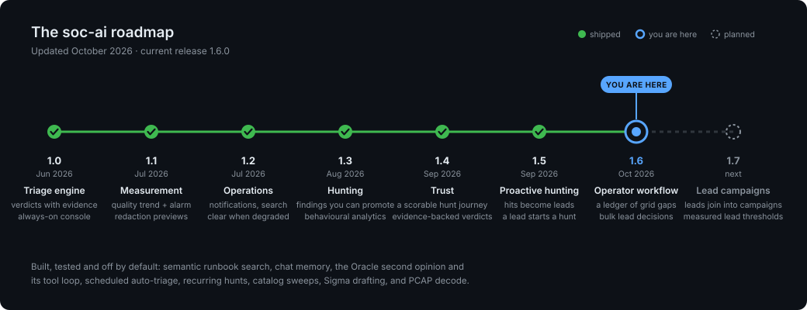

# Roadmap

soc-ai is developed in public, and it releases often. This page says what shipped,
what you can turn on today, and what comes next.

## Release history

**Release 1.0 shipped the core function in June 2026.** An agent reads an
alert on your Security Onion grid. It calls tools to investigate the alert. It
writes a verdict and attaches the evidence.

Each verdict needs evidence, and each write waits for your click. No data
leaves your network. The console shipped in release 1.0, and it runs all the time.

**The 1.0.x releases added tools for daily work.** The Hunt Console took a
plain-English objective and hunted across the whole network. Backtests replayed the agent
against alerts that you had already dispositioned. You could measure trust before
you relied on it. Runbooks gave the agent your team's own procedures to
cite. Grid discovery let the agent learn what data your deployment holds.

**Release 1.1 was the measurement release.** It added a nightly quality eval with
a trend line and a regression alarm. It added redaction previews that you can
inspect span by span. It added a runbooks workspace. If the agent gets worse, a
chart shows it.

**Release 1.2 came from a full analyst shift on a live deployment.** The shift
recorded 14 findings, and the release fixed all 14. The release added
notifications, entity search, a maintenance panel, pipeline-error visibility with a one-click dismiss, group
acknowledge, and a deep re-run. The dashboard can also schedule the quality eval.

**Release 1.2.6 rebuilt the Config page as a master-detail screen.** A section
nav now drives a single-section pane. The old page was a scroll about 36 screens
long.
Settings search works on the page and in the command palette. An Apply bar names
each staged change. The identifier lists support paging, filters and bulk
edit. An About page shows the running version, with an opt-in GitHub update check that sends
nothing by default.

**Release 1.2.7 adapted the pipeline to any model behind the gateway.** It
added a fitness battery and a standalone probe, so you can judge a candidate
backend before production depends on it. The pipeline also records
exactly why a model failed, and it recovers from the most common failure on its
own. Hunts gained a telemetry-first scope. A generic sweep now hunts the
telemetry for beacons, first-seen destinations and odd cadences. The reason is
that triage already owns the alert queue.

The next patch fixed four problems that an operator meets. A paused scheduled
hunt now says that it is paused. Before, it showed a switched-on pill that never
fired. Triage now retries a transient grid error. Before, it dropped the
investigation. The nightly regression alarm no longer pages on one flipped
verdict at a small sample size.
The config console groups the switch for each integration with the key that it
needs.

A later patch refreshed the alert workspace. It added design-token theming and a
filter bar that becomes bulk actions without shifting the table below it. It also
added toast notifications with a one-click clear, and freshness markers for a
stalled poll.
The patch also included fixes from a code review and from in-house use.

**Release 1.2.8 was the degraded-grid release.** It set what soc-ai says when
Security Onion is down, saturated or stalled, or reads only some of its shards.
A partial read now raises an error. Before, it passed for a whole read. A sweep
that could not read the backlog now shows as degraded. Before, it showed as
empty. Every screen that an analyst depends on shows only the
numbers that it obtained. The health pill in the topbar and the audit chain
follow the same rule. soc-ai treats a false all-clear as worse than any visible
error.

**Release 1.2.9 was the first-run release.** It covered the first 30 minutes
after an install. The installer asks how you reach a model. A local endpoint stays the
primary route. A cloud key gets redacted egress by default and a printed
disclosure.

The doctor checks for the setup faults that used to take an afternoon to find.
They are the audit write grant, a narrowed index pattern, and DNS and TLS inside the container. It names
the fix on every failing line. The console opens as an analyst tool. The config
page shows 8 day-1 decisions, and each section hides the rest behind a reveal.
An Operate hub holds the tools that measure trust. A setup-health card says
what is broken.

**Release 1.3 made soc-ai a hunting tool.** An analyst can promote a finding from
a hunt to a full investigation on the finding's own evidence. "This looks odd"
then reaches a verdict with no retyping. Four behavioral analytics sweep the network traffic
itself: beaconing cadence, DNS entropy, DCE-RPC operation histograms, and
first-seen external destinations. soc-ai can also draft a confirmed true
positive into a Sigma rule and export it for you to review and deploy yourself.
soc-ai writes nothing to your detection store.

**Release 1.3.2 was an adversarial security audit of our own work.** It planted
18 attacks against the redaction boundary, the citation grounding and the route
guards. Every finding is fixed or refuted on the record. 2 of the defects it
found were in earlier fixes.

**Release 1.4 was the trust release.** Its subject is whether you can check the
judgement of soc-ai for yourself.

The evaluation could plant an attack and score the verdict on one alert. It
could not score the main work of the product. That work is a plain-English hunt
across your network that produces a finding, promotes it, and reaches a verdict.
The evaluation now scores that full path. If the path fails, the evaluation
names the failed step. Either the hunt found nothing, the finding cited no usable
evidence, or the investigation reached the wrong verdict.

A verdict must now rest on evidence that soc-ai retrieved. The old checks
confirmed that the run had gathered evidence. They did not confirm that the
evidence supported the conclusion. One successful lookup was therefore enough to
let a confidently wrong true positive stand. One such verdict came from text
planted in the network traffic under analysis.

The Oracle second opinion can now check its own claims with read-only tools. It
used to reason from whatever the local run wrote down. That work showed that the
outbound privacy gate was a blocklist. The gate blocked the field names we had
thought of, and a bare internal hostname has no shape that a filter can catch.
The gate is now an allowlist. soc-ai masks any value from a field that the
sanitizer does not recognise. The mask applies before the model can see the
value. No value from an unknown field can therefore cross the boundary.

Release 1.4 holds one more change. The evaluation can run each scenario several
times and report a confidence interval. A test-retest on code that provably could not affect the
outcome moved a headline recall number by 0.235. It also flipped 6 of 25
scenarios between pass and fail. A single batch cannot tell an improvement from
chance. The evaluation no longer claims that it can.

**In release 1.5, soc-ai started to hunt on its own.**

In every earlier release, soc-ai waited for a person. One measurement shows the
reason for the change. On 2026-09-04, the grid that soc-ai is developed against
held about 3.4 million documents from the sensors. Of those, 3,940
carried an alert tag. That is about a tenth of one percent, from 2 datasets out
of about 70.

The grid holds about 19 million more documents that arrived as imports. Most of
them came from one Windows event-log import. The 3.4 million count leaves the
imports out. No sensor saw them.

An analyst who works the alert queue sees only that tenth of one percent. A hunt
that starts from the alert queue has the same limit. A full credential-abuse chain against a real domain
controller produced nothing that anyone could have seen at the time. The rule for
it had been enabled for months. A rule engine reads the stream as it arrives, and
its cursor had already passed those events. A query has no cursor, so it can
read past events at any time.

An analytic can now be a document. The document is a YAML spec that compiles to
a single query and runs with no model call. That makes a spec cheap enough to
leave running. soc-ai ships 18 specs. Seven are query specs. They cover the
credential-abuse techniques that leave evidence and raise no alert, and the
interactions with a decoy host. Nine specs test a host against its own profile or
its peer group. Two specs are learned detectors.

The spec path has three properties. A finding from that path cannot be invented.
No generative step runs on it. The words come from the spec, and a person writes
the spec and reviews it. A condition that soc-ai has already shown you does not
come back. The tenth sweep therefore repeats nothing that an earlier sweep
showed. soc-ai can also tell "nothing happened" from "I could not see". Every
spec declares the telemetry that it depends on. An absent data source therefore
shows as a coverage gap in your findings. A sweep with a coverage gap does not
report an all-clear.

You can watch a spec before you trust it. A shadow mode reports what every spec
would have reported, and it records nothing. It also spends none of the
once-only budget. After a week in shadow mode, each detection still fires on the
day that you switch it on.

soc-ai also reports on itself. Every sweep leaves a record, and a clean sweep
leaves one too. The Operate hub shows the last sweep and the last firing of each
spec. It also shows whether the spec is blind, errored or overdue. The panel
shows "switched on" and "running" as separate facts.

Two weeks of use followed. One deployment ran against its own grid, and the
attack range ran against its exploit chain. Both exercised every read and
write the way an analyst does. Two of the fixes from that use changed the
numbers that you see.

Every prevalence, novelty and baseline figure used to count everything on disk.
On the development grid most of that was imported packet captures. Those figures
now count your own sensors only, and they say so. The catalog rules now also
apply in triage. A detection that the catalog says has no benign population
cannot be closed benign on how often it fires. Two such detections are directory
replication by a non-machine account, and an account without Kerberos
pre-authentication.

A spec can also name alternative telemetry that satisfies one requirement. It can report that a data source is present only as
imported history.

**Release 1.5 then joined the parts into one pipeline.** The word hunt had done
three jobs. It now
names one thing, and four other nouns name the rest. An analytic is one
written detection. A hit is one match of one analytic on one entity. A lead is
the observations on one entity that are worth one decision. A hunt is one run
against one objective. An investigation is one run of the model that ends in a
verdict.

Every source writes into one observations table: a profile departure, a catalog
hit, a triaged alert and a promoted hunt finding. Each observation carries a
weight, and the weight decays with a 48 h half-life. A lead forms at a live
weight of 0.85 across two or more types. A finding with no benign baseline forms
a lead alone, and so does one type that repeats. The lead is the one join in the system.

A new analytic runs in shadow before it counts. Its hits show their evidence:
the matched documents, the baseline, a 30-day dry run and the overlap
with a live analytic. You approve the analytic from its own hit card. Nothing in
shadow starts a hunt.

A lead starts its own hunt. A loop picks up each open lead within 60 s and runs
the hunt that the Hunt button runs. The hunt reads the lead's own documents
before it queries the grid. The hunt then investigates its findings. The subject
of each investigation is the hunt. The subject holds the objective, every finding,
and every document those findings cite, up to 40.

A lead also names the open leads that relate to it over the last 7 days. A
related lead shares an analytic, an alert rule, an external network or an ATT&CK
technique. A coordinated attack across several machines is then visible from any
one of them.

The Hunts page holds that pipeline in order. The Needs you strip at the top
counts the two things that wait on an analyst. They are the unread shadow hits
and the leads that need a decision. Everything else runs without you.

**Release 1.5 also measured its own verdicts.** A turn audit read 41 stored
investigations. The correct verdict was reachable at 2 s and stated at 17 s. The
58 s after that first statement were 79% of the wall time, and no turn in them
changed a verdict. An accuracy test then ran eleven attack-range alerts with a
known answer. Each alert ran three times, and the two hardest ran twice, so each
arm made 31 runs. The investigation loop now writes the verdict
report itself, and that path went from 29 of 31 correct to 31 of 31. The
first-pass synthesis call runs only when it can close the alert. That removes
about 18 s and 8,000 tokens from each affected run.

**Security Onion 3.3 needed a new login.** Security Onion 3.3 stopped accepting
a Kratos API-flow session token. Every write then failed with HTTP 401, and reads
kept working. soc-ai now logs in the way the Security Onion web interface does,
with the browser flow and a session cookie. The `so_login_flow` setting takes
`auto`, `browser` or `api`, and `auto` picks the flow that the grid accepts.

**Release 1.6 is the current release. soc-ai shows the operator each grid gap.**
The sensor of the attack range was down from 2026-10-15 to 2026-10-19. Before
release 1.6, a baseline learned that outage as a count of zero. The Alerts page
said that the grid was quiet.

soc-ai now keeps a ledger of grid gaps. A gap opens when the grid does not
answer for 3 minutes. A gap also opens when most hosts of a plane send no
documents in the same hours. The sweeps do not score the hours of a gap. The
Dashboard, Alerts, Hunts and host pages show each gap in their window. The
operator can mark the hits of a gap benign with one confirm.

Release 1.6 also reduces the steps of daily work. The operator acts on waiting
actions from the Investigations list. One press dismisses, reopens or hunts many
leads. One action rule decides whether a write to Security Onion can run, and
each refusal states its reason. An Alerts group names the other groups on its
network flow.

## Options that ship off

Many parts of soc-ai ship off. Each one is built and tested, and it is off by
default. You decide what runs on your network. The list today holds
semantic runbook search and reranking, chat memory, and the Oracle second opinion
with its tool loop. It holds scheduled auto-triage, recurring hunts, catalog
sweeps and scheduled identifier discovery. It also holds outbound notifications,
PCAP fetch and decode, Sigma rule drafting, web search and online enrichment.

Turn one on when you decide that your network is ready for it. Semantic runbook
search and reranking need an embeddings model on your gateway. Each one is a
config toggle, and the admin page hot-applies most of them.

## Release 1.7

Release 1.7 holds five items. Each item comes from a limit that the 1.5 work
recorded.

- **A campaign object over related leads:** today a lead names the open leads
  that may belong to one attack, and the hunt prompt asks whether they are one
  campaign.
  Nothing joins them into one record with one owner and one verdict. A week of
  in-house use showed related leads that read as one attack. The join is
  therefore the next step.
- **An API key login for Security Onion:** Security Onion 3.3 takes a browser
  session cookie or an API key. soc-ai uses the cookie. An API key needs no
  password on disk, and a login throttle does not affect it. It is therefore the
  better credential for an unattended service.
- **A group key of its own for a hunt-subject investigation:** the record still
  stores the first cited document as `alert_es_id`. soc-ai keeps the run out of
  that alert's group on every surface. A key of its own removes that special
  case.
- **Threshold validation from the quality report:** soc-ai has not yet tested
  the lead threshold of 0.85, the single-type threshold of 1.5 or the hub limit
  of 8 against a miss. The lead quality report exists to measure them. A threshold
  moves only on a week of data.
- **A production trial of the hunting layer:** we built the layer and tested it
  against an attack range over six rounds. It has not run on a production
  deployment for a week.

**After release 1.7: hunts that start themselves.** A hunt must start when a
cluster of activity moves from reconnaissance towards command-and-control. The
next visit to the console is too late. The baselines also need seasonality
beyond the hour of the week. soc-ai must raise an alarm when an analytic
that used to fire stops.

**Further out:**

- multi-tenant deployments with role-based access for MSSPs and multi-team SOCs
- deployment of a drafted detection into Security Onion, if a supported path
  arrives
- specialty copilots on the same audited core, for detection engineering and for
  incident-response playbooks

The plan changes when the evidence gives a reason. This page tracks the current
state. The
[1.5.0 release notes](releases/1.5.0.md) hold the measured numbers and the
upgrade steps. The [1.5.1 release notes](releases/1.5.1.md) list the review
fixes made after 1.5.0. The [1.5.2 release notes](releases/1.5.2.md) describe the two TLS
paths. The [1.5.3 release notes](releases/1.5.3.md) describe the detection ladder. The
[1.6.0 release notes](releases/1.6.0.md) describe the grid gaps and the operator workflow. The [hunting guide](HUNTING.md) covers the pipeline. The
[changelog](project/changelog.md) holds the full version-by-version record.
