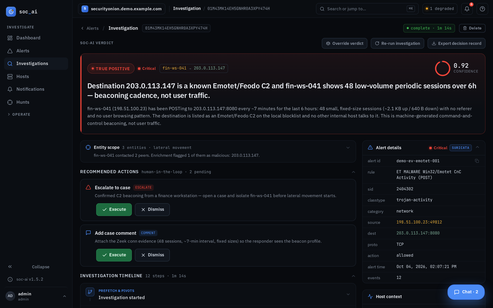
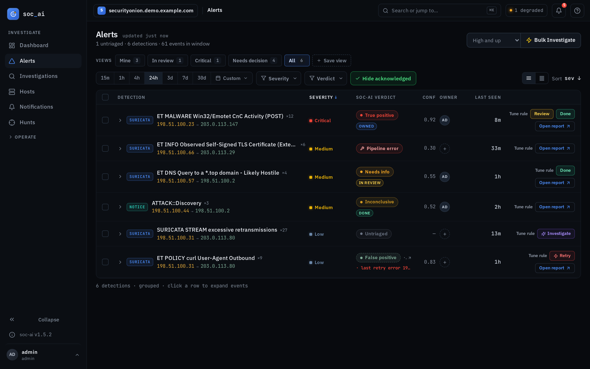
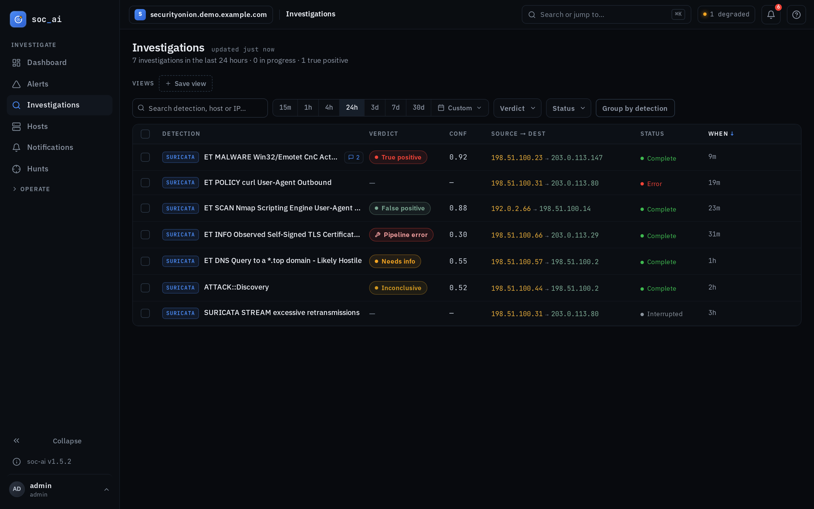
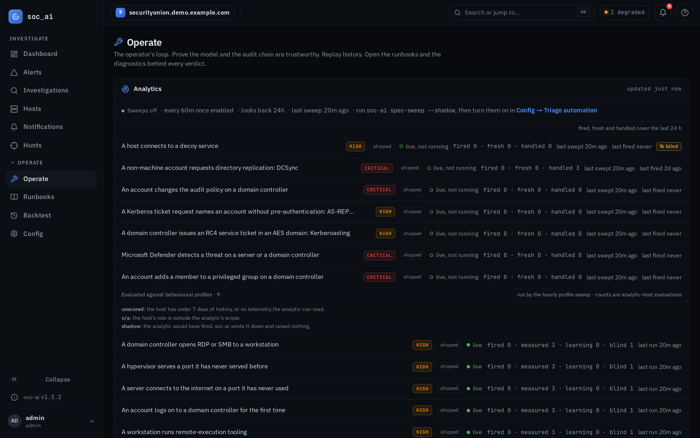
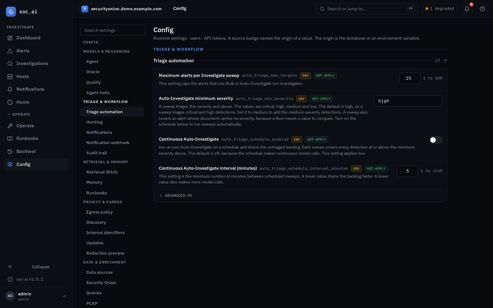

# Console guide

The soc-ai console is a self-hosted triage console for Security Onion alerts. It
runs on the soc-ai host at `https://<host>:8443/app` behind session
authentication. This guide is a reference for the analyst screens and the
operator screens.



> The console is the React app at `/app`. It is the only web surface.
> Bare `/` redirects to it. After sign-in, the console opens the Dashboard.
> soc-ai no longer serves the old server-rendered `/ui` console.

> **First run with a self-signed certificate:** the console serves HTTPS with a
> self-signed certificate. Visit the base URL once and accept the certificate
> warning before you sign in. If you do not, the browser refuses the connection
> with an opaque `TypeError: Failed to fetch`.

## The flow


Work comes in on two paths. Each path ends in a verdict and an action in Security Onion.

- **The alert path:** Security Onion raises an alert. soc-ai triages the alert to a verdict.
  Auto-Investigate starts the triage, or you press **Investigate** on the Alerts screen. The chain
  is Alert, Investigation, Verdict, Action in Security Onion.
- **The sweep path:** a sweep runs every hour. An analytic hit writes an observation. Observations
  on one entity form a lead. A new lead starts its own hunt. The hunt investigates what it finds
  and brings back the verdicts. The chain is Hit, Lead, Hunt, Investigations, Verdicts, Actions.

Needs you is the single queue for your decisions. It holds the leads that wait on a decision, the unread shadow hits,
the alert groups with no verdict, the verdicts that need more info and the recommended actions
that wait for you. You decide on one object at a time: agree, override, acknowledge, escalate,
dismiss or open an investigation. Your actions go to Security Onion. You tune an analytic with
approve, reject and draft.

Two controls start the next step:

- **Hunt this lead:** a hunt is one run against one objective. It returns findings and a
  narrative. The hunt itself writes no verdict and takes no action. soc-ai investigates each
  finding and brings back the verdicts. A hunt is complete only after soc-ai
  investigates its findings.
- **Open an investigation:** an investigation ends in a verdict, recommended actions and an audit
  record. Its actions go to Security Onion. The hunt page offers this control on a finding with no
  investigation.

The alert drawer, the investigation page, the lead page and the hunt page each show a flow strip
under the header. The strip names each step and its state: done, current, next or
not yet. A done step links to its object. The next step names the control that moves the flow.
The Dashboard and the Hunts page link to the chart, **How this flows**.

## Sign in

`/app/login` takes a username and a password. There are two roles:

- **analyst**: the full triage console, with alerts, hunts and investigations.
- **admin**: everything an analyst can do, and the Settings page at `/app/config`.

soc-ai creates the first admin, `admin`, at the first start. It writes the
generated password once to a locked-down sidecar file,
`<soc_ai_data_dir>/bootstrap-admin-password.txt`, with mode `0600`. It does not
write the password to the service log. The people who can read that log often
must not know the password. Read the file for your deploy path:

```bash
# Docker deploy (default data dir /var/lib/soc-ai/data)
docker exec soc-ai cat /var/lib/soc-ai/data/bootstrap-admin-password.txt
# systemd / host-venv deploy
cat "$SOC_AI_DATA_DIR/bootstrap-admin-password.txt"
```

soc-ai logs the plaintext password only if the data directory was not writable
at startup. Read it then with `journalctl -u soc-ai | grep -i password` or with
`docker compose logs soc-ai | grep -i password`. On the normal path the log holds
a pointer line and no password.

Change the password after the first login. Select your name or your initials at the
bottom of the sidebar to open the account menu. Select **Change password**. Enter the current
password, the new password and the new password again. Then select **Change password**
in the dialog. The console keeps your session and ends your other sessions. soc-ai refuses a new password that is the same as the current one.

When the `admin` password changes, soc-ai deletes the sidecar file. If the log says
that soc-ai could not delete it, delete the file by hand. The volume must not keep
the password.

Until you change it, three places warn that the generated password is in use.
A banner under the top bar shows on every page: "This account still uses the
generated password. Change it now." Its **Change password** button opens the
dialog, and the banner hides after the change. **Remind me later** hides the
banner until the browser session ends. Settings > Users shows a banner with a
**Change password** button. The doctor row `admin password` is WARN. The
generated password can also come from `BOOTSTRAP_ADMIN_PASSWORD` in `.env`,
which `setup.sh` writes. The warning covers that value too.

After 5 failed sign-ins for one username from one address, soc-ai locks that
username for 5 minutes. The form warns when 2 tries or fewer remain. After 20
failed sign-ins from one address, soc-ai locks that address for 15 minutes.

The sign-in page names the transport of the page: HTTPS, or HTTP with "The
connection is not encrypted." With authentication off, the page says
"Sign-in is off" and offers **Open the console**. Every visitor has admin access
then. Sign in with an account to create an API token or to manage users.

### Recovery of a locked-out admin

If no admin can sign in, set a new password from the host. The command needs
access to the store, so run it where soc-ai runs:

```bash
# Docker deploy
docker compose exec soc-ai soc-ai users reset-password admin
# systemd / host-venv deploy
uv run soc-ai users reset-password admin
```

The command prints a new random password once. It ends every session of the
account. It revokes every API token that the account created. It also deletes
the bootstrap sidecar file of `admin`. Sign in with the new password. Then
change it in the account menu. `soc-ai users list` prints each account with
its role and state.

## Navigation

The sidebar has two groups. Analyst holds Dashboard, Alerts, Investigations,
Hosts and Hunts. It stays open, because an analyst spends most of a shift on those screens.
Operator holds Status, Runbooks, Backtest and Settings. It starts collapsed,
because you reach those screens once a shift or once a week.

Click the Operator heading to expand the group, or go straight to one of its
screens. Operator expands itself when the current page is in that group. Thus a
closed group never hides the current page.

The bell in the top bar holds the notifications. Its "View all notifications"
link opens the Notifications page at `/app/notifications`. The sidebar has no
entry for that page.

The bell badge states the Needs-you count. The "Needs you" block lists each part of
that count, with its scope and a link to its list. The block is at the top of
the bell panel and of the Notifications page. The parts add up to the badge. The
events follow the block. "Show more" loads 20 more events.

"Dismiss all" hides every event up to the moment the list loaded. It also
marks every unread shadow hit up to that moment as read, and the audit trail
records it. Leads, alert groups with no verdict, verdicts that need more info and
recommended actions are decisions. Dismiss all does not touch them.

The Alerts, Investigations and Hunts entries carry a badge for the work that
waits on you there. The badges are parts of the Needs-you count. The
Needs-you tile on the Dashboard and the bell state the same total.

The help button in the top bar opens this guide in a new tab. The command
palette holds the keyboard shortcuts. Press ⌘K and type "shortcuts".

The Ask soc-ai button at the right end of the top bar opens the chat. See
[Ask soc-ai](#ask-soc-ai).

The top bar shows the workspace switcher only when more than one workspace
exists. On a lead page, the breadcrumb reads "Hunts / Lead 18", and the Hunts
entry stays highlighted.

## Ask soc-ai

Ask soc-ai is the chat of the console. It answers in one turn with the read
tools of an investigation. A turn takes as long as one investigation turn.

### Open and close

- The **Ask soc-ai** button is at the right end of the top bar on every page.
- The label names the object of the page: "Ask soc-ai about this
  investigation", "about this host", "about this lead" or "about this hunt".
  A page with no object reads "Ask soc-ai".
- Press `c` to open the panel from any page. The key does nothing while you
  type in a field. The shortcut sheet lists it.
- The panel slides in from the right, over the page. It has the same width and
  the same header on every page.
- The focus moves into the question box when the panel opens.
- Press Esc or the close button to close the panel. The focus goes back to the
  control that opened it.
- The page under the panel stays live. You can scroll it and use its controls.
- The report drawer on the Alerts page covers the top bar. The top row of the
  report holds the same button. Esc closes the panel first and the drawer second.

### Scopes

The scope is the subject of a thread. The line under the panel header names
the scope and the object.

| Scope | Page | Thread |
|-------|------|--------|
| This investigation | An investigation page, or the report drawer on Alerts | One thread for each investigation. All analysts share it. |
| This host | A host page | One thread for each host. All analysts share it. |
| This lead | A lead page | One thread for each lead. All analysts share it. |
| This hunt | A hunt page, after the hunt ends | One thread for each hunt. All analysts share it. |
| General | Every page | One thread for each analyst. Two analysts do not see each other's questions. |

- **Switch to general** on the scope line opens your general thread.
- **Back to this host** returns to the thread of the page. The words name the
  object of the page.
- The panel scope follows the page. When you open another host, the panel shows
  the thread of that host.
- soc-ai stores each thread on the server. A reload, a restart and a second tab
  show the same thread.
- The browser tab keeps an unsent question for each scope. The question stays in
  the box when you close the panel, switch the scope or reload the page.
- **Clear conversation** discards the thread of the general scope, a host or a
  lead. A thread about an investigation or a hunt stays.

### Starter questions

An empty thread shows three starter questions. A click on a starter sends it.
While a turn runs, the click puts the question in the box.

The Dashboard holds an **Ask soc-ai** card with the three general starters. A
click on a starter opens the panel on the general scope and sends the question.
**Open** opens the panel with no question. The card keeps the `assistant` slot
of a saved Dashboard layout.

### Proposals

- **A verdict:** on an investigation, the chat can propose a verdict. The
  answer then shows **Apply verdict**. The control appears only if evidence
  backs the proposal. A proposal of the current verdict reads "This is the
  current verdict."
- **An escalation:** a proposed true positive also shows **Escalate to case**.
  The control opens the escalate confirm on the page. It writes nothing itself.
- **A hunt:** on the general scope, a host or a lead, a question can need a
  search across many hosts or a long window. The answer then shows a Start hunt
  card. The card holds an objective that the agent wrote. It also states the
  question that the hunt answers. Press **Start hunt** to run that objective and open the
  running hunt.
- **The hunt scope:** it answers from the report of the hunt. It proposes nothing,
  and it cannot change the result.

### Limits

The chat has read tools only. It runs no write action. It never acknowledges or
escalates an alert. Apply verdict, Escalate to case and Start hunt are controls
that you press.

### General chat switch

Open Settings → Models & Reasoning → Agent → *General chat*. The setting turns
the general scope off. It takes effect with no restart. The console reads it
when a page loads.

With the switch off, a page with no object shows no Ask soc-ai button. The
Dashboard hides its card, and the panel offers no switch to general. The scopes
of an investigation, a host, a lead and a hunt stay on.

    Turn it off if the triage backlog already saturates a shared analyst model.
    The general scope is open on every page. It is the easiest place in the
    console to spend inference capacity by accident. Nothing runs while nobody
    types. The stored threads survive the change.

## Dashboard

The Dashboard is at `/app/dashboard`. Its title reads "Dashboard". The console opens it after sign-in. The
Dashboard shows the current activity of the grid and what soc-ai concluded about it. The Ask soc-ai card opens the
chat on either one.

### Needs you

The first tile states the work that waits on you. It has one line for each
part, and each line opens the list that holds that work:

- the leads that wait on a decision,
- the unread shadow hits,
- the alert groups with no verdict in the last 7 days,
- the verdicts that need more info in the last 30 days,
- the recommended actions that wait for you on the true positives of the
  last 30 days.

The sidebar badges and the bell state the same total. A part that soc-ai cannot
read shows its own line with the reason, and the total then reads "11+". The
tile says "Nothing needs you" only when it read every part and each part is
zero.

The recommended actions line opens the Investigations list with the filter
**Action waits for you**. Each row shows its waiting actions: the alert or the
case, and the reason of the model. Each action has two buttons on the row. The
first button names the write, as on the action card: **Escalate to case**,
**Acknowledge** or **Add comment**. The second button is **Dismiss**. You do not
need to open the investigation. The write button asks first and states what
soc-ai writes to Security Onion. **Dismiss** asks first, and a toast offers
**Undo**. The row then leaves the list, and the counts change.

To dismiss the actions of many rows, select the rows with their checkboxes.
Then press **Dismiss actions** in the selection bar. One confirm covers the
press. The result line names each row and offers **Undo** for the whole press.
A row that failed stays selected.

An action counts only when soc-ai can execute it. One rule decides for the
action card, the list row, the count and the write to Security Onion. The
count, the badges, the bell and the list leave out an action in these cases:

- The run is a backtest replay, or a newer run replaced it.
- The run is a promoted finding or a promoted lead.
- A promoted finding or lead uses the document of the run as its anchor, and the
  document is not a Security Onion alert.
- A promoted finding or lead uses the document of the run as its anchor, and the
  grid did not say whether the document is an alert.
- An analyst verdict on the alert disagrees with the verdict of the run.
- The action is an ack, and an analyst set the alert to a verdict other than
  false positive.
- The action is a comment, and the run opened no case.

The action card of the investigation keeps such an action. The card turns the
write off and states the reason. **Dismiss** stays on. Override the verdict of
the run, and the actions follow the new verdict.

An anchor is often a Zeek or host-log record with no alert behind it. soc-ai
asks the grid whether the alert feed holds the anchor document. The question
uses the alert filter of the Alerts page and has no time window. A Security
Onion alert that a promotion uses as its anchor keeps its actions. For a
document outside the feed, the card reads "A promoted lead uses this document
as its anchor. The document is not a Security Onion alert." When the grid does
not answer, the card reads "soc-ai could not read the anchor document. Try
again when the grid answers." The run of a promoted finding or lead writes
nothing to Security Onion in every case.

An escalate card names each Security Onion case that the alert is already on,
with a link to the case. A press then opens no second case. soc-ai records the
action as done.

Under the tile one sentence states the flow: "soc-ai investigates alerts and runs hunts. You
make each decision in Needs you. soc-ai sends your actions to Security Onion." The **How this
flows** link after it opens the chart on the Hunts page.

The true positives tile counts the investigations with a true positive verdict
in the Dashboard window. The Investigations list counts the same runs with the
same query. "Open them" opens that list.

When the grid answers the health probe late, an amber banner reads
"The grid is slow. Counts can be late." Each tile that reads the grid then
says "May be incomplete." A red banner means that the probe got no answer.

### Setup health

In the shipped layout, a persistent card is at the top of the side column on
the Dashboard.
Persistent means that the card never hides itself. The panels below it hide when
they have nothing to review.

A clean card is one compact line, "All checks passing," with the time since that
check. On a degraded card an admin sees each failing or warned check by name,
with its detail and a hint if one exists. The card also carries a Re-check
button. Re-check forces a fresh check past the 10 minute cache. Use it after you
fix a problem. A re-check that fails reads "The re-check failed. Try again." It
leaves the last known-good rows on screen. An analyst sees a count and a pointer
to Settings → Diagnostics. An analyst never sees the row names.

The card reads the same checks as the doctor, without the model fitness probe.
That probe can take a few minutes, and a dashboard poll cannot wait that long.
Fitness stays on the model battery in Settings.

### Outcome and severity tiles

The address of the page holds the window that you picked. Back and a shared link
open the same window.

The verdict tiles count alert groups over the range that you picked. Each group
counts under the worst verdict among its runs inside that range. A group with no
run in the range counts under its older verdict. That verdict is inherited, and
the panel states how many groups carry one.

Each tile opens `/app/alerts` with the same verdict filter. That link carries
your range and un-hides acknowledged groups, so the destination holds what the
tile counted.

The severity bars open the same list, filtered to that severity.

### Verdict quality

This card holds the trend from the nightly micro-eval. See
[DOCKER.md](DOCKER.md#nightly-quality-micro-eval-schedule)
for how to schedule it. The badge names the instrument that measured each point.
An oracle-graded point carries an agreement rate. A locally measured point
carries fallback and error rates. soc-ai never blends the two on one line.

Under the run count, one line dates the newest point and the last attempt. If a
run wrote nothing, the line carries the reason from that run. The usual reason is
a grid with no eligible alerts. With the in-app nightly on, a point older than 2
scheduled runs gets an amber "no point in Nd" marker. Thus the card cannot show
last month's point as last night's point. The server process keeps the time of the last
attempt in memory. A restart clears it.

Under the headline rate, the card shows the grade composition, "3 agree · 2 partial". A
partial critique reads "right verdict, thin reasoning". It lowers the rate as much
as a full disagreement. A rate of 60% alone does not show which of the two caused the
misses. A partial critique tells you to improve a prompt. A disagreement tells you to
look for a regression.

If a point raises an alarm, the card prints the path to the eval bundle of that run. That
directory holds the oracle critiques. The critiques are the only evidence for or
against the alarm. The card prints a file path on the soc-ai host. Read the
file with `docker exec soc-ai cat <path>/report.md`.

### Dashboard layout

The Dashboard places its panels in a layout of 12 columns. You can move and resize
each panel. The shipped layout puts each panel in the place and the width it had
before the column layout.

To change the layout:

1. Click **Edit layout**. Each panel shows a dashed outline, a handle on its
   top edge and a corner mark at its bottom right.
2. Drag a panel by its handle. The other panels move to make room.
3. Drag the bottom right corner to change the width or the height of a panel.
4. Click **Done** to stop. The console saves each change at once.

Outside edit mode, a drag does nothing. Edit mode is available in a window of
1024 pixels or wider. A narrower window stacks the panels in reading order and
says "Widen the window to move or resize panels."

A panel is never shorter than its content. A layout therefore cannot clip a
failing check or a warning. You can make a panel taller than its content.

To use the keyboard, move the focus to a handle. The arrow keys move the panel.
Shift and an arrow key change its width or its height. A screen reader
announces each step.

**Reset layout** puts every panel back in its shipped place and size.

soc-ai keeps one layout for each user account. You see the same layout on
another workstation. The routes are `GET`, `PUT` and `DELETE` on
`/api/v1/me/dashboard-layout`. With authentication off, no user account owns a
layout. The browser then keeps the layout in local storage under the key
`soc-ai.dashboard.layout`. Another browser shows the shipped layout. The help
line in edit mode states where the console keeps your layout.

A release can remove a panel. A saved layout then loses the slot of that
panel. A panel that a release adds appears at the bottom of its column.

## Triage console



The triage console is at `/app/alerts`. The main pane holds alert groups in the
Security Onion style. soc-ai groups them
by rule and shows the newest first.

- **Filter and sort:** the controls are the time range, the severity, the sort
  order, and a free-text OQL box.
- **Expand a group:** click a group row to load its recent events.
- **Investigate:** start an investigation for an alert or a group. An
  investigation runs as a background task. It continues when you close the drawer. It runs
  beside other investigations, and soc-ai records every run. The drawer shows live progress: the phase, the
  elapsed time, the tools called and the enrichments.
- **Verdict badges:** each group and each alert shows an investigation verdict:
  true_positive, false_positive, needs_more_info, running or error. A group
  shows the worst verdict among its runs inside the time range, with the count
  of each verdict. A group with no run in the range shows its older verdict as
  a dashed "inherited" badge with the age of that verdict. An alert shows the
  verdict of its latest run. A dashed alert badge means the verdict came from a
  similar alert. A similar alert has the same rule and the same src/dst pair,
  inside the inherit window.
- **Permalinks:** every investigation has a URL that you can share,
  `/app/investigation/{id}`. soc-ai creates the URL while the investigation
  still runs.
- **⚡ Bulk Investigate:** investigate every alert in the current view
  that nothing covers yet. Use the severity checkboxes to choose the severities it acts on.
  The default is critical and high. `auto_triage_max_targets` caps a single
  run at 25 targets, so one click cannot start dozens of investigations. The
  next run takes the remaining uncovered alerts. The status chip shows the hunted, total and
  skipped counts with the chosen severities.

## Investigations



The Investigations screen is at `/app/investigations`. It lists every past investigation and every running one, with a
permalink on each. A row carries the verdict, the rule, the time and the person
who started it. Use the list to review history and to find an earlier verdict.

**Stale-run reaping:** soc-ai cleans up an investigation that a crash, a restart
or a network drop left in `running`. At startup it marks every orphaned `running`
row as `error`, because the worker for that row died with the previous process. A
periodic check then marks any run that stays `running` past
`investigation_reaper_minutes` the same way. That setting defaults to 30. You do not
need to clear an orphan by hand.

**Analyst verdicts:** a verdict that an analyst sets stays on the alert. A newer
run of the alert does not remove it. The page of each run of the alert names the
analyst verdict and links its run. An Alerts row names it beside the verdict
badge. **Re-run** and **Request more info** start a new run, and the new run can
reach another verdict. Each asks first when an analyst verdict stands on the
alert. The bulk **Re-investigate** of this list skips such an alert and names the
reason. soc-ai does not acknowledge an alert that an analyst set to true positive.
A recommended action that disagrees with the analyst verdict has its write button
off on the action card. The card states the reason. The action does not count as
waiting.

**Backtest replays:** the list hides the investigations that a backtest ran. The
header figures do not count them. The header line names how many replays it left
out. Turn on **Show backtest replays** to add them to the list and to the figures.
A grey **Backtest replay** chip marks each replay. The Dashboard counts never
include a replay. The [Backtest](#backtest) section gives the reason.

## Hunts

The Hunts screen is at `/app/hunts`. It holds the hunting pipeline in order, top to bottom: the Needs you
strip, Analytic hits, Leads, Hunts and the New hunt drawer. A second tab,
Analytics, holds the analytic catalog and the Lead quality block.

The Needs-you strip counts the two things that wait on you: the unread shadow
hits, and the leads that need a decision. Each link jumps to the block that holds
them, with the filter set. The sidebar badge on the Hunts item shows the same
count.

A lead settles when its hunt finishes. A hunt that found no threat closes the
lead. The lead then shows under Closed as "Closed. The hunt found no threat." with
the chip "closed by soc-ai". A hunt closes the lead only when it read its
evidence. A lead stays under Needs decision if its hunt could not read all
evidence, or if an earlier hunt found a threat. The lead page states the reason. A
hunt that found a threat or a visibility gap leaves the lead under Needs decision. If its hunt could not run on two attempts, the lead stays there as
"Hunted · Could not run", with Hunt again.

[docs/HUNTING.md](HUNTING.md) is the full guide. It covers the five nouns, the
path from a hit to a lead and from a lead to a hunt, and the shadow week. It also
covers the settings, the command line and the API routes.

## Hosts

The Hosts screen is at `/app/hosts`. It holds what soc-ai concluded about each
machine on your network, and what you declared about it. It has two parts: the
list and the host page.


**The list** at `/app/hosts` gives one row per machine. A machine is the set of
addresses that soc-ai holds to be one device: the addresses an agent reports, the
container bridge that agent owns, a DHCP lease by MAC, or a name that only one
machine carries. A row holds the host name and its source, the primary address
with the count of the other addresses, the agent, the role, the event count, the
first-seen time and the last-seen time.

Every column header sorts both ways. The Role, Agent, Activity and First seen
headers hold filters. One search box matches a name from any source, an address
with an exact match first and a prefix match next, a MAC, the OS, the role and
the agent name. The search reads every machine, with or without the activity
filter. The URL holds the search, the sort, the filters and the page, so Back
and a reload keep them. Click a row to open the machine.

Six cards for the whole network are above the table, with a role bar under them.
Each card is a link to the list filter it counts: Machines, With an agent,
Without an agent, New in 7 days, Needs attention and Conflicts. The filters never
change the cards.

Under the cards, a line gives the age of the numbers, for example "Last swept 4h ago". A
note appears while automatic sweeps are off. It gives the time of the state that the
list shows. A row whose agent last reported more than a day before
carries a stale mark. A count that soc-ai could not read shows a dash. It never
shows a zero.


**The host page** at `/app/hosts/<machine>` holds these parts, top to bottom. An
old link by address still opens the machine page with that address in focus.

- **The banner** names the machine. It uses the hostname if any source knows one,
  and the address if none does. It also carries the role, the source of that
  role, the OS, the criticality, and whether the machine reports on itself. "no
  agent data" means that the network supplied every field below. The host itself
  reported nothing to soc-ai.
- **Four counters** cover the services the host answers on, the accounts that
  authenticated, the connection volume, and the alerts over 7 days. An
  `all alerts · 7d` link is under the alert count. The alerts console filters
  by time, severity and verdict, and never by host. The link therefore opens on
  the detections of the whole network over those days, with this host's
  detections among them.
- **Peers, volume and users** over the window that you pick, 24h or 7d.
- **12 field cards**, one for each dossier field.
- **The behavioural profile**, one row for each dimension of the host's baseline.
  Each row carries a coverage chip: measured, learning, blind, behind proxy or
  unmeasurable. A blind row reads "cannot be measured:" and the reason. On a
  host with an agent, the reason names the missing plane and the planes that the
  host ships. An example is "this host ships no endpoint process events. It ships
  host logs and osquery." The console reads the planes from the grid. When the
  grid cannot answer, the reason names host logs only. An unmeasurable row reads
  "not measured:" and the reason the grid gave when it refused the query.

An internal address opens here from anywhere in the console. Alert rows, the peer
graph and old `/entity/<ip>` links all redirect to it. An external address still
opens the Entity screen, because the sweep builds hosts inside your
`internal_cidrs` only.

### The two lanes

Every field holds up to 2 answers, and one answer never overwrites the other:

- **inferred** is what the sweep concluded. It carries a provenance rung that
  names the type of signal, a confidence, and the evidence under **Why?**.
- **operator** is what you declared. soc-ai stores it in its own columns, so no
  rebuild can overwrite it.

soc-ai stores no "current value". The page resolves each field as it reads it. It
takes the operator lane first. It then takes the inferred value if that value
clears the confidence floor `dossier_min_confidence` and a re-confirmation falls
inside the freshness window `dossier_staleness_hours`. A field that resolves to
nothing names the test that it failed. The reason is that "no signal yet" and
"observed but too weak to assert" are different answers.

### Declarations

On any field card:

- **Declare a value** writes your value and an optional note. The card records
  your name and shows the value back. The button reads Edit declaration once a
  declaration exists. Three fields hold structured values and take JSON:
  services offered, activity profile and management plane.
- **Hand back to the builder** deletes your override. The answer from the
  sweep then applies again.
- If the sweep disagrees with a value that you declared, the card says so and
  names the type of disagreement. There are three types: the evidence points
  elsewhere, the evidence for your value is gone, or the address appears to have
  rebound to a different machine. A rebound needs a hostname or a MAC that changes
  to a different value. A value that appears for the first time is not a rebound. Only an address with a
  declaration shows a rebound. Then you have two choices:
  - **Accept inference** drops your override and takes the answer from the sweep.
    Confirm it with Discard my value.
  - **Keep mine** keeps your value and pauses the question for a period. The
    period doubles each time you press it, up to 90 days.

An analyst sees all of this as read-only. Only an admin can declare a value,
accept one, keep one, or run a sweep.

soc-ai shows a disagreement only if it repeats. soc-ai prompts you after 3
consecutive builds disagree. `dossier_conflict_min_observations` sets that count.
It prompts at most once per field per 14 days.
`dossier_conflict_prompt_interval_hours` sets that interval. One build that
agrees resets the count.

### Dossier sweep

The scheduled sweep is off by default. `dossier_schedule_enabled` controls it. A
sweep covers hundreds of hosts and runs several Elasticsearch queries for each
one. You decide when it runs. The Hosts screen stays empty until the sweep runs
once. An empty screen means that the sweep has not run yet. The behavioural baseline does not wait on this
schedule. The profile sweep rebuilds it when it is older than the dossier refresh
interval, and a scheduled dossier refresh rebuilds it too.

- **Rebuild now** on the Hosts screen runs a sweep in the background and reports
  what it built. Only an admin sees the button.
- Settings → Host dossier turns on the schedule and sets its interval. Every
  setting there applies with no restart. The next sweep reads it.

### Host identity

A machine is a set of addresses that soc-ai holds to be one device. The sweep
builds the machines at the end of each run. The per-address dossier stays under the machine. It
holds the facts that an alert joins on.

The sweep applies five rules in this order. A rule never moves an address that
a stronger rule placed.

1. **Agent:** one agent is one machine. Its addresses are the internal values
   of `host.ip` that it reports. Link-local addresses do not count. An address
   that two agents report belongs to neither agent. Docker's `172.17.0.1` is an
   example.
2. **Bridge and container:** an agent that reports a bridge gateway owns the /24
   of that gateway. A gateway is an IPv4 address that ends in `.1`. An address
   in that /24 that the endpoint sensor of the agent sees is a container on the
   machine. Other datasets can also see the address. The address stays a
   machine when another agent claims it or a DHCP lease names it. A container
   is not a row in the list. The machine page lists it.
3. **DHCP lease:** an address that a lease gave to one MAC belongs to the
   machine of that MAC. An agent owns a MAC when it reports the MAC and reports
   8 MACs or fewer. A container host reports one MAC for each container, and a
   host with hundreds of MACs owns none. A MAC that no agent owns is a machine
   of its own. If two MACs held one address in the window, the newer lease wins.
4. **Unique name:** a network-only address joins an agent machine when its
   strong DNS name has the short name of that machine. A short name that two
   machines share joins neither machine.
5. **Single address:** an address that no rule placed is a machine of its own.

| Item | Rule |
|---|---|
| Machine key | `agent:<agent id>`, else `mac:<mac>`, else `ip:<address>`. The key stays the same across sweeps. |
| Merge | An agent that appears on a machine soc-ai knew by MAC or by address takes that machine. The machine page lists the older key. |
| Primary address | The agent address with the most events, else the newest lease, else the only address. |
| Name | A declaration, else the agent `host.name`, else the newest lease hostname, else the strong DNS name of the primary address. The machine keeps every name with its source. |
| Events | The sum over the addresses of the machine. An address that only its agent reports counts the agent's own documents for that address. |
| Last seen | The newest event on any address of the machine. |

An agent's own name and a DHCP lease hostname are the names that the machine gives
itself. The sweep keeps them when they are a public top-level domain, such as "nexus".
The sweep still drops a bare DNS name that is a top-level domain.

The sweep reads DHCP leases in two shapes. Security Onion 3.x writes
`client.address`, `dhcp.assigned_ip`, `host.hostname` and `host.mac`. Older
grids write `source.ip`, `dhcp.hostname` and `dhcp.client.mac`.

An address that no census has found for `dossier_stale_address_days` leaves the
dossier table. The default is 30 days. An address with an operator declaration
stays. The machine keeps the address in its history. A sweep whose census
failed removes nothing.

If the census, the agent pass or the DHCP lease pass fails, the sweep keeps the
machines that it has. The run records the error. A machine therefore never
changes its key because one pass could not read the grid.

The observations, the profile and the entity page of a host read every address
and every name of its machine. A first label of a name joins only when no other
machine has that label. A value that names no machine reads itself only.

The machine endpoints:

| Route | Answer |
|---|---|
| `GET /api/v1/hosts` | One row per machine, searched, filtered, sorted and paged. |
| `GET /api/v1/hosts/summary?activity=` | The cards and the counts in the column menus. Each count equals the list total of one filter with the same `activity`. The default is `all`, and the cards use it. The column menus send the activity of the list. |
| `GET /api/v1/hosts/resolve?value=` | The machine key of an address, a name, a MAC or an agent id. 404 when no machine holds it. |
| `GET /api/v1/hosts/{key}` | One machine: each address with its type, the containers, the MACs, the merged keys and the dossier of the primary address. |

The list takes these parameters. An unknown value is a 422 that names the legal
values.

| Parameter | Values |
|---|---|
| `q` | Search. It matches each name from any source, each address, each MAC, the OS, the role and the agent name. Case does not matter. An address matches exactly or by prefix. A name or an address equal to the query ranks first. A name or an address that starts with the query ranks second. Other matches rank last. The `sort` orders the rows inside one rank. Search ignores `activity`. |
| `sort`, `dir` | `name`, `address`, `role`, `agent`, `events`, `first_seen`, `last_seen`, with `asc` or `desc`. The address sort is numeric. Empty values sort last in both directions. |
| `role` | A role, `unknown`, `low_confidence` or `stale`. |
| `agent`, `declared`, `named`, `conflict` | `yes` or `no`. |
| `activity` | `active`, the default, keeps the machines with events. `all` keeps every machine. |
| `seen` | `new` keeps the machines first seen in the last 7 days. |
| `health` | `broken` keeps the machines whose primary address has no clean build. `attention` adds the machines whose build is older than the staleness window. |

## Status



The Status page is at `/app/operate`. The sidebar names it Status. It shows the
state of the automatic work. Four live panels come first. Six cards follow. Each
card names one thing that soc-ai can prove, and links to the screen where you
prove it. The cards carry no live status of their own.

**Dependencies** shows Security Onion, Elasticsearch and the model gateway. Each
row says up, slow, down or unknown, with the reason. It links to Settings >
Connections. A row that soc-ai could not read says unknown. It never says up.

**Scheduled jobs** shows each job that runs with no operator. The jobs are
continuous Auto-Investigate, the dossier sweep, the discovery scan, the audit
chain check, the nightly quality eval and the backup. Each row shows the state,
the last run, the last result and a link to its setting. The audit chain row
tells a clean check from a check that could not read the audit index. soc-ai
keeps some of these times in memory, so a restart clears them.

**Escalations awaiting an answer** lists each escalation claim that has no answer
from Security Onion yet. Each row links to its alert.

Select **Check Security Onion now** on a row to compare that claim with Security
Onion. soc-ai reads the case links and the alert, and writes nothing to Security
Onion. When a case holds the alert, soc-ai settles the claim with that case. When
Security Onion shows no case for the alert, soc-ai releases the claim. The alert
can then be escalated again. The claim stays open in three cases:

- The claim is less than 15 minutes old. Its escalation can still be in flight.
- Security Onion marks the alert escalated and shows no case link.
- Security Onion does not answer, or answers in part.

The panel states the result in one sentence. One check runs at a time. The audit
trail records each settled claim as `escalation_claim_settled`.

The Analytics panel shows the analytic sweep. The scheduler runs the analytic
catalog as a sweep with no model call. If no analytic fires, the
sweep leaves no trace anywhere else in the console. Use this panel to confirm that
the sweep runs.

The status line says whether the sweeps are on, how often they run, how far back
they look, and when the last one ran. With the sweeps off, the line still shows
the other three. A `soc-ai spec-sweep` run by hand leaves the same record with the
same look-back. The interval then reads "once enabled", because that is the
schedule the flag would start. The line also says how to turn the sweeps on.

A legend above the rows says that the counts cover the last 24 hours. Each analytic
then gets a row. The row holds the level of the analytic and the number of times it
fired in that window. It also holds how many of those hits were fresh or already
handled.
It also holds the last sweep time, the last firing time, and 3 markers.

**shadow** is amber and carries a count. It means some sweeps in the window were
`spec-sweep --shadow` runs. A shadow sweep counts what it would have reported as
fresh. It never counts it as fired. On a marked row, "fired 0, fresh 2" comes from the
shadow sweeps. The analytic holds back no hit. A condition that a shadow sweep saw
is fresh again to the live sweep that follows. The fresh count is therefore per
sweep.

**blind** is amber. It means that the precondition of the analytic matched nothing on the
last sweep. The telemetry that the analytic reads is absent. An absent telemetry
plane does not mean a clean grid.

**error** is red. It means that the sweep itself failed on that analytic. Hover over the
marker for the reason.

The row of a profile analytic also carries a coverage cell. The cell gives how
many entities the last sweep measured against a learned baseline and how many it
read blind. It also gives the age of the baseline, as in "baseline 3 h old". The cell adds
"stale" if a rebuild was due and did not happen. It reads "baseline unmeasurable:" and the
reason the grid gave when the grid refused the query that builds a dimension.

An analytic that no sweep has reached yet reads "not yet swept". A row of zeros means
"swept, saw nothing". The panel refreshes itself every 5 minutes.

- **Model fitness** proves that the model is fit before triage depends on it.
  It links to Settings → Agent.
- **Verdict quality** proves that the verdicts held up. It carries the nightly
  micro-eval trend and links to Settings → Quality.
- **Audit chain** proves the tamper-evident record is intact. It links to
  Settings → Diagnostics, and that screen carries a Verify audit chain button.
  Press it. It reports one of 5 outcomes:
  - intact. A green check. soc-ai verified the records.
  - partial verification. Amber. The scan stopped at the start of the chain and
    did not cover the whole chain.
  - intact within N epochs. Amber. Every restart has its own verified trail, but
    soc-ai cannot link one restart boundary to another. This outcome does not
    claim one unbroken chain. Read the paragraph below.
  - tampered. Red. The message names the sequence number and the restart it broke
    in.
  - couldn't verify. Amber. The console could not read the chain at all.

  Only a full, single-epoch, uncapped scan gets the green check.

  A chain that spans more than one epoch is not proof of a problem. A process
  restart cannot link back to the records before it. This is expected behaviour. A
  bug that is now fixed once turned restarts into 134 epochs. The Diagnostics panel
  holds the details. The console names that state. It reports no tamper at a boundary.
- **Backtest** replays history against the current pipeline. It links to
  Backtest.
- **Diagnostics** is the doctor's view from inside the app. It links to
  Settings → Diagnostics.
- **Runbooks** holds the procedures that ground every verdict. It links to
  Runbooks.

## Backtest

The Backtest screen is at `/app/backtest`. It replays the agent over alerts that
your analysts already closed in Security Onion. Then it compares each verdict of
soc-ai with the decision of the analyst. An escalated alert counts as a true
positive. An acknowledged alert that nobody escalated counts as a false positive.

Select **Run backtest** to start a run. soc-ai first states the cost: the number
of investigations by the model and the time. The time is the median time of the
recent replays. soc-ai does not start a run while the grid or the model gateway
is down.

To stop a running backtest, select **Cancel backtest** and confirm. The current
alert finishes, and no new alert starts. The run then has the status
`cancelled`. soc-ai keeps the results of the alerts that finished. The page
states "Cancelled after N of M alerts." Only an admin can cancel a backtest. The
audit trail records each cancel as `backtest_cancelled`.

The report shows three figures:

- **Agreement with analysts**: the share of the decided replays where the
  verdict of soc-ai matches the decision of the analyst.
- **False-positive agreement**: the share of the acknowledged alerts that
  soc-ai called a false positive. Auto-acknowledge acts on fewer alerts. It also
  applies the confidence threshold, the evidence test and the severity guard.
- **Missed true positives**: the escalated alerts that soc-ai called a false
  positive.

Each row of the per-alert table links to its replay investigation. **Past runs**
lists the earlier runs. Select **Open** to read the report of an earlier run.

Each replay is a full investigation, and soc-ai keeps it. A replay is a
measurement of the model. soc-ai applies these rules to every replay:

- The replay writes nothing to Security Onion. Auto-acknowledge is off for the
  replay.
- The page of a replay shows the recommended actions as not executable. The
  execute route refuses them.
- The verdict of a replay writes no observation. A replay therefore forms no
  lead.
- A replay sends no notification. The bell does not list it.
- The verdict of a replay is not the verdict of its alert. The Alerts screen,
  the Dashboard counts and auto-triage read the live runs only.
- No other alert inherits the verdict of a replay.
- **Re-run** and **Request more info** on a replay start a live run of the
  alert. The verdict of that run becomes the live verdict of the alert. The page
  asks first and names the live verdict.
- The Investigations list hides the replays by default. A grey **Backtest
  replay** chip marks each replay on the list and on its page.

Before this release, the verdict of a replay wrote an observation like a live
run. A replay could then form a lead. At startup, soc-ai marks each lead that
formed from replays only. The lead page lists the mark as the decision
`formed_from_backtest`. The mark changes no status. Dismiss the lead when no
other evidence supports it.

## Runbooks

The agent grounds each verdict in the runbooks of your own team. A runbook
records what is normal on your network, which hosts are known-benign, and how
you triage each class of alert. During an investigation the agent searches the
runbooks with its `lookup_runbook` tool and cites the best match. The search
ranks a rule link first, then a tag, then a keyword. An optional embeddings tier
adds semantic search. Everything stays on your host.

The Runbooks screen at `/app/runbooks` is the authoring space. An analyst can
read a runbook. Only an admin can create, edit or delete one.

- **Editor**: the title, the markdown content, the tags, and the linked rules. A
  write and preview toggle is on the content field. A linked rule is a
  detection rule name or UUID that this runbook applies to. A rule link is the
  strongest retrieval signal. When that rule fires, the search ranks this runbook first.
  After **Create runbook**, the editor stays open on the new runbook.
- **Linked rule chip**: each linked rule on a row opens the Alerts screen. The
  screen shows the alerts of that rule in the last 30 days. An empty list means
  that the rule matched no alert in that window.
- **Delete**: select **Delete**, then **Confirm delete**. The model then stops
  citing the runbook. You cannot undo a delete. Press Escape to cancel.
- **Import files**: import your existing `.md` procedures from your wiki or repo
  in bulk. The optional YAML front-matter fields are `title:`, `tags:` and
  `rules:`. The parser is lenient. It ignores malformed metadata and still
  imports the body. When the title is missing, the parser uses the first `#` heading,
  then the filename.
- **Load starter pack**: seed 10 generic, vendor-neutral SOC runbooks from
  `runbooks/starter-pack/` in the repo. The pack covers beaconing and
  command-and-control, scanner false positives, brute force, DNS tunneling,
  phishing, lateral movement, exfiltration, cryptomining, TLS anomalies, and a
  rule-tuning method. The action is idempotent by title, so it never duplicates
  or overwrites a runbook that you already have. Run it again after an upgrade.
  You can edit the seeded copies. A later load keeps your edits.
- If you configure the optional Retrieval embeddings tier, each row shows its
  embed status: `embedded`, `not embedded` or `stale embedding`. To embed
  the runbooks again, use Settings → Retrieval → "Re-embed runbooks".

The Settings page keeps a compact summary next to the Retrieval settings. The
summary holds a count and a manage link.

## Settings

The Settings page is at `/app/config`. The sidebar names it Settings. Only an admin can use it. It configures
soc-ai from the console. A non-admin who opens it gets a 403 page. The console does
not send that user into a login loop.

### The day-1 view



Settings opens on 8 decisions. The decisions are the investigation model, the events index pattern, the alerts query, the 4 auto-triage
settings, and the notifications master toggle. The 4 auto-triage settings are the
schedule switch, the interval, the per-run target cap and the minimum severity.
setup.sh already asks about most of them at install time. The others decide whether
the console shows anything at all. The notifications toggle is the only opt-in
decision about outbound egress. It needs a check on day 1.

The other settings of a section are behind an Advanced (N) fold, collapsed by
default. A section with no day-1 setting in it starts with its Advanced fold
open, so it does not read as empty.

Settings search still finds every setting, day-1 or behind Advanced. A click on a
result opens the section of the setting. It also opens the Advanced fold if the
setting is there.

### Settings sections: Oracle, Agent and PCAP

These sections hold editable, non-secret runtime settings. Each row shows an
origin badge:

- `default` means soc-ai uses its code default.
- `env` means the value comes from the environment or `.env`. The row also names
  the default.
- `db` means an admin saved the value in the console. soc-ai stores it in the
  `config_overrides` table. A `db` value wins over `.env` and the default.

A `db` row names the value under the override. Select **Use the .env value** or
**Use the default** to remove the override. soc-ai then returns to that value.

A `hot-apply` setting applies at once. A save writes the override and changes the
live settings. A `restart` setting applies at the next start. Until then its row
shows "waits for restart". soc-ai applies the overrides again at startup, so they
stay after a restart.

A number field shows its range. A value outside the range gets an error under
the field before **Apply**. The error names the setting by its label.
These keys are editable:

- **Oracle**: `oracle_enabled`, `oracle_model`, and the escalation thresholds
  `oracle_escalate_*`. `oracle_enabled` turns on the Oracle, the cloud second
  opinion. soc-ai sanitizes everything that it sends there. The Oracle toggle
  is in this section.
- **Agent**: `investigate_when_unsure` and `general_chat_enabled`.
  `investigate_when_unsure` runs the bounded investigation loop if evidence does
  not back the fast round-1 verdict. `general_chat_enabled` controls the
  general scope of Ask soc-ai and the Dashboard card. It is on by default.
- **PCAP**: `pcap_enabled` fetches and decodes raw packets on demand from the
  Suricata pcap ring on the Security Onion sensor.

### Connection settings

The connection details for the model gateway, Security Onion and Elasticsearch
default to the values in `.env` on the host. The Settings > Connections section
lets an admin override the connection identity and the credentials. A row shows
the current value of a non-secret setting. **Edit** starts from that value. A
secret shows **Set** or **Not set**. soc-ai never returns the value of a secret.
An optional secret that is not set shows in a neutral tone. The fields
are `so_host`,
`so_username`, `so_password`, `so_verify_ssl`, the SSH-pivot fields
`so_ssh_host`, `so_ssh_user` and `so_ssh_key`, `es_hosts`, `es_username`,
`es_password`, `es_verify_ssl`, `litellm_base_url`, `litellm_api_key`, and
`internal_cidrs`.

Each write needs a typed confirmation. Retype the key name to confirm it. soc-ai
encrypts the value at rest with Fernet, so this panel needs `CONFIG_SECRET_KEY`.
soc-ai builds the clients for these settings at startup. Thus an override takes
effect at the next restart.

An admin session can repoint the gateway or the grid from here. That sends the
enriched context of every alert to a different endpoint. Treat the admin role and
`/app/config` as trust-sensitive.

- **Test** in an edit of a gateway or Elasticsearch setting probes the edited
  value before you save it. The test saves nothing and changes nothing.
- **Test connection** buttons in Settings > Diagnostics probe the model gateway
  with `GET /v1/models` and report the model count. A second button probes
  Elasticsearch with `ping` and reports the cluster and the version. Each result
  is an inline ✓ or ✗ and holds no secret.

### API keys

A separate API keys panel holds the enrichment-provider secrets:
`shodan_api_key`, `greynoise_api_key`, `misp_api_key`, `maxmind_license_key`,
`abuse_ch_auth_key`, and `crawl4ai_token`. The panel is next to Data sources,
outside the normal settings groups. These keys are write-only. soc-ai
encrypts each one at rest with Fernet and never shows it again. soc-ai
reads each key again on every enrichment call. Thus a key needs
no restart and no typed confirmation. soc-ai can store the keys only when
`CONFIG_SECRET_KEY` is set.

### Users

Add a user with a username, a password of 8 characters or more, and a role. You
can enable a user, disable one, reset a password, and change a role.

**Reset password** asks first. A reset ends every session of the user and
revokes the API tokens that the user created. soc-ai shows the new password once
with a **Copy** button. The banner closes after 30 seconds.

Three guards apply. You cannot reset your own password here. Your own row has
**Change password**, because a reset would end your own session. You cannot
disable your own account. You cannot disable or demote the last enabled admin.

### API tokens

Create and revoke API tokens here. Give each token a name, for example the name
of the integration. soc-ai shows the `scai_` token one time, at creation, with a
**Copy** button. Copy it then. soc-ai stores only the hash of the token.
**Revoke** asks first and names the token. A token gives programmatic API access
for automation and integrations after you enable `API_AUTH_REQUIRED`.

A token needs a signed-in user to own it. With authentication off and no
signed-in user, the section has no **Create token**. Sign in as an admin first.

### Diagnostics

Diagnostics lists every doctor row. The header has one chip per grade with rows:
FAIL, WARN and INFO, in that order. A chip shows the rows of its grade only. Press
it again to show every row. **Verify audit chain** reads the audit records of the
last 7 days, and the result line names that window.

### Settings search

The search finds a setting by its label, its key or its help text. It also finds
a section by its name, and words of a panel such as `maxmind` or `battery`. It
finds the rows of Agent tools, Data sources and API keys by name. A click opens
the section and marks the row. Press Escape to clear the search.

## Safety model summary

Every read tool that the agent uses is read-only. A write tool changes Security
Onion state. The write tools acknowledge an alert, escalate it to a
case, and add a comment. The agent can only *recommend* a write tool. You execute
it with a click from the report, and soc-ai audits every execution.

The only bounded exception is the confidence-gated auto-acknowledge for a
low-stakes false positive. `auto_ack_fp_enabled` controls it. It never touches a
critical alert or a malware-class alert. It never acts on a verdict for which the run
retrieved nothing. See [SAFETY_MODEL.md](SAFETY_MODEL.md) and the agent
capability surface in [AGENT_TOOLS.md](AGENT_TOOLS.md).
