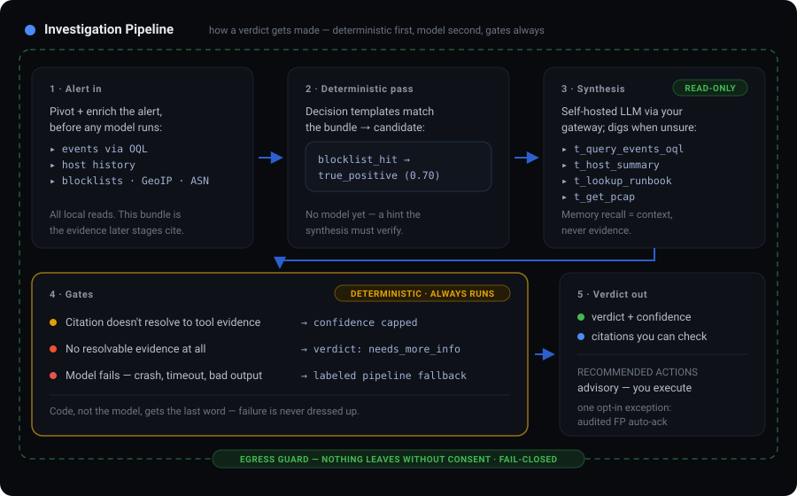

# Getting an LLM to show its work

*2026-07-10*

I built [soc-ai](https://github.com/nuk3s/soc-ai) because I wanted an LLM
to triage my Security Onion alerts. I did not want to send my network's
hostnames, usernames and traffic to someone else's cloud for it. That is
the whole origin of the project. Alert triage is the most repetitive job in a
SOC, and it suits an LLM best. It is also the job that touches your most
sensitive data. Every commercial offering resolves that conflict in the
vendor's favor. I resolved it in my favor. The model runs on my hardware, and
the data stays on my network. The code is Apache-2.0, so you can use it too.

A second reason shaped the architecture. An LLM that triages alerts is
sometimes wrong. A confident wrong verdict is worse than no verdict. So the
design problem was this: **"make it impossible for a verdict to look better
than the evidence behind it."**

## How it works



soc-ai enriches each alert before any model is involved. It queries the
related events and reads the recent history of the host. It checks the
indicators against local threat intel: blocklists, GeoIP and ASN. All of these
are local reads. This bundle matters because later stages can cite nothing
else.

Then a deterministic pass runs decision templates against the bundle. A
blocklist hit on the destination of a critical-severity alert produces a
candidate verdict with no model involved. The model's job is to verify or
overturn that candidate.

The LLM works in the synthesis stage. It is a model that you host, behind
your OpenAI-compatible gateway. When it is unsure, it investigates. It
queries events, summarizes hosts, checks rule prevalence, looks up your
runbooks and pulls packets off the sensor. Every tool is read-only. If
investigation memory is enabled, it also sees prior verdicts and past analyst
chats for similar alerts. They arrive as *context* that no verdict can cite.
An analyst's old opinion should not count as proof of anything.

Next come the gates. They are the most important part of the system. They
are plain code that no model touches, and they always run:

- If a verdict cites evidence that does not resolve to a tool result, the
  gate caps its confidence.
- A true-positive verdict with no resolvable evidence becomes
  `needs_more_info`.
- A crash, a timeout or malformed output from the model produces a verdict
  **labeled as a pipeline fallback**. The UI shows a distinct chip for it, and
  the accuracy dashboard excludes it. soc-ai never presents it as the model's
  work.

The output is a verdict, a confidence number and citations that you can
click. The write actions are acknowledge, escalate and comment. Each one is a
recommendation that you execute. The one exception is an opt-in
auto-acknowledge for high-confidence, low-stakes false positives. soc-ai
audits every one of those.

The egress guard covers the whole pipeline. By default nothing leaves your
network. If you opt into the cloud second-opinion path, all outbound data
goes through reversible redaction. A separate fail-closed check then inspects
the sanitizer's *output*. If any internal value is left, the check refuses
the send. Last week that check refused a live prompt. An mDNS service name
had passed my redaction regex. The refusal was correct behavior. The
investigation that followed found and fixed the regex. A 640-case property
test now pins the invariant. The gate found my bug before any data leaked.

## What it runs on

My deployment runs **DeepSeek-V4-Flash** with 1M context on a two-node
**NVIDIA DGX Spark** cluster. A **LiteLLM** gateway is in front of it, and the
grid is **Security Onion 3.0**. soc-ai does not depend on that stack. It works
with any OpenAI-compatible endpoint. An Ollama box, a llama.cpp server or vLLM
on a spare GPU all work. A model-fitness probe tells you in advance whether
the model that you picked can do the job. The probe exists because an unfit
model fails with no warning, and I learned that from experience. Every verdict
becomes a fallback.

The app itself is one Docker container with SQLite inside. `setup.sh` checks
your Security Onion and gateway connections before it builds anything, so a
wrong password fails in seconds. This week, on a bare Rocky Linux box, the
time from clone to a healthy container was 43 seconds. When something is
wrong, `soc-ai doctor` checks every dependency in one command.

## Measured

A claim about an LLM system costs nothing to make. soc-ai therefore measures
itself. A nightly micro-eval runs real alerts through the pipeline and trends
verdict quality on the dashboard. If an engine swap degrades verdicts, a
sparkline drops and an alarm fires. When the data shows that a feature does
not help, the feature stays off. Majority-vote self-consistency measured as
pure cost. It gave zero split votes across 32 real alerts and +18% latency. It
is off. Generic runbook packs had zero measured effect on verdicts. soc-ai
therefore turns *your own investigation history* into draft runbooks that you
approve. I publish the negative results too.

The project has 2,466 tests, 84% coverage and a Playwright end-to-end run in
CI. I checked every number in this post against the repo before publishing.

## Installation

```bash
git clone https://github.com/nuk3s/soc-ai.git && cd soc-ai
./setup.sh
```

soc-ai is free and Apache-2.0, with no meter and no phone-home. The code is at
[github.com/nuk3s/soc-ai](https://github.com/nuk3s/soc-ai). If you run
Security Onion, soc-ai triages your queue with a model that you own. When it
cannot support a verdict with evidence, it tells you so.
