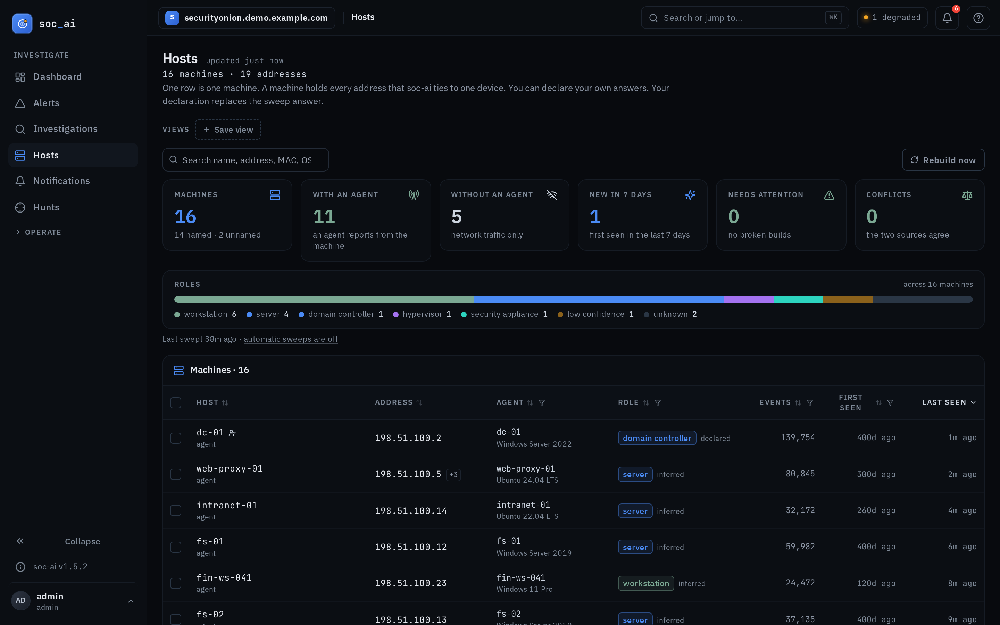
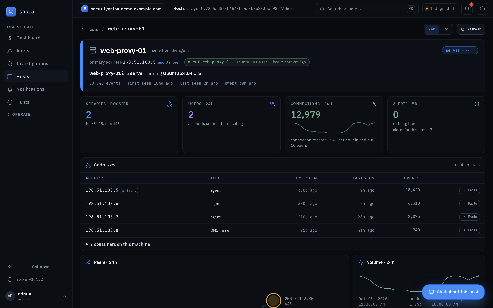

# soc-ai hunts on its own now

*2026-10-04*

soc-ai hunts on its own now. This is the largest change since the [last post](2026-07-getting-an-llm-to-show-its-work.md) in July, at 1.2.0. The clearest reason for it came from my range in early September. A Kerberoast and then a DCSync from a workstation account did not raise one Security Onion alert. At that time soc-ai read only alerts, so it saw nothing either.

Since 1.5.0, soc-ai runs its own detection logic over your grid on a schedule. When enough hits collect on one machine, it opens a lead and starts a hunt there. It does not wait for an alert or for you. The rule from the July post still holds: a verdict cannot look better than the evidence behind it. A hunt obeys that rule too. Most of this post shows how the product applies it.

## How a hunt starts

Each piece of that detection logic is an analytic, a short YAML file that compiles to one Elasticsearch query. No model touches it. When one fires, you can open the file and see exactly why. Seven are plain queries. One finds DCSync from a non-machine account in event 4662. One finds Kerberoasting with RC4 tickets in event 4769. One finds AS-REP roasting against accounts with preauth disabled in event 4768. One matches anything that touches an OpenCanary decoy. The other three read Windows events on servers and domain controllers. They find Defender detections in events 1116 and 1117, and audit policy changes in event 4719. They also find additions to privileged groups in events 4728, 4732 and 4756.

Nine more analytics are profiles. Each one compares a machine with its own baseline. The profiles cover the ports it serves, the users who log on, its process names and its connection rate. They also cover the DNS names it looks up, and a few more things. A profile catches a server that starts to listen on a port that it never served before. A profile needs about a week of baseline data before it scores anything. Until then, the analytic reports that it is learning. It makes no claim about the host in that time.

Consider the September chain from the range. The Kerberoast left an event 4769 on the domain controller, and the DCSync left a 4662. Both analytics fired on them. Each hit became an observation on what it named. Observations decay over about 48 hours, and they stack. One odd event fades out. A few on the same machine add up past a threshold. These formed a lead on the domain controller that cites both the 4662 and the 4769.

Every lead starts its own hunt. You read what the hunt found and promote the finding that you believe. The finding becomes an investigation that ends in a verdict with its evidence attached. On the Hunts page all of that reads left to right, and a "Needs you" strip lists the items that wait on you. Every analytic has a status: candidate, shadow, live or retired. It also has a record of what it produced: the observations it wrote, the leads it fed, and how those leads ended. You approve a shadow analytic to live after you watch it for a while. You retire an analytic with a reason.


## What a hunt can't do to a lead

A hunt that answers "clean" closes its lead. That is the purpose of an automatic hunt on a lead. A hunt can close a lead only if it read the lead's evidence. Suppose the grid was stalled, and the hunt's own finding says "Alert documents unreadable due to grid timeout". The lead then stays open under "Needs you", and it shows that reason. After an earlier hunt on a lead finds a threat, no later hunt can close that lead. This is true however clean the later hunt looks. I added both rules after I saw a stalled re-hunt close a lead with two critical findings on it. That is the false all-clear that I built soc-ai to prevent.

Every decision on a lead now stays on the lead. The page lists every decision in order: dismiss with a reason, reopen, promote, hold and closed by a hunt. Each entry links to its hunt or its investigation. Reopening a lead clears its old dismissal, so an open lead never carries a stale reason.

## Drafting a detection from a finding

"Draft an analytic" is a button on a hunt finding. It turns the finding into a candidate analytic that you can run in shadow and then approve. The first version wrote an analytic for the one case. A finding about one host that polled two dead domains became an analytic that matched that host and those two names. It could fire only on the case it came from. I saw it and said "the proposed analytic was very specific." An analytic must generalize.

So the drafter now describes the behavior. It keeps exact values only where they are stable, for example event codes, datasets and response codes. It refuses a clause pinned to one host, user, domain or path. A deterministic check reads every clause before you see the draft. The model then gets one retry that names the pinned values. If the draft is still that specific, the dialog says "specific to one case" before you save it. The dry run also tells you how many distinct hosts the clause matched in the window. "1 host matched in 30 days" tells you that the draft is still too narrow.

## The Hosts page

From August 7, when the host dossier shipped, the Hosts page showed one row per IP address. My proxy box has 14 addresses, so it got 14 rows. One VM with five network cards got ten, and none of them had a name. On production that came to 205 rows for about 144 machines. On October 2 I wrote this about it:

> I am not convinced that the search works. The columns cannot be filtered or sorted. There is clearly an issue with hosts with multiple nics being displayed multiple times.

All three complaints were correct. Search could not find two agent hosts at all. Their one-word hostnames are also public top-level domains, and there are about 1,400 of those. I wrote a name filter to drop junk names such as a bare "com". It also dropped each agent's own report of its name.

The Hosts page now shows one row per machine. Addresses group by agent identity first, then by a container bridge that the agent owns. Next they group by DHCP lease MAC, and then by a name that only one machine has. Each machine gets a stable key. Every column sorts both ways, and Role, Agent, Activity and First seen have filters in the header. One search box finds names, addresses, MACs, OS, role and agent name. It searches every machine whether or not the list is filtered. An address matches exactly first, then by prefix. Back returns you to the page and the scroll position that you left. The list state is in the URL. Each card above the list is a link to the filter it counts.



A box with several network cards gets one row. Its own page lists every address with its type, and any containers that run on it. One container host on my network shows 7 addresses and 30 containers there. Old links by address still work: they resolve to the machine page with that address in focus. Production shows 182 machines across 222 addresses today, and 13 of them are agent hosts. Search finds every one of them by name.



## Knowing what a host ships

On September 20 a triage said one Linux host had no host telemetry. That host runs Elastic Agent with filebeat and osquerybeat, and it ships about 75,000 documents a day. Since August 17, twelve investigations and hunts had made that same claim about it. Every one of them asked for Elastic Defend datasets, `endpoint.events.process` and `endpoint.events.network`, which that host has never shipped. If your hosts run Elastic Agent without Elastic Defend, you'd have hit this too. Nothing in soc-ai told the model which datasets a host ships. The model asked the wrong question, got zero results and wrote the wrong sentence.

soc-ai now counts each type of data that a machine ships. The types are host logs, process events, endpoint network, Windows security, osquery and the agent's own logs. The host dossier tool and the alert enrichment both carry that count. The model therefore sees "this host ships host logs and osquery, and no process events" before it writes anything. If a hunt writes "No host telemetry on X" anyway, the hunt gate rewrites it to "No process or endpoint network telemetry on X". In reports, a grounding check does the same. The profile baselines also read what Linux agents ship. Logon users and DNS names therefore now measure on a host that has no Windows security log.

## Checking its own work

1.4.0 added an eval that plants an attack, runs the hunt, promotes the finding and reads the verdict. It scores each step, so you can see which step broke. soc-ai marks every synthetic run as synthetic on every screen that shows it. I also ran the same eval batch twice on code that could not change a verdict. Six of 25 scenarios flipped between pass and fail. That is the noise floor. For that reason, the eval never moves a threshold on one batch.

The audit chain check now reads the newest seven days first, one page at a time. It tells duplicate sequence numbers apart from an altered record. Two writers at the same time leave duplicates. `soc-ai doctor` and the preflight both carry an audit-chain row. soc-ai also scrubs secrets from model text before it stores the text. A password that the model read from a file in the telemetry never reaches a report.

## Turning on TLS

1.5.2 puts Caddy in front of soc-ai with one command:

```bash
scripts/tls-proxy.sh enable <domain> [auto|internal|<cert.pem> <key.pem>]
```

Caddy runs as a compose profile and handles the renewals for you. The certificate comes from Let's Encrypt or from the Caddy CA, or you bring your own. If you run soc-ai without the proxy, it validates your certificate and shows it in Config and in the doctor. It warns you 30, 14 and 7 days before the certificate expires.

The main branch has a fourth form that is not released yet: `acme <directory-url> <root.pem>`, for a private ACME CA. My lab issues its certificates from its own Caddy. Production chained to it on Friday, October 2. Since then, Caddy has renewed that certificate six times with no action from me. The leaves last 12 hours, and Caddy renews them every eight hours.

The release notes for [1.5.0](../releases/1.5.0.md), [1.5.1](../releases/1.5.1.md) and [1.5.2](../releases/1.5.2.md) have the rest. The code is still at [github.com/nuk3s/soc-ai](https://github.com/nuk3s/soc-ai).
